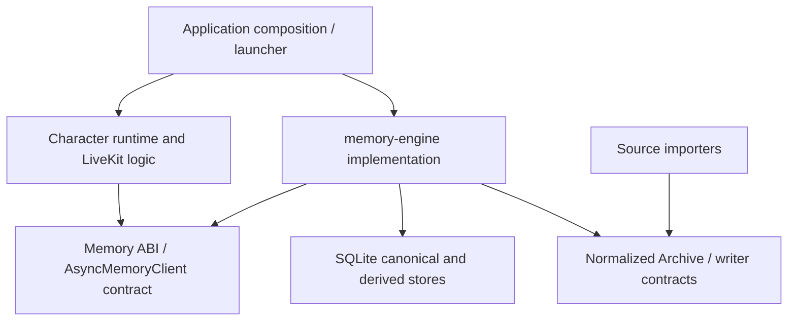
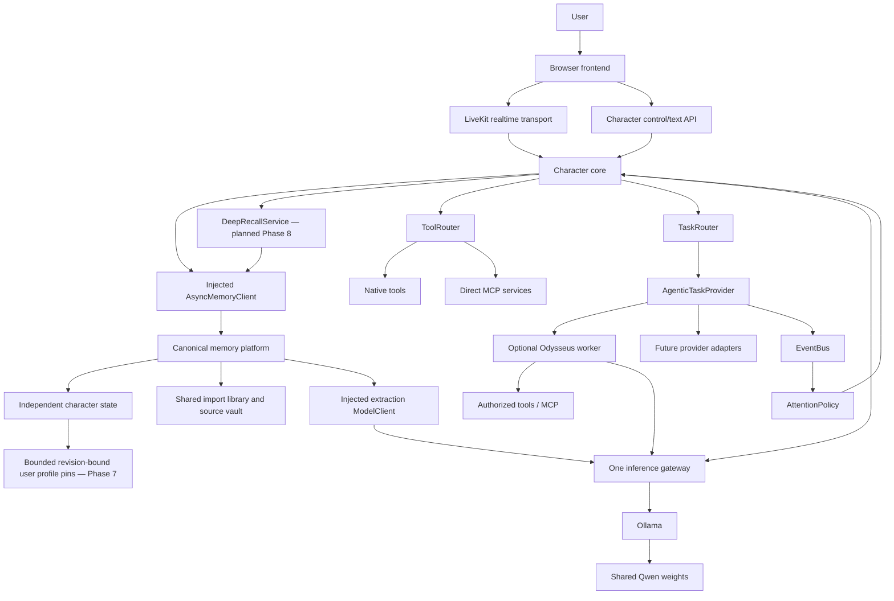
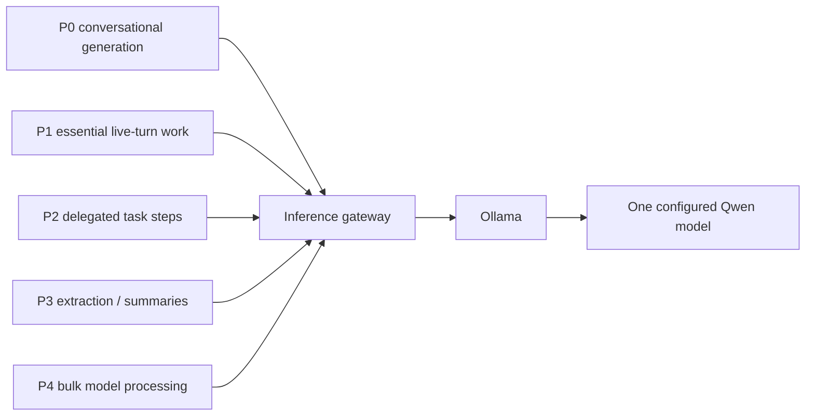
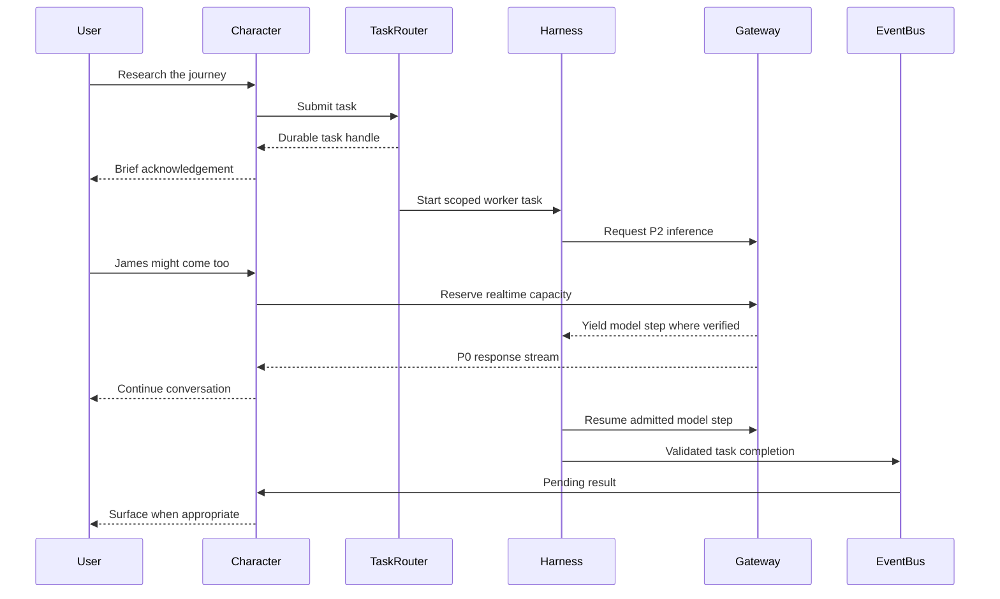

# ember — Character Memory Platform and Local Character Stack — Revised Implementation Plan

## 1. Executive summary

Build one local character application from two first-party repositories:

- **`ember-memory`** owns durable autobiographical memory, source archives, provenance, temporal facts, retrieval, extraction, consolidation, forgetting, seeding, and bundles.
- **`ember-agent`** owns realtime interaction, LiveKit, personality, audio, vision, browser UI, tools, skills, delegation, events, attention policy, deployment composition, and inference scheduling.

The character’s identity, personality, conversation continuity, and memories remain independent of external agent frameworks.

**Odysseus is the first optional agentic provider.** It executes delegated work through an adapter and isolated worker profile. Removing it leaves ordinary conversation, memory, native tools, and independently configured MCP tools functional.

All primary-Qwen generation uses **one inference gateway**, implemented incrementally. Ollama owns the loaded model weights; the gateway owns request admission and scheduling.

The Heretic-derived model build is complete. The model has been quantized/imported and is available through local Ollama. Integration must pin its actual runtime tag and digest and measure its behavior.

The remaining model unknowns are:

- Realtime TTFT and generation throughput.
- Tool-use and structured-output reliability.
- 8K context behavior.
- Runner/KV memory behavior.
- Cancellation and preemption.
- Context-switching cost.
- GPU/VRAM characteristics.
- Odysseus compatibility through the gateway.

### Initial deployment choices

| Component | Choice |
|---|---|
| Language/environment | Python 3.12 and `uv` |
| Realtime framework | LiveKit Agents |
| Primary LLM | Local Heretic-derived Qwen through Ollama |
| GPU | RTX 3090 |
| VAD/STT | Local Silero and faster-whisper; CPU STT initially |
| TTS | Local Kokoro-FastAPI, `af_alloy` |
| Canonical persistence | SQLite |
| Retrieval | FTS5, CPU BGE-small, replaceable sqlite-vec backend |
| UI | Browser, static portrait, headset |
| Memory deployment | In-process engine behind dependency injection |
| Gateway deployment | Launcher-owned local child process by default |
| Concurrency | One speaking character and one active delegated workflow initially |
| External harness | Optional isolated Odysseus worker |
| Cloud AI dependency | None |

---

## 2. Ownership and dependency boundaries

### Ownership

| Component | Owns |
|---|---|
| `ember-memory` | Canonical source records, beliefs, evidence, revisions, source grants, suppression, retrieval, extraction policy, consolidation, bundles |
| `ember-agent` | Personality, conversational state, LiveKit, prompt composition, audio, tools, skills, task routing, events, attention, inference policy, launcher |
| External harness | Task-local execution context, autonomous tool loops, temporary checkpoints, observations, artifacts, structured results |

An external harness cannot own or modify:

- Character identity or personality.
- Canonical autobiographical memory.
- Memory activation/extraction policy.
- Source grants or suppression.
- Conversation continuity.
- The realtime voice loop.
- Inference priority policy.

### Memory dependency injection

Character business logic depends on the **public Memory ABI and `AsyncMemoryClient` contract**.

The application composition root constructs the concrete implementation.



Initial deployment remains in-process:

```text
Character runtime
    → injected AsyncMemoryClient
    → bounded async facade
    → synchronous memory engine
    → SQLite
```

A future deployment can replace the injected client with a local-daemon transport without changing LiveKit hooks, prompt composition, or conversation logic.

Production packaging may install `ember-memory-engine` through the standard local-deployment extra. Installation does not authorize runtime modules to import engine internals.

Only composition, maintenance, and backend adapter modules construct concrete engine implementations. Character logic must not import SQLite backends, migrations, ranking implementations, or engine-private classes.

Enforce this through import-boundary tests.

---

## 3. Architecture diagrams

### Character application



### Inference priorities



Parsing, database operations, CPU embeddings, browser activity, and network I/O do not need a Qwen slot unless they invoke the model.

### Asynchronous delegation



---

## 4. Deployment composition, launcher, startup and shutdown

### User-facing command

The finished application starts through:

```powershell
ember start
```

A Windows PowerShell wrapper may call the same launcher. It must not contain a separate implementation of startup policy.

The browser frontend is served by the application. A production launch does not require a separate frontend development server.

### Runtime topology

| Component | Boundary | Initial management |
|---|---|---|
| Ollama | Independent local model service | Attach to existing service |
| LiveKit Server | Separate realtime service | Check/start where configured as managed |
| Kokoro-FastAPI | Separate TTS service | Check/start where configured as managed |
| `ember-agent` | Main application process | Launcher/composition root |
| Memory engine and async facade | In-process libraries | Constructed and closed by composition |
| EventBus, AttentionPolicy | In-process | Application-owned |
| ToolRouter, TaskRouter, prompt composer | In-process | Application-owned |
| Operational-store client | In-process | Application-owned |
| Inference gateway | Local child process by default | Application-owned |
| Odysseus worker bridge | Optional separate process/profile | Start/connect only when configured |
| MCP servers | In-process client plus natural external server processes | Per-server configuration |
| Frontend | Browser application | Served/opened by `ember-agent` |

Suggested configurable endpoints:

```text
Ollama:              http://127.0.0.1:11434
LiveKit signalling:  ws://127.0.0.1:7880
Kokoro:              http://127.0.0.1:8880
Inference gateway:   http://127.0.0.1:11435
```

LiveKit supports a local server deployment; its documented development signalling endpoint uses port 7880. Production-local configuration uses generated credentials rather than shared development credentials. [LiveKit local deployment](https://docs.livekit.io/transport/self-hosting/local/)

The gateway may later run in-process using the same implementation. There is one scheduler, regardless of its process boundary.

### Composition root

`runtime/composition.py`:

1. Resolves configuration and active character.
2. Constructs the memory implementation through its public factory.
3. Receives its `AsyncMemoryClient` implementation and lifecycle handles.
4. Creates gateway clients, routers, event bus, attention policy, and prompt composer.
5. Injects contracts into the character runtime.
6. Registers shutdown handlers.

A conceptual dependency object is:

```python
@dataclass
class CharacterDependencies:
    memory: AsyncMemoryClient
    inference: InferenceClient
    tools: ToolRouterContract
    tasks: TaskRouterContract
    events: CharacterEventBus
```

Concrete construction stays outside conversation and LiveKit logic.

### Configuration

Deployment configuration contains:

- Active character/profile.
- Data roots and backend selection.
- Model tag and expected digest.
- Gateway endpoint and execution mode.
- Service endpoints and management modes.
- Provider/MCP configuration.
- Prompt budgets.
- Tool authority.
- Startup/shutdown timeouts.

Use management modes such as:

```text
attach
managed
disabled
```

Absolute paths are deployment configuration. They do not enter public contracts or bundle identity.

Dependencies are installed during setup. Startup does not silently download models, install skills, or upgrade packages.

### Startup sequence

1. Load and validate configuration.
2. Acquire the application/profile lock.
3. Validate/open character and memory stores.
4. Determine index health and degraded retrieval capabilities.
5. Check Ollama availability.
6. Verify configured model tag/digest through read-only metadata.
7. Check/start LiveKit where managed.
8. Check/start Kokoro where managed.
9. Start/connect the gateway and verify its model/profile configuration.
10. Perform configured warmup through the gateway.
11. Start runtime API, browser backend, and LiveKit worker.
12. Optionally start/connect the Odysseus bridge.
13. Discover MCP tools and refresh provider health.
14. Expose/open the browser UI.
15. Report overall and feature-specific readiness.

Ollama’s model inventory includes model names and digests, allowing startup to verify a configured pin. [Ollama model inventory](https://docs.ollama.com/api/tags)

Read-only upstream health/metadata checks are permitted. Qwen generation, including warmup, uses the gateway.

Optional discovery has bounded deadlines and can finish after the core UI appears. A stalled provider must not delay usable core startup indefinitely.

### Health output

Example:

```text
Memory ........ ready
Indexes ....... ready / degraded / rebuilding
Ollama ........ ready
Qwen .......... ready — configured digest, warm/cold
Gateway ....... ready — conservative/preemptive mode
LiveKit ....... ready
Kokoro ........ ready
Odysseus ...... disabled / ready / unavailable / unsupported
MCP ........... N available tools; M unavailable servers
Character ..... ready
Voice ......... ready
```

Expose separate states for application, character, and voice readiness. Do not label the character ready merely because its HTTP port is open.

### Degraded startup

| Unavailable component | Result |
|---|---|
| Semantic/FTS index | Character starts with canonical fallback; rebuilding reported |
| Odysseus | Core continues; delegation unavailable |
| One MCP server | Other tools/core continue |
| Kokoro | Spoken output unavailable; browser text output remains available |
| LiveKit Server | Voice transport unavailable; browser text/control path remains available |
| Ollama/Qwen | Memory/control UI available; model-backed conversation unavailable |
| Gateway | Model-backed conversation unavailable; no direct-Ollama bypass |
| Canonical character store | Character unavailable; diagnostic/control mode only |
| Shared source library | Adopted state survives; affected evidence/archive access reports unavailable |

The browser text path uses the same character core, memory client, prompt composer, and P0 gateway. It does not create another personality or conversation system.

### PID and ownership semantics

Record launcher-owned processes with:

```text
application instance ID
component ID
PID
process start time
executable/config identity
ownership mode
```

Before stopping a process, verify identity and start time to avoid PID reuse errors.

- Stop only processes started or explicitly adopted by this application instance.
- A healthy existing service is attached only when its configured identity matches.
- Port occupation alone does not establish ownership.
- Do not kill processes by executable name.
- Keep independently managed Ollama running by default.
- Track owned descendants using appropriate Windows job/process ownership or POSIX process groups.
- Reject duplicate instances for the same profile/stores or connect to the verified existing instance.

### Shutdown sequence

1. Enter draining mode; stop accepting new delegated tasks and background inference.
2. Stop new conversational turns.
3. Stop LiveKit generation/TTS and persist committed delivered dialogue.
4. Cancel/drain current model work according to verified capabilities.
5. Stop or checkpoint owned delegated work; reconcile effectful operations.
6. Commit pending task/results/events and leave undelivered events durable.
7. Flush runtime writes and close/checkpoint the operational database.
8. Flush canonical writes and close memory workers/connections.
9. Stop launcher-owned bridge/MCP/gateway/supporting processes.
10. Release ownership locks.

Use a bounded shutdown deadline. Uncertain external writes remain uncertain and are never automatically replayed.

A failed cancellation does not authorize killing independently managed Ollama. Persist the interrupted request metadata and require a safe startup quiescence/readiness check before new work.

---

## 5. Terminology and durable data layers

Retain five distinct layers:

1. Immutable raw source archive.
2. Canonical normalized source records.
3. Derived search projections.
4. Canonical distilled knowledge/character beliefs.
5. Public Memory ABI.

| Term | Meaning |
|---|---|
| Source record | Immutable content actually present in imported/native conversation or preserved observation |
| Source evidence | Immutable revision and exact span supporting/contradicting a claim |
| Candidate memory | Proposed interpretation awaiting validation |
| Approved imported knowledge | Accepted library-owned snapshot available for seeding |
| Canonical memory / character belief | Accepted character-owned recall record |
| Task result | Validated operational delegated output |
| Tool observation | Attributed, time-bound tool/provider report |
| Derived projection | Rebuildable acceleration |
| Skill | Instructions/resources, without inherent authority |

A task finding is not automatically an autobiographical belief.

Generated summaries never replace original normalized history.

Hidden reasoning/chain-of-thought is excluded from memory, normalized task sources, durable task checkpoints, ordinary logs, and diagnostic exports.

---

## 6. Shared import library and independent characters

### Global library

Owns:

- Raw exports/manifests.
- Normalized conversation graph and documents.
- Source snapshots and identity mappings.
- Assets.
- Immutable evidence spans.
- Candidates/approved knowledge.
- Shared archive indexes.

Source content and existing revisions are immutable. New imports or normalization improvements append records/revisions.

### Character-owned state

Owns:

- Personality/configuration.
- Native history.
- Revisioned beliefs.
- Pins/summaries.
- Independent seed snapshots.
- Character-owned entities.
- Source grants.
- Suppression.
- Private belief/native-history indexes.

Seed metadata:

```text
destination_memory_id
destination_character_id
origin_memory_id
origin_memory_revision
origin_source_store_id
seed_operation_id
seeded_at
evidence references
```

Destination memories receive new UUIDs. Shared evidence is referenced without duplicating imported messages/assets.

Minimal seeded entity context becomes character-owned with origin mappings.

### Presets

| Preset | Beliefs | Supporting evidence | Deep archive |
|---|---|---|---|
| Fresh | None | None | None |
| Seeded | Selected snapshots | Granted support | None by default |
| Selected archive | Selected snapshots | Explicit scope | Explicit scope |
| Primary | Approved selected snapshots | Granted historical scope | Full currently granted scope |

Later imports do not silently revise beliefs or expand grants.

`evidence_read` and `archive_search` are separate capabilities.

Character-bound identity comes from trusted runtime configuration, not model arguments.

---

## 7. Memory ABI, IDs, and serialization

### Maturity

Start:

```text
Memory ABI 0.1.x
Normalized Archive 0.1.x
Bundle format 0.1.x
```

Freeze ABI 1.0 only after real integration and restoration acceptance.

The freeze remains independent of Odysseus and delegated-task completion.

Pre-1.0 releases require compatibility matrices and migrations; they do not justify wiping history.

After 1.0:

- Additive compatible changes use minor versions.
- Breaking semantic changes require major versions.
- Unknown same-major extensions survive round trips.
- Unsupported writes fail.
- Deprecations retain documented read compatibility.

### Identity

Use UUID4 for canonical entities and integer revisions.

External IDs map through source identity crosswalks.

Do not expose SQLite row IDs, ChatGPT IDs, provider task IDs, or vector keys as memory identity.

Ambiguous source equivalence produces warnings and separate identities.

Derived chunk IDs may be UUID5 over immutable input references/specifications.

### Serialization

Use UTF-8 JSON/JSONL:

- Lowercase hyphenated UUIDs.
- UTC RFC 3339 microseconds.
- SQLite integer Unix microseconds.
- Unknown times as `null`.
- Half-open intervals.
- Finite scores.
- Namespaced extensions.
- Specified canonical JSON for object hashes.

Source SHA-256 uses exact UTF-8 content.

Preserve ambiguous timestamp representation and timezone assumptions. Import time never substitutes for missing source time.

Use extensible wire strings for kinds/modalities/reasons. Unknown values remain readable but cannot automatically acquire supported semantics.

```python
class SourceRef(ContractModel):
    source_store_id: UUID
    record_kind: str
    record_id: UUID
    record_revision: int
    part_id: UUID | None = None
```

Paths remain outside this contract.

---

## 8. Memory models, evidence, and client interfaces

Use Pydantic v2 contract objects.

The ABI package has no SQLite, LiveKit, Ollama, MCP, or harness dependency.

### Domain models

Retain:

| Model | Main responsibility |
|---|---|
| `Memory` | Character-owned revisioned belief |
| `CandidateMemory` | Proposed interpretation and verdicts |
| `ApprovedKnowledge` | Library-owned seedable snapshot |
| `FactPayload` | Subject/predicate/value/polarity/validity |
| `EpisodePayload` | Event, participants, place/time |
| `GoalPayload`, `PlanPayload` | Intent, uncertainty, state |
| `Entity` | Store-owned entity and origin mapping |
| `Evidence`, `EvidenceAssertion` | Exact span versus interpreted assertion |
| `MemorySource` | Resolved original evidence/provenance |
| `Conversation`, `Message` | Canonical normalized history |
| `ArchiveChunk` | Derived text/source mapping |
| `SessionSummary`, `PinnedMemory` | Bounded working context |
| `MemoryQuery`, `ArchiveQuery` | Storage-independent filtering |
| `MemoryResult`, `ArchiveResult` | Records plus ranking explanations |
| `RetrievalContext` | Structured prompt input and coverage |

A memory includes ownership, revision, lifecycle, kind, payload, modality, confidence, importance, temporal metadata, processing provenance, and extensions.

### Evidence coordinates

```python
class EvidenceSpan(ContractModel):
    start_codepoint: int
    end_codepoint: int
    start_byte: int
    end_byte: int
    source_content_sha256: str
    quoted_span_sha256: str
```

Validate bounds, nonempty span, Unicode boundaries, exact revision, and hashes:

```python
quote = text[start_codepoint:end_codepoint]
byte_quote = text.encode("utf-8")[start_byte:end_byte].decode("utf-8")

assert quote == byte_quote
assert sha256(text.encode("utf-8")) == source_content_sha256
assert sha256(quote.encode("utf-8")) == quoted_span_sha256
```

Browser code converts codepoint indices to/from UTF-16 indices.

Search normalization never changes canonical evidence.

### Public interfaces

The ABI declares synchronous `MemoryStore` and asynchronous `AsyncMemoryClient` contracts.

Methods cover:

```text
capabilities
search
search_archive
retrieve_context
get
get_sources
get_recent
get_pinned
remember
update
supersede
disable
forget
pin
unpin
record_access
```

Representative async boundary:

```python
class AsyncMemoryClient(Protocol):
    async def retrieve_context(self, request: ContextRequest) -> RetrievalContext: ...

    async def search(self, query: MemoryQuery) -> SearchResponse: ...

    async def search_archive(self, query: ArchiveQuery) -> ArchiveSearchResponse: ...

    async def get_sources(self, memory_id: UUID) -> list[MemorySource]: ...
```

All remaining methods have equivalent typed async signatures.

The engine supplies an `InProcessAsyncMemoryClient` implementation using bounded workers. Future transports implement the same contract.

Mutations carry idempotency keys; updates carry expected revisions.

Typed errors include not-found, revision conflict, access denied, unsupported write/version, invalid evidence/predicate, index unavailable, deadline exceeded, and source unavailable.

### Harness memory access

A worker may receive a task-bound read-only broker capability with:

- Bound character.
- Allowed records/source scope.
- Current suppression checks.
- Limits.
- Expiry/revocation.

No memory mutations, pins, grant management, or canonical source writes are exposed.

### Planned associative lookup compatibility

Deep Associative Recall's minimal optional RelatedLookupClient, temporal interval
filters, read profile and ReadManifest are specified in section 13. Their semantics
remain backend-independent and character-bound. Version and negotiate additions:
legacy strict decoders receive the legacy response shape unless they advertise the
new capability; unchanged operations keep their defaults. Current ABI 0.3.0, schemas
and implemented client capabilities are not changed by this plan update.

---

## 9. Predicates, modality, activation, and temporal semantics

### Predicate registry

```python
class PredicateDefinition(ContractModel):
    name: str
    definition_version: str
    value_type: str
    cardinality: str
    temporal: bool
    replacement_meaningful: bool
    normalization_rules: dict[str, JsonValue]
    aliases: list[str]
    deprecated_aliases: list[str]
    allowed_modalities: list[str]
```

Initial definitions:

| Predicate | Cardinality | Rule |
|---|---|---|
| `hardware.primary_gpu` | One | Replacement requires primary-use evidence |
| `hardware.owns_gpu` | Many | Another purchase does not end ownership |
| `music.likes_genre` | Many | Removal requires evidence |
| `person.knows` | Many | Relationships accumulate |
| `entity.name` | One | Naming/renaming evidence |
| `entity.alias` | Many | Aliases accumulate |

Preserve original extracted predicates and normalization decisions.

Unknown predicates remain conservative until registered or manually confirmed.

Definition evolution is independently versioned.

### Modality

Retain:

```text
FACTUAL_ASSERTION
BELIEF
PREFERENCE
GOAL
PLAN
INTENTION
UNCERTAINTY
HYPOTHETICAL
PAST_STATE
NEGATED_ASSERTION
QUOTED_THIRD_PARTY_CLAIM
```

Store modality in interpreted evidence, candidates, and accepted revisions.

A Berlin intention is not residence. A possible GPU purchase is not ownership. A third-party claim remains attributed.

### Authority and activation

Authority depends on the claim:

- User confirmation/correction is strongest for personal context.
- Direct identified-user statements outrank assistant speculation.
- Tool observations require source-specific authority/freshness.
- Generated summaries do not create independent corroboration.

Initial policy:

```text
activation.conservative@0.1.0
confidence ≥0.90
importance ≥0.50
supported verdict
appropriate authority
compatible predicate/kind/modality
no unresolved ambiguity/conflict
required corroboration
```

Confidence is not a probability.

Persist decision inputs, policy/version, verdicts, reasons, and manual overrides.

Policy changes re-evaluate candidates, not silently rewrite accepted beliefs.

### Time axes

Keep:

- Valid time.
- Observed time.
- Recorded time.

Fields include validity bounds, precision/basis, observed time, recorded time, creation, and last confirmation.

Do not infer continuous validity from vague dates.

Supersession preserves old assertions and creates transition evidence/new revisions.

Queries distinguish:

- Current state.
- Historical world state.
- What the character believed before a correction.

Similarity alone does not merge episodes or resolve contradictions.

### Event occurrence, state validity and recall eligibility: planned Phase 8

The valid axis describes when an accepted assertion applies in the world: an episode's
supported occurrence interval or a state fact's validity interval. Observed time is when
the source described it; recorded time is when the engine stored that interpretation.
A July 2026 message saying "I went to Berlin last December" can support December 2025
event time. Neither July observation nor October import/seed time substitutes for it.

An episode's ended event interval does not expire the memory of that episode. Current
state facts retain their current-validity checks; past episodes remain recallable while
their lifecycle and current access policy permit them. Apply this distinction consistently
to canonical queries, derived lexical/vector eligibility and delivery certificates.
Do not implement event-time support by applying wall-clock validity to every memory kind.

Retain precision, basis, exact date evidence and original timezone assumptions. A coarse
occurrence interval does not assert that an event lasted throughout that interval.
Distinguish supported matches from uncertain overlaps; unknown/ambiguous boundaries are
not fabricated dates or independent confirmation. Completed-event requests must not
silently include plans, intentions, hypotheticals or assistant-authored narratives.

Historical selectors authorize a time interpretation, not renewed access. Current
forgetting, dependency suppression, source availability, grants and source selection
still apply to old revisions. Recorded history uses the existing recorded_before
as-of cutoff; it is not a claim that the ABI already supports arbitrary recorded ranges.

See [conversational temporal recall](#conversational-temporal-recall-planned-phase-8-architecture)
and [Root ADR 0014](docs/adr/0014-planned-conversational-temporal-recall.md).

---

## 10. SQLite schema and data classification

### Layout

```text
<data_root>/
├── registry.db
├── libraries/<library-id>/
│   ├── memory.db
│   ├── sources/
│   ├── assets/
│   ├── manifests/
│   └── indexes/search.db
└── characters/<character-id>/
    ├── memory.db
    ├── personality/
    ├── config/
    └── indexes/search.db
```

The deployment chooses an appropriate local application-data root.

Live SQLite databases remain local. Raw-source vaults/backups may use configured NAS storage.

### Canonical tables

| Tables | Durable content |
|---|---|
| `store_metadata`, `schema_versions` | Identity and migration history |
| `imports`, `source_components` | Manifests/fingerprints/components |
| `source_keys`, `source_occurrences` | Identity mapping/raw locators |
| `conversations`, `conversation_snapshots` | Conversation identity and snapshots |
| `graph_nodes`, `node_snapshots`, `graph_edges` | Branch/edit/regeneration structure |
| `messages`, `message_revisions`, `message_parts` | Immutable normalized content |
| `documents`, `document_parts` | Documents/preserved observations |
| `assets`, `actors` | Assets and attribution |
| `entities`, `entity_aliases` | Store-owned entity context |
| `predicate_definitions`, `activation_policy_definitions`, `processing_specs` | Referenced specifications |
| `memories`, `memory_revisions` | Knowledge/belief revisions |
| `fact_assertions`, `episode_details` | Typed temporal payloads |
| `evidence_spans`, `memory_evidence` | Exact evidence and interpretations |
| `memory_relationships`, `memory_supersessions` | Derivation/consolidation/transitions |
| `conflict_sets`, `conflict_members` | Preserved conflicts |
| `pins`, `sessions`, `session_summaries` | Working context |
| `seeding_receipts` | Origin/destination mapping |
| `source_grants`, `suppression_rules`, `suppression_targets` | Access and forgetting |
| `processing_runs`, `activation_decisions`, `audit_events` | Processing/user decisions |
| `source_deletion_tombstones` | Destructive deletion disposition |

Evidence spans live with their source record. Characters reference shared library evidence.

Task-specific metadata enters generic preserved sources through namespaced extensions, not agent-task tables in the memory engine.

### Operational memory tables

```text
jobs
job_failures
candidate_memories
mutation_keys
index_outbox
access_stats
maintenance_state
```

Human confirmation/rejection/forgetting survives operational cleanup.

### Derived search tables

```text
memory_projections
message_projections
conversational_units
archive_chunks
chunk_spans
memory_fts
message_fts
archive_chunk_fts
embedding_specs
index_generations
embedding_records
vector_key_map
vec_memories
vec_archive
effective_scope_cache
retrieval_cache
```

### Constraints

```sql
CREATE TABLE memory_revisions (
    memory_id TEXT NOT NULL,
    revision INTEGER NOT NULL CHECK (revision > 0),
    kind TEXT NOT NULL,
    lifecycle TEXT NOT NULL,
    modality TEXT NOT NULL,
    confidence REAL NOT NULL CHECK (confidence BETWEEN 0 AND 1),
    importance REAL NOT NULL CHECK (importance BETWEEN 0 AND 1),
    recorded_at_us INTEGER NOT NULL,
    payload_json TEXT NOT NULL CHECK (json_valid(payload_json)),
    extensions_json TEXT NOT NULL CHECK (json_valid(extensions_json)),
    PRIMARY KEY (memory_id, revision),
    FOREIGN KEY (memory_id) REFERENCES memories(id)
);
```

Evidence rows retain both coordinate systems and hashes, with nonnegative/nonempty checks.

Engine validation enforces hashes, Unicode boundaries, modality/predicate compatibility, and cross-store references.

Important indexes cover source uniqueness, conversation/time, role/time, graph traversal, subject/predicate, temporal bounds, lifecycle/kind/importance, evidence/supersession, seed mappings, grants/suppression, revisions, embedding identities, leases, and idempotency.

Do not enforce uniqueness that destroys conflicting historical facts.

---

## 11. Optional import and source reconnaissance

ChatGPT import is optional bootstrap functionality.

### Phase 0

Begin phase 0 while the personal export is pending:

- **Phase 0a — preparation:** research official export guarantees and primary
  public format observations; implement provisional source models, synthetic
  structural/safety fixtures, bounded reconnaissance for likely layouts, and
  pinned local inference profiles without generation. Public observations remain
  hypotheses about this account, not verified export capabilities.
- **Phase 0b — actual export acceptance:** preserve and inspect the real export,
  confirm/revise the hypotheses, produce sanitized source-derived fixtures, and
  complete the capability/ambiguity report. This gate remains required before
  finalizing phase 1 source-dependent contracts. The generic phase 1 core may
  proceed as experimental 0.1 contracts before this acceptance.

Track evidence and provisional designs in `docs/phase-0-research.md`,
`docs/phase-0-source-model.md`, and `docs/phase-0-runbook.md`.

Inspect the real export for:

- Components/formats.
- Conversation graph.
- Regenerations/edits/selected paths.
- Missing nodes.
- Timestamps/timezones.
- Archive/deletion markers.
- Content/channel types.
- Actors/tool/model metadata.
- Attachment files/references.
- Unknown structures.
- Memory-related content, if present.

Produce sanitized structural fixtures and coverage/capability reports.

Do not assume saved memories are included.

### Observed export and phase 3 implementation record — 2026-10-07

The official `OpenAI-export.zip` has been inspected and imported into a separate
private canonical library. This section records the implemented architecture,
verified behavior, measured costs and the remaining operator-reviewed acceptance
gate. The implementation keeps the code readable and efficient.

The original private baseline is
`.local/reports/openai-export-2026-10-07-recon.json`; the updated recognizer report
is `.local/reports/openai-export-2026-10-07-phase3-recon.json`. Original source
fingerprints, identifiers, member paths and normalized personal messages remain in
ignored `.local/` state. Tracked documentation and fixtures contain aggregate
findings or synthetic data. The exact original archive is preserved in the library
raw-source vault. Importing it did not activate memories.

#### Observed capabilities

| Observation | Source-backed finding |
|---|---|
| Physical bundle | 881,600,298 bytes; 818 inventoried files; 1,978,407,645 bytes of combined uncompressed inventory, including nested containers and their children |
| Conversation layout | 13 JSON array shards, all inside the same nested export container; its `user.json` is in that same container |
| Conversation scale | 1,205 distinct conversations; 24,055 messages; 25,260 graph nodes; largest conversation has 1,695 nodes |
| Graph observations | 110 branch points; 1,205 null-message roots; no parent cycles or duplicate child edges recorded by the baseline scan |
| Parse coverage | No invalid/deferred JSON or deferred nested containers in the baseline scan; about 5.5 seconds for read-only inspection on this machine |
| Source components | 783 asset candidates, one HTML history, one account-metadata candidate, 16 other files and four nested ZIPs |
| Nested archives | One conversation-bearing export ZIP plus three other ZIPs; do not treat attachment ZIPs as additional accounts or dialogue automatically |
| Content types | 18,362 `text`, 1,486 `multimodal_text`, 2,393 `thoughts`, and 1,814 records subsequently identified as `reasoning_recap` |
| Source time | Conversation/message creation uses numeric Unix-second candidates, including fractions; many message update times are null |
| Legacy visible replies | 2,304 assistant text messages have null channel, recipient `all`, successful completion and `end_turn=true`; do not discard these solely for lacking a channel label |
| Attachment observations | 652 attachment-metadata entries and 1,663 structured-reference candidates; these counts do not establish successful file resolution |
| Saved memories | No memory-named component was identified; saved-memory inclusion remains unestablished and is not inferred from conversation text |

The first inspector knew about `thoughts` but reported `reasoning_recap` under a
hashed unknown content type. The updated full inspection confirms all 13 shards
were structurally parsed, with zero warnings, and classifies all 1,814 recap
messages explicitly. Retain the first report as historical evidence. The combined
reasoning/recap count is 4,207; both types are excluded from normalization and the
preserved raw archive remains their only retained representation.

The supplied scraper source remains a separate namespace and adapter. Its 219
conversations, 5,585 messages and 989 failed-conversation entries are partial
observations. Do not merge its identity mappings into the official export merely
because IDs or content resemble each other.

#### 1. Desired behavior

Provide `ember-memory import chatgpt-zip <archive> --source-namespace <scope>` as
an offline maintenance operation. Preserve the exact archive, stream its supported
conversation components, retain every graph branch and null-message root, and
commit immutable normalized source records with faithful coverage. Repeating the
same import adds no revisions. An interrupted import resumes with the same IDs,
part IDs, record revisions and batch inputs, including inside a large conversation.

Explicit human memory entry remains independent of exports. A supported explicit
source claim becomes an unapproved deterministic proposal with exact evidence;
confirmation uses the existing character-bound mutation path. Imported dialogue
does not automatically become belief, personality, grants or system instructions.

#### 2. Ownership and introduced coupling

| Owner | Responsibility and dependency |
|---|---|
| Importers | ZIP layout, provider keys, visibility rules, guarded parsing, private replay metadata and coverage; depend on ABI and an injected maintenance port |
| Engine | Canonical IDs/revisions, source keys, atomic transactions/cursors/receipts, evidence, authority and bounded database workers |
| Maintenance composition | Translate the importer port to engine operations, bind namespace/store and acquire offline ownership |
| Agent composition | Bind stable character/personality, construct clients and expose explicit human entry |
| Character/LiveKit | Consume `AsyncMemoryClient` and model transport; own prompt/delivery behavior without importing ZIP or SQLite internals |

The only new storage coupling is a bounded bulk source-revision lookup on the
engine maintenance API. Keep it out of the public Memory ABI and ordinary character
logic. A library may contain tens of thousands of original messages while fast
recall still queries the character's accepted beliefs. Parsing/hashing/import must
never run on the realtime event loop or cause full-library scans per user turn.

The current engine has one owner per data root. Use offline maintenance ownership
for import; do not bypass locks to write alongside the running text application.
The later active-owner control interface belongs to application integration.

#### 3. Existing abstractions to reuse

Reuse the phase 0 nested-ZIP inspection and guarded JSON event reader, the generic
ArchiveWriter/SourceRecord contracts, UUID4 source IDs, exact SourceRef/Evidence,
immutable revisions, source keys, import cursors, receipts, grants, suppression,
MemoryStore/AsyncMemoryClient and the existing P0 gateway. Source namespaces remain
explicit. There is no need for a ChatGPT-specific memory database or runtime client.

#### 4. Necessary new primitives and data flow

Use an internal verified ZIP component reader and an importer-private replay plan.
The pipeline has two bounded normalization passes after inspection/preservation:

```text
inspect container and classify supported conversation scope
  -> preserve one exact content-addressed ZIP
  -> pass A: stream one graph, prepare keys, bulk-read previous revisions,
             normalize, record only reconstruction metadata and hashes
  -> atomically publish the complete private replay checkpoint
  -> pass B: stream one graph, reconstruct and verify the planned records,
             commit bounded record/key/cursor/receipt batches
  -> return coverage and explicit completion
```

Stage a nested container in a private temporary file only when random-access ZIP
reading requires it; spill after 8 MiB and release it on every exit. Group shards
by containing ZIP so each container is staged once per pass. Do not expand the
archive into a directory tree or separately copy all assets and HTML.

The checkpoint header binds store, namespace, raw and logical source fingerprints,
qualified component identities/hashes, adapter and processing versions. For each
conversation retain a single set of record metadata: source-key assignment,
canonical revision, ordered part UUIDs, batch boundaries and reconstruction hash.
Store the store ID once in the header; avoid repeating whole SourceRefs alongside
the same key assignment. The checkpoint must contain no message bodies, titles,
tool payloads or reasoning. Provider IDs/locators are private metadata.

Two passes intentionally exchange some offline parsing time for small checkpoints
and reproducible crash recovery. Keep one conversation's source/canonical bodies
in memory at a time. Bound metadata too: start with a 64 MiB checkpoint cap, the
existing guarded 64 MiB per-conversation parser, a 10,000 normalized-record limit
per conversation, and 256-record write batches within ABI's 1,000-record maximum.
Fail with explicit coverage if a bound is exceeded. Measure these limits before
changing them. The observed largest graph fits the record limit.

#### 5. Contracts and invariants

- Publish replay metadata before the first canonical write. Uncommitted future
  node/part IDs must survive a crash: assigning new UUIDs on retry would break
  references already committed by earlier batches of the same conversation.
- Capture planned revisions and ordered part IDs, not just provider-to-UUID keys.
  Recomputing from partially updated latest rows would increment revisions and
  change the idempotent request. Reconstruct exact planned inputs from the pinned
  raw source and versioned adapter, then verify their normalized hash.
- Keys, records, cursor and receipt still commit together in each engine batch.
  Replay metadata is not a second canonical identity owner. Existing committed
  crosswalks remain authoritative; never silently remap a provider key.
- Use an unambiguous, versioned provider-key encoding for conversation/node pairs.
  Do not make slash concatenation a permanent identity contract. Preserve existing
  JSON/scraper mappings; new ZIP key semantics require an explicit adapter version
  or reviewed reconciliation, not an implicit migration.
- Batch source-revision reads on the existing worker, querying only latest rows.
  Preserve payload-hash/store/row-identity checks. Do not dispatch a separate worker
  round trip for each node/message or read all old revisions unnecessarily.
- Preserve ordered graph edges and alternative branches. Record ambiguous current
  selection; never repair or flatten it to justify automatic activation. Partial
  graphs are not eligible for automatic proposal promotion.
- Exclude `thoughts`, `reasoning_recap`, `reasoning`, analysis/reasoning channels
  and explicitly hidden metadata before copying text to normalized records.
  Preserve the exact original only in the raw archive.
- Recognize assistant visibility using explicit `final`/`commentary` channels with
  ordinary supported content and recipient checks. For null-channel legacy text,
  require assistant role, content type `text`, recipient `all`, status
  `finished_successfully`, `end_turn=true` and no hidden flag. Retain the original
  null channel; this is a versioned derived visibility rule, not invented metadata.
- Preserve each visible string part separately with exact UTF-8 hashes and Unicode
  evidence coordinates. Retain unsupported multimodal parts as typed absences;
  record their resolution disposition rather than fetch attachments remotely.
- Keep asset bytes and full attachment pointers in the raw ZIP; keep inspected
  hashes/qualified locators in private source inventory. Initial archive-only
  assets are unavailable to runtime attachment consumers until an explicit resolver
  can validate a local match. Never advertise resolved assets solely from filenames.
- Source times remain source observations; null/unsupported times stay unknown.
  Import recorded time never supplies missing world validity or source time.
- Keep complete component cursors for fast no-op replay. Verify the pinned source
  and checkpoint before skipping completed work; an empty response alone does not
  prove completion. Changed sources create a new import run and immutable revisions.

Source snapshots currently favor coherent historical relationships. Measure their
storage growth on edited re-exports before changing snapshot granularity. Do not
silently change the meaning of versioned SourceRefs or rewrite old evidence to
save bytes. Start with the immediate storage improvement of metadata-only recovery
and one preserved raw container; compression/dedup migrations require their own
measured decision and compatibility handling.

#### 6. Failure behavior

Reject unsafe/reparse paths, duplicate or ambiguous components, changed fingerprints,
duplicate conversation IDs across unsupported scopes, corrupt metadata, unsupported
wrappers and parser bounds with fixed content-free diagnostics. Commit no source
records during inspection or planning. If writing is interrupted, retain completed
batches and retry their exact planned identities. If a checkpoint is lost after
commits, require recovery of that checkpoint; do not invent fresh IDs or delete
canonical state. Existing archives, receipts and evidence remain recoverable.

Do not interpret another attachment ZIP/account as the same source implicitly.
Report unsupported/unresolved components honestly. No automatic remote fetch,
model processing, activation, seeding or grant expansion occurs during import.

#### 7. Acceptance and performance evidence required

Create small wholly synthetic fixtures matching the observed nested wrapper,
numbered array shards, null roots, branch structure, legacy completion flags,
`thoughts`/`reasoning_recap`, fractional clocks, multimodal parts and unknown metadata.
Do not promote personal excerpts or actual reasoning into tracked tests.

Verify interrupted recovery within a conversation exceeding 256 records, exact
replay without revisions, changed-source revisions, stable Unicode part evidence,
completed-cursor skip, lost/corrupt checkpoint behavior, source/hash/scope binding,
unsupported attachment coverage and exclusion of all hidden text from checkpoint,
canonical storage, candidates, prompts and logs. Verify separate characters keep
independent adopted beliefs and current suppression/grants still control evidence.

Measure real import/replay wall time, peak resident memory, checkpoint bytes,
canonical DB/WAL bytes and preserved-source bytes. Inspection's 5.5-second baseline
is an observation, not an import-performance promise. Confirm unrelated accepted-
belief recall remains bounded as this archive grows; retain the existing 150 ms
fast-recall target for later indexed acceptance. No full-archive parser or model
extraction may become part of conversational recall. Profile before adding native
code, compression, another service or parallel ownership.

Complete the actual-source narrow path: select an explicitly supported real user
claim, produce a deterministic unapproved candidate, confirm exact evidence,
adopt into character-owned memory, restart, recall via the injected client and
LiveKit/P0 gateway, and resolve the original quote. If no real statement matches
the current whole-message GPU rule, add one narrow source-backed production rule
with sanitized acceptance or report the remaining gate; synthetic recall is not
real-source acceptance. Full library approval/seed receipts/bundles remain phase 4.

Run the locked quality gate and schema reproducibility check after implementation.
Revalidate the installed SDK/gateway paths only as needed for new runtime changes.
Short synthetic MTP/non-MTP probes already worked, but sustained load, peak KV/VRAM,
full voice-room delivery and measured preemption are not established by those probes.

#### 8. Implementation record and stopping point

The following phase 3 work is implemented in the existing two-component architecture:

- `ember-memory import chatgpt-zip <archive> --source-namespace <scope>` uses the
  typed maintenance CLI and existing `ImportTarget`, archive writer, engine owner,
  source records, evidence, cursors and receipts. The importer does not depend on
  SQLite internals; the CLI composition adapts its bounded port to the engine.
- `zip_source.py` verifies the preserved archive and inspected member hashes,
  stages nested containers with an 8 MiB in-memory threshold, and streams each
  bounded conversation graph without expanding the archive tree.
- `zip_pipeline.py` writes version 0.3.0 metadata before canonical writes. The
  checkpoint binds the store, namespace, raw and logical fingerprints, qualified
  member identities/hashes, key adapter and processing specification. It stores
  key assignments once and references each record by identity index, planned
  revision, part IDs, batch boundaries and record hash. It contains no message
  bodies, titles, tool payloads or reasoning.
- The new `chatgpt_zip_v1` source-key encoding serializes conversation/node ID pairs
  unambiguously. Existing JSON and scraper crosswalks keep their prior adapter keys.
  The engine bulk-reads up to 10,000 latest revisions in one reader task, using
  SQLite-safe SQL chunks and validating payload hashes, store/row identity and
  revision. This remains maintenance-only and does not extend the public Memory ABI.
- Pass A plans one conversation at a time and publishes a complete checkpoint.
  Pass B reconstructs the exact records and commits the planned batches of at most
  256 records with source keys, cursor and receipt. Missing or corrupt metadata
  after a partial commit fails closed; completed cursors skip replay without new
  revisions. Changed exports append coherent revisions and retain existing part IDs.
- The visibility rule retains supported user text and explicit assistant
  `final`/`commentary` content, plus the observed completed legacy text shape.
  `thoughts`, `reasoning_recap`, analysis/reasoning, hidden flags and non-visible
  assistant/tool content never enter normalized text. Unsupported parts remain
  typed absences; archive assets are not fetched or advertised as resolved.

The injected `latest_many` lookup is the only new database-facing coupling. The
engine owns its SQLite worker and atomic writes; maintenance owns offline import;
the agent and character remain independent of ZIP and SQLite. Archive parsing,
hashing and revision reads stay outside realtime turns. No public ABI, canonical
schema, runtime memory server or model dependency was added for this importer.

Acceptance evidence completed on 2026-10-07:

- Synthetic nested-ZIP tests cover branches, null-message roots, legacy visibility,
  `thoughts`/`reasoning_recap`, Unicode, unsupported attachment parts, collision-safe
  provider IDs, no-op replay, changed-source revisions, stable part IDs, namespace
  binding, and corrupt/lost checkpoint behavior.
- A synthetic graph with 1,201 records interrupted after its first 256-record
  batch resumed with the planned IDs and wrote the remaining 945 records. Its
  1,201-key revision lookup crossed the SQLite query chunk boundary.
- The updated private inspector report covers all 818 files and 13 conversation
  shards, with 1,205 conversations, 24,055 messages, 25,260 graph nodes, 4,207
  reasoning/recap messages excluded, zero invalid/deferred conversation shards,
  zero warnings, and saved memories still `not_established`.
- The private import wrote 50,520 canonical records across 13 complete cursors.
  Their summed cursor positions equal 50,520; all 50,520 record IDs are distinct
  and at revision 1. A subsequent replay wrote zero records. The import report
  records 18,761 available text parts, 5,198 excluded parts and zero failures.
- The original ZIP is 881,600,298 bytes; the persistent checkpoint is 16,947,692
  bytes and the canonical SQLite database is 170,311,680 bytes. The initial import
  took 138.6 seconds. A temporary instrumented re-import took 134.07 seconds and
  sampled 268,574,720 bytes peak process RSS at 50 ms intervals; it reused the
  preserved raw ZIP and removed its temporary database automatically. A complete
  no-op replay took 7.0 seconds including re-inspection and source verification.
  These are machine-local measurements, not latency guarantees.
- `scripts/check.py` passed formatting (132 files), Ruff, strict Pyright, and the
  complete test suite: 294 passed, one opt-in real-model test skipped.
- All three `uv.lock` files pass `uv lock --check --offline`, and
  `scripts/export_contract_schemas.py --check` passed. `uv sync --locked --offline`
  could not build the local editable package because Hatchling is not available in
  this machine's package cache; the already-installed development environment ran
  the complete gate successfully.

The phase 3 code and import path are ready for architecture review; the later
2026-10-08 runtime record below extends this delivery with real LiveKit text rooms. The existing
whole-message primary-GPU rule matched zero of the archive's 9,778 user messages,
so no real-source candidate or character memory was created. To finish that narrow
acceptance, add a source-backed extraction rule with sanitized tests or choose a
specific supported claim for operator review; do not infer a fact from nearby
dialogue. Saved-memory inclusion remains unestablished. Full voice-room delivery,
sustained GPU/VRAM load and preemption remain later or separately unverified gates;
generalized P3/P4 extraction stays deferred.

Stop here for the user's phase 3 architecture review before phase 4.

### Phase 3 LiveKit text-runtime integration — 2026-10-08

The user's requested runtime slice now includes `ember start --config <deployment>`
and `ember livekit-chat --config <same-deployment>`. This is the Phase 3 text slice
of the existing launcher design, not completion of Phase 8 browser/audio/provider
integration. [Agent ADR 0003](ember-agent/docs/adr/0003-managed-livekit-text-runtime.md)
records the eight architecture checks, introduced coupling and remaining scope.

Composition manages an explicitly installed LiveKit Server and the existing P0
gateway, authenticates occupied/attached services, constructs one LocalRuntime
canonical owner and dispatches one SDK AgentSession to a created room. A terminal
participant uses room-scoped tokens and explicit RPC input; replies use the SDK's
lk.transcription text streams. Typed input explicitly prepares the existing memory
hook because programmatic SDK text generation does not invoke the audio hook.
Ready acknowledgement waits for SDK participant/output initialization. Explicit
human memory authoring uses composition's existing service, and SDK copies of
history are cleared after each turn so CharacterCore remains the history owner.

Generated credentials, room bindings and child metadata stay in ignored runtime
state. A retained Windows job handle bounds owned descendants and kills them if the
launcher crashes; no persisted PID or occupied port confers stop/adoption authority.
The gateway exposes authenticated graceful shutdown for launcher-owned instances.
Single-room dispatch avoids per-job workers competing for the engine's data-root lock.
No memory ABI/schema or importer change was required. Direct terminal chat remains
independent of LiveKit. Startup never installs or downloads dependencies.

Explicit setup installed checksum-verified LiveKit Server 1.13.9. Actual room tests
used the installed LiveKit Agents 1.8.5 SDK. Real server/session/participant tests
proved reopened synthetic memory recall, source quote resolution, explicit authoring,
replay/unauthorized RPC rejection and managed service cleanup. An actual non-MTP
Qwen request also recalled the synthetic remembered color through the real room/P0
path. This is real transport/model acceptance with synthetic memory, not proof of
a real export claim. The importer still contains no approved personal beliefs.

Current quality evidence: formatting, Ruff and strict Pyright pass; 301 tests passed and two opt-in real-model tests skipped. The separate actual-Qwen room test passed. Locked root and agent dependency
setup succeeded. No Phase 4 work began. All Phase 3 acceptance remains conditional
on operator review/adoption of one exact real imported claim and its restart/recall/
provenance test. Full library seed/bundle semantics, indexed recall, general extraction,
voice/browser integration and sustained GPU/preemption testing remain in their
planned phases.

### Pipeline

```text
Inspect
 → immutable preservation
 → fingerprint/manifest
 → source adapter
 → bounded resumable normalization
 → canonical validation
 → coverage report
 → indexing jobs
 → candidate extraction
 → validation/consolidation/activation
 → approved knowledge
```

ZIP fingerprints preserve raw identity plus logical inventory. Directory fingerprints use deterministic relative paths/content hashes.

Source namespaces prevent accidental account merging.

Commit records and resume cursors together.

Equivalent identities survive reparsing; changes append revisions; ambiguity produces warnings.

### Graph/content handling

Preserve graph structure independently of messages.

Visible paths are derived views. Alternative branches remain searchable and labelled.

Ambiguous branch selection blocks automatic branch-dependent activation.

Preserve reasonable unknown metadata and report unsupported content.

Exclude reasoning/analysis from normalized recall, extraction, indexing, and prompts. Preserve original raw exports verbatim.

Preserve attachment hashes/files/references/unavailable status. No automatic remote fetching.

### Memory summary

Use `chatgpt_memory_summary` as a separate source adapter.

Preserve Markdown/text exactly and extract atomic candidates with evidence.

Summary-only factual confidence remains below the initial automatic threshold unless corroborated or confirmed.

Archive evidence may support, date, refine, contradict, or supersede summary claims.

---

## 12. Extraction, consolidation, chunking, and embeddings

### Extraction

```text
Source window
 → optional temporary compression
 → atomic claims
 → actor/modality
 → predicates/entities/time
 → exact evidence validation
 → support/contradiction
 → duplicates/conflicts
 → activation
 → canonical record
 → outbox
```

Prioritize durable preferences, relationships, experiences, projects, equipment, goals, and recurring interests.

Reject unsupported speculation, filler, noisy duplicates, and misinterpreted hypotheticals.

Original source spans remain evidence.

Re-extraction proposes diffs and respects manual corrections/suppression.

### Event dates and accepted-memory enrichment: planned Phase 8

Current general extraction assigns source observed_at with
source_observation_not_validity; its existing claim schemas do not generally extract
event dates. Temporal SQL support alone therefore cannot make the present imported
memories answer strict event-period questions.

Version the extraction contract, prompt/schema hashes and temporal policy for new jobs.
Capture exact source passages supporting the event date, normalize source-relative dates
against the original message clock and supported timezone, and retain precision/basis.
A July source's "last December" resolves to the previous December, independently of the
querying conversation's clock. Vague or conflicting time stays unknown/qualified.
Plans, hypotheticals, third-party attributions and assistant narratives retain modality
and authority; date normalization cannot promote them to completed personal events.

Offer a separate, resumable enrichment workflow for a selected character's already
accepted memories. Reuse processing provenance, exact source references, interactive
review and compare-and-swap UpdateRequest revisions. Review/apply explicit temporal
proposals; never implicitly approve a new semantic claim. Preserve memory IDs, payload,
modality, confidence/importance, original acceptance/approval history and seed origins;
append dated processing/evidence provenance and a new recorded interpretation revision.
Apply/reject decisions and checkpoints are durable and idempotent. Concurrent revision
changes require revalidation/review; forgotten, disabled or inaccessible targets stay
excluded. Reject proposals that alter semantic content or unsupported dates.

Library changes never silently update independent seeded characters. Enrich the selected
character's eligible records using their exact source/origin dependencies instead of
reseeding or repeating the whole archive import. Publish metadata/index updates through
existing outbox/generation machinery and reuse embeddings when semantic input is unchanged.
Old recorded interpretations remain available under authorized historical selectors.

Do not edit, restart or reinterpret an ongoing extraction job's pinned specification,
completed windows or candidates. Old jobs can finish with unknown event dates; subsequent
reviewed enrichment is independent. Background enrichment generation remains P3/P4 under
the existing gateway admission rules, never relabelled P0 to run in a connected session.
No automatic maintenance, index rebuild or data migration occurs at startup.

### Early versus full extraction

Phase 3 uses a narrow **production deterministic extractor** for supported explicit facts, plus normal evidence validation and audit. It proves the real path without introducing a background Qwen workload before P3 exists.

Phase 6 introduces general model-based extraction through P3/P4.

Do not classify background extraction as P0.

### Consolidation

Use normalized claim keys, predicate/entity/value comparison, lexical/semantic candidate matching, and evidence-aware decisions.

Preserve redirects, revisions, and every evidence relationship.

### Conversational grouping and chunks

Group compatible turns using graph/reply relationships, adjacency, short gaps, continuation/topic signals, and paragraphs.

Initial gap heuristic: about ten minutes, adjusted by reply/topic signals.

Pack approximately:

```text
400 target tokens
480 maximum content tokens
64 overlap tokens
```

Use the embedding tokenizer and reserve attribution/template space.

Prefer complete units; split oversized units by paragraph/sentence/token boundaries.

Retain short fragments and exact mappings. Never mix exclusive branches.

### Embeddings

Initial model:

```text
BAAI/bge-small-en-v1.5
CPU
384 dimensions
512-token model limit
```

Persist model/tokenizer revisions, pooling, dtype, normalization, query/document mode, prefix, preprocessing, truncation policy, template version, exact input hash, target revision, timestamp, and generation.

Silent truncation is forbidden.

Replacement builds a separate generation, validates it, switches the pointer, and leaves canonical data unchanged.

---

## 13. Retrieval, diagnostics, and degraded operation

### Bounded user profile: Phase 7 implementation

Status: implemented experimentally in the isolated Phase 7 worktree; see
[Root ADR 0013](docs/adr/0013-phase-seven-native-consolidation-and-profile.md) and the
[validation record](docs/phase-7-validation.md). This section defines the shipped
worktree behavior; deployment against the primary database awaits review. Phase 7 adds a small per-character profile of the
identified conversation user's stable accepted facts and explicit communication
preferences. It accompanies unrelated questions without relying on a lexical/vector
match. A NAS question can therefore include the user's preferred name, pronouns and
response-style preference alongside networking recall. Phase 7 delivers this in the
existing terminal and LiveKit text paths; Phase 8 reuses it for browser/audio and
source-selection controls. This is selected memory data, not a second personality.

Ownership and reuse:

- ember-memory owns deterministic eligibility/selection, revision-bound pins,
  profile policy, operator exclusions and dependency validation in the existing
  character store. No source import, candidate approval or seed occurs on a profile
  read; only already accepted character memories can contribute.
- ember-agent owns formatting, the final prompt budget and delivery/history
  dependency checks. It consumes public typed clients; composition binds the same
  engine owner used by ordinary recall. No SQL/private engine access enters the core.
- Reuse PinnedMemory, pin/unpin/get_pinned, ContextRequest.include_pinned,
  RetrievalContext, structured predicates/entities, temporal metadata and existing
  origin/evidence/suppression dependencies. Return profile pins and their supporting
  Memory revisions with ordinary retrieve_context; do not issue one get per field,
  an additional vector query, archive hydration or another Qwen call.
- Necessary additions are a small typed/versioned profile policy and pin-purpose/
  management/dependency metadata. Extend existing contracts/storage additively only
  where current pin metadata cannot represent ownership and durable exclusions;
  negotiate any new public capability and preserve legacy client defaults. Do not
  add a profile daemon, separate database, free-text biography, duplicate canonical
  memories or a parallel profile retrieval API. Derived selections are rebuildable.

Eligibility and selection:

- Initially allow registered predicates for preferred name, explicitly stated
  pronouns, known timezone and explicit communication preferences. Bind every field
  to the identified user's canonical entity; another participant's facts cannot fill
  it. Additional fields require explicit operator configuration and supported rules.
- Require active accepted revisions, appropriate identified-user authority or
  recorded human confirmation, supported kind/modality, current validity and allowed
  origin/source scope. Preserve approved seeded provenance. An unapproved summary,
  candidate, raw message, assistant speculation, plan, hypothetical or inferred trait
  cannot become profile knowledge merely because it is salient or high-confidence.
- Apply Phase 7 conflict/supersession rules before selecting a current field. Omit
  unresolved alternatives or unknown current-state claims with a specific reason;
  never choose a winner solely by import/recorded time, similarity or model confidence.
- Enable the initial allowlisted profile by default for eligible accepted facts;
  expose an explicit per-character disable setting and field controls. This requires
  no manual pinning or additional acceptance of already accepted knowledge.
- Select deterministically by explicit operator choices and versioned field priority,
  with stable identity tie-breaks only among semantically equivalent eligible facts.
  Start with at most eight automatic profile entries. Manual pins retain operator
  priority; automatic refresh cannot overwrite them or re-enable excluded fields.
- Preserve purpose/manager metadata so removing an automatic selection cannot delete
  a manual pin on the same memory. Persist field exclusions by user entity/predicate,
  with identity/redirect dependencies, so replacement revisions or re-extraction do
  not silently undo an operator's exclusion. Re-enabling is an explicit control.

Budget, validity and failure behavior:

- Profile entries and manual pins share section 25's existing 384-token Pins
  allocation; profiles do not increase the 7,000-token input ceiling or consume the
  six ordinary recall slots. Count rendered values, labels and qualifiers. Deduplicate
  the same memory across profile/pins/ordinary/deep context; report excluded/dropped
  fields rather than claiming every profile fact fits every turn.
- Preserve memory ID/revision, source/origin dependencies, validity/expiry and policy/
  selection version through prompt inclusion and memory-dependent history. Cached
  selection is bound to character, policy/source selection and supporting revisions;
  invalidate on mutation, correction, disable/forget, suppression, revoked/expired
  grants, source unavailability, profile changes and validity boundaries. Revalidate
  before inclusion and during delivery; stop unsafe delivery and evict dependent
  cached/history context. A wall-clock TTL alone is not sufficient.
- A corrected name drops the old pin and may select the eligible replacement only
  after normal acceptance rules. A missing/stale/unsupported profile omits affected
  fields and exposes partial/disabled reasons; it never serves last-known private
  values to hide a failure. Healthy ordinary recall/chat can continue without a
  profile. Canonical integrity failures retain existing failure behavior.
- Canonical profile pins remain usable when FTS/vectors/encoder are unavailable.
  Profile reads and small invalidation/reselection run on existing bounded workers;
  background rebuilding must not hold the realtime loop or force model warmup.
- Inspect included/omitted fields, priority, supporting revisions/evidence and policy
  through the existing authorized memory/CLI controls. Settings persist per character,
  independently of model tag, capture policy and imported-library approval. Phase 8
  source switches also filter profile pins/caches/history by preserved origins;
  enabling a profile never expands grants or activates an imported claim.
- Render all profile values as attributed untrusted observations. A communication
  preference may inform style within trusted personality/security rules; it cannot
  replace those rules, change authority, run a tool or rewrite configuration.

Root ADR 0011 records the original design; implementation is in Root ADR 0013.
P7-AC-10 through P7-AC-17 and sections 25, 30 and 31 own acceptance.

### Fast recall

Search character-owned accepted beliefs, pins, entities, and recent native context.
The Phase 7 profile adds bounded query-independent pins to this same context
operation, while retaining one hybrid query and six distinct ordinary recall slots.

Phase 7 ordinary-chat complexity limits: one retrieve_context request including the
bounded profile/pins, one existing hybrid query, zero related resolve/expand calls,
zero archive hydration and no relationship traversal or full relationship read
manifest construction. Delivery validation carries only the selected memory/source
references and necessary policy/selection/time stamps: at most 256 distinct references
combined and 64 KiB serialized metadata. Deduplicate and trim whole dependent history
turns if those limits would be exceeded; do not weaken final access/expiry checks.
Capability-supported validation batches the union of selected dependencies at
prompt preparation, before generation and before visible delivery/final completion,
replacing serial per-ID calls. Metadata-only progress does not trigger relationship
checks. Unsupported clients retain equivalent bounded checks. No separate profile cache, rebuild queue or change
subscription system is justified without measured need over simple indexed selection.

Initial limits:

- 40 lexical candidates.
- 40 semantic candidates.
- Six ordinary recalled memories.

Apply structured scope first, rank fusion, bounded entity/importance/time adjustments, redundancy reduction, and final canonical/access checks.

Ranking remains versioned behind retriever/reranker interfaces.

No realtime model-based reranker. Fast recall does not invoke the planned Deep
Associative Recall service, expand related records or hydrate sources. Installing
the Phase 8 capability leaves this path and its soft deadline unchanged.

Vector filtering must search eligible records correctly rather than discard an unrestricted tiny top-k.

### Conversational temporal recall: planned Phase 8 architecture

Status: accepted design, not implemented. Temporal intent resolution is ordinary memory
query construction, distinct from Deep Associative Recall's multi-record investigation.
The current CharacterCore passes the utterance as MemoryQuery.text without a temporal
selector. The engine already accepts valid/observed intervals and recorded_before, but
these are not yet connected to ordinary conversation. Current prompt rows include time
metadata; that alone does not construct or enforce the requested historical scope.

Normal flow:

Utterance or confirmed STT transcript -> local typed query resolution ->
retrieve_context with MemoryQuery/TemporalQuery -> bounded prompt -> final Qwen P0 reply.

#### Query ownership and reuse

ember-agent owns one small typed resolver shared by terminal, browser, voice and deep
invocation. It takes the utterance, injected conversation reference clock, configured
IANA timezone and optional previous resolved scope, returning a narrowed query or
clarification with interpretation/uncertainty labels. Default deployment timezone is
Europe/London; do not silently infer it from the execution host or import date.
Explicit setup supplies IANA timezone data (tzdata for Python zoneinfo on Windows);
startup/readiness checks the configured zone without downloading dependencies.
Unavailable/invalid zone data produces a typed temporal-capability/clarification outcome,
not a host-clock fallback. The currently installed root environment lacks tzdata; this
is a Phase 8 setup requirement, not a dependency installed by this documentation change.
Calendar summer uses northern meteorological bounds: local June 1 through September 1,
exclusive. Season policy/reference timezone are explicit and inspectable.

Resolve explicit dates, months, seasons, years and calendar-relative expressions locally.
For "summer 2026" in London the UTC bounds are 2026-05-31T23:00:00Z through
2026-08-31T23:00:00Z, exclusive. Respect DST and leap years; "last year" means the previous
local calendar year. Missing years/ambiguous antecedents request clarification rather
than silently selecting a year. Strip recognized scope/control language from topical
search terms; a date-only question uses structured retrieval, not a meaningless embedding.

| Conversational request | Selector/meaning |
|---|---|
| "Memories of events from summer 2026" | Supported valid/event interval overlap; unknown event dates are omitted explicitly |
| "NAS problems from that summer" | Same time scope plus existing lexical/semantic topical retrieval |
| "What did I tell you that summer?" | Observed-time interval; description time does not prove event time |
| "What did you believe before that correction?" | recorded_before as-of interpretation, only with a supported cutoff |
| "What was my job then?" / "What is my job now?" | Historical valid-time state / current-state selection, separately labelled |
| "The year before" / "during that same period" | Narrow follow-up based on an unambiguous previous resolved scope |

The engine owns parameterized SQL, indexed temporal filtering before candidate limits,
ranking and current grants/suppression/source controls. Reuse MemoryQuery, TemporalQuery,
ContextRequest, coverage and optional batched validation. BGE supplies conceptual
similarity, not date parsing or temporal eligibility. Do not introduce another database,
query daemon, persistent temporal graph, general planner or inference scheduler.

#### Optional interpretation and small follow-up state

Qwen interpretation is independently opt-in and defaults off. An unresolved linguistic
request may make at most one short schema-constrained foreground P0 call through the
existing gateway, before retrieval/final synthesis. Composition bounds input, output
tokens and deadline; cancellation is owned and there are no automatic interpretation
retry loops. Output is an untrusted proposed intent, never SQL, character identity,
permissions or mutation authority. Validate allowed fields, calendar bounds, original
request consistency and any claimed event anchor. Ambiguity, missing anchor support,
invalid output, timeout or unavailable capability produces a typed clarification/limited
outcome, not an unfiltered answer presented as historically scoped.

This call adds serial GPU work; its queue/prefill/decoding and final-answer TTFT require
measurement. It is query interpretation, not reranking, condensation or deep planning.
Installing deep recall never enables it, and P8-AC-13's deep path still uses no extra
planning call. Background extraction/enrichment remains P3/P4; it cannot masquerade as
this foreground user-request interpretation.

Retain only the last resolved scope/reference clock and selected exact references within
the conversation. Relative follow-ups reuse that scope and revalidate dependencies;
ambiguous references clarify. Never retain whole result blobs, inherit broader permissions
or automatically start deep expansion. Historical/current comparisons use bounded,
explicitly labelled selections within the same six-memory total and prompt/dependency
budgets. Unsupported event-relative requests offer clarification or explicit deep recall,
rather than manufacturing a move/replacement date.

[Root ADR 0014](docs/adr/0014-planned-conversational-temporal-recall.md) records ownership,
minimum contract extensions, failures and the new P8-AC-23 through P8-AC-30 gates.

### Deep Archive Search

Separate mode:

- Message/chunk FTS.
- Semantic chunks.
- Source/date/role/conversation/branch filters.
- Literal source-text verification.
- Provenance navigation.

Use for historical wording, first known mention, broad history, insufficient confidence, or exact evidence.

### Deep Associative Recall: planned Phase 8 architecture

Status: design only, not implemented. Deep Associative Recall investigates related
accepted memories and, separately, authorized source observations. Deep Archive Search
is the existing primitive that retrieves/verifies historical passages; neither is
a claim that every imported statement is an accepted character belief.

#### 1. Desired behavior and invocation

Ordinary conversation continues using retrieve_context: one hybrid recall, approximately
six ordinary memories, existing fallback and a 150 ms soft deadline. It never performs
recursive expansion, extra query-planning inference, source hydration or timeline
construction simply because deep recall is installed.

Phase 8 exposes an explicit browser "Recall deeply" action and text command/control
against the running application's owner. A supported explicit spoken request can use
a deterministic control phrase; it does not need another routing LLM. Optional automatic
selection is opt-in, versioned and explains its trigger; ambiguous intent asks/offers
rather than silently making every conversational question expensive.

Example: investigate the NAS/Tailscale/MagicDNS/AdGuard/OPNsense project, distinguish
other networking incidents, and answer with the best-supported reconstruction or a
clarification. Search completion is not the same as exhaustive autobiographical recall.

#### 2. Ownership, reuse and implementation constraints

- ember-agent owns DeepRecallService, invocation/cancellation and conversation-local
  date/time interpretation, bounded association selection/clustering, UI and prompt
  condensation. It consumes public typed memory clients, never SQL or engine internals.
- ember-memory owns indexed relationship/source lookup, temporal/scope filtering,
  canonical revision/evidence validation, admission/worker/lease lifetime and access/
  suppression. The engine compiles bounded indexed joins and returns permitted objects.
- Composition injects a read-only deep client bound to the same character and engine.
  Deep recall must not launch ember-memory maintenance or acquire another root owner.
- Reuse search, search_archive, get, get_sources, TemporalQuery/ArchiveQuery,
  MemoryResult/ArchiveResult/Evidence, existing graph grouping, origin/dependency
  indexes, bounded workers, query cache and generation leases.
- Phase 6 has two foreground canonical readers per store and one deep reader; separate
  foreground/deep VectorPools, one two-slot EncodingPool and a derived writer already
  exist. However search/get/get_sources currently use foreground admission, encoding
  is FIFO, and BgeEncoder serializes ONNX with a shared lock (two intra-op threads).
  Merely invoking these repeatedly or adding another executor does not isolate load.
- Current CharacterCore passes a 4,096-unit ABI memory packing budget and renders
  IDs/revisions/modality/payload under a conservative serialized-byte guard. The
  section 25 768/640 token category allocations are planned composer policy, not
  proof that all current prompts contain time/confidence/source metadata or use a
  verified tokenizer. Implement/measure that policy in Phase 8; do not silently
  enlarge the existing fast path for deep recall.
- General memory_relationships/conflict-set traversal is planned, not a currently
  complete graph API. Phase 7 must expose supported canonical transitions/redirects;
  Phase 8 cannot infer missing project relationships from a table named in this plan.

No new daemon, canonical store, vector service, graph database, GPU scheduler or
persistent search-job framework is required. Deep result associations remain ephemeral,
versioned interpretations and cannot mutate sources, beliefs, grants or personality.

#### 3. Minimum public extensions and introduced coupling

Existing search results do not efficiently expose memory-by-source/conversation
neighborhoods, aliases/entity resolution or batched final dependency validation.
Use one capability-gated, storage-independent optional RelatedLookupClient operation:

```python
class RelatedLookupClient(Protocol):
    async def lookup_related(self, request: RelatedLookupRequest) -> RelatedLookupResponse: ...
```

Its request has an intent (resolve/expand/validate), bounded memory ID/revision anchors,
explicit SourceRefs, allowed relationship reasons, adjacency limit, temporal scope,
original-query relevance terms, result/row limits and deadline. Character/source
authority comes from its injected binding; identifiers/filters only narrow that scope.
The response includes permitted memory/source references, minimal entity/alias and
conversation/branch/time metadata, supported transition links, inclusion reasons,
per-record validation/availability and coverage. No arbitrary SQL, graph queries,
unbounded cursor crawl, raw file path or whole ungranted conversation is exposed.
Batch expansion avoids N+1 engine round trips; validate intent rechecks the final
dependency set without doing another similarity search.

Composition also supplies a deep read profile for existing read operations, retaining
their semantic contract. It propagates through nested cross-store resolution, encoding,
KNN and canonical checks; old default clients remain foreground. The profile is a
trusted lowering of admission, not a model-selected priority or authorization grant.
A budgeted read handle lives only for this request and drains active jobs before release;
it is not a new durable task system. Unsupported backends advertise lack of deep-profile/
related-lookup support; they return a limited explicit mode or unavailable, never run
the same large workload through foreground readers.

Add only the concretely missing temporal filters to the existing public TemporalQuery:
observed_from/observed_until and an optional valid-time interval, with explicit time-axis,
unknown-date and half-open semantics. Apply them before candidate limits. Preserve
valid_at/recorded_before meaning; recorded_before must use canonical historical
revisions, not just today's index. ArchiveQuery already has source_from/source_until.

A typed ReadManifest in retrieval coverage/related responses records touched logical
store/generation IDs, watermarks, policy epochs and source-selection revision. It
contains no physical paths and is not an authorization token. These are proposed
additive pre-1.0 ABI capabilities: version schemas/compatibility, feature-negotiate,
test fake/in-process clients and retain legacy defaults. No current version number
or database schema is bumped by this documentation task.

Agent-owned Pydantic contracts are DeepRecallRequest, DeepRecallBudget,
TemporalInterpretation, RecallAssociation, RecallCluster and DeepRecallResult.
Request identity, character/session/turn, invocation mode, original query, local
reference time/timezone and budgets are bound by runtime. Result carries:

- outcome (complete_within_budget/partial/unavailable/cancelled/deferred);
- selected memory revisions and separately labelled archive observations;
- anchor/association reasons, strength (explicit/source-supported/topical-hypothesis),
  retrieval score separately from belief confidence, and uncertainty/conflicts;
- observed/valid/recorded axes with unknowns/basis and separate likely-incident clusters;
- exact evidence references and bounded excerpts, processing/seed origin references;
- search frontier/hops, counters, limits hit, missing/skipped scopes and read manifest;
- a dependency manifest and bounded prompt selection, never a prebuilt system prompt.

The complete_within_budget outcome means the planned bounded investigation finished,
not that all memories or the entire archive were searched.

#### 4. Bounded algorithm and defensible associations

1. Interpret the original question deterministically: retain full text, extract
   named terms and explicit calendar expressions, and resolve known aliases through
   the scoped lookup. Do not treat the common User subject or a generic device/topic
   as a useful incident edge. Unknown entities remain lexical terms, not invented IDs.
2. Run one initial scoped hybrid search, inspect at most 40 returned candidates,
   select up to six nonredundant supported anchors with their original-query scores,
   and retain alternative plausible anchors instead of forcing one project.
3. Resolve anchor relationships in one bounded batch. Prefer explicit transition/
   contradiction links, shared exact evidence and branch-compatible source neighbors.
   Non-generic entity/predicate/value matches and temporal proximity are weaker clues.
   A common conversation may contain many incidents and is not itself an incident ID.
4. Expand at most two hops with a visited logical ID/revision/source-span set. Every
   non-anchor needs both a recorded connection to an anchor and relevance to the
   original query or its resolved time constraint. Neighbors sought as context can
   support that relevance through the validated source connection; label the basis.
   Lexical/entity structured expansion is the default; at most two additional
   semantic queries retain the original query and add verified alias/project terms.
   Never replace it with the last neighbor's text and recurse nearest neighbors.
5. Query Deep Archive Search only within explicit archive_search grants and current
   source selection. Narrow by anchored conversation/branch/date where justified.
   Evidence_read grants permit cited spans, not browsing adjacent unquoted messages.
   If accepted anchors are absent or insufficient, one original-query archive
   search within granted time/scope can supply separately labelled source anchors;
   it consumes the same limits and never manufactures an accepted memory.
   Hydrate exact original spans only for selected ambiguities, transitions or evidence
   requests. Missing/partial libraries cannot be fabricated from a chunk projection.
6. Group source-supported related observations deterministically and construct
   timelines with explicit time axes. Preserve mutually exclusive branches,
   contradictions and low-support topical hypotheses in separate clusters.
   Shared User, semantic similarity or date proximity alone cannot join incidents.
   Don't propagate weak hypotheses transitively into strong incident membership.
7. Recheck latest lifecycle/revision, historical-query eligibility, grants/expiry,
   source selection and suppression for every delivered item/edge/quote. Remove
   invalidated items and dependent clusters/excerpts; return partial or restart
   once within the original budget if a coherent valid subset cannot be produced.
8. Select compact nonredundant content within section 25's existing categories,
   show the larger bounded result in the owner-bound UI, and make the final answer
   through the normal P0 gateway. No extra inference is required for search or
   deterministic condensation; model-generated connections are not corroboration.

Canonically recorded contradictions/replacements may be examined as explicit typed
links. Forgotten/inaccessible historical records remain excluded even where a
supersession link names them. Ranking policy/thresholds are versioned and calibrated
on the curated fixtures in section 31; no similarity score is a truth probability.
If indexed joins need acceleration, add small generation-versioned relationship
projections to the existing search database. They are rebuildable, encode only
canonical supported links/source coordinates and require final policy checks.
Do not require an elaborate persistent knowledge graph.

#### 5. Temporal interpretation and uncertainty

Reuse the local resolver and time-axis semantics in
[conversational temporal recall](#conversational-temporal-recall-planned-phase-8-architecture).
Calendar filtering is available to ordinary turns; deep mode adds supported anchor/
association investigation. It does not enable the optional Qwen interpreter.

Resolve "last year" against the requesting conversation's reference date and IANA
timezone: the preceding calendar year, converted to UTC half-open bounds. "Around
September" without a year stays ambiguous; request clarification or show separately
labelled candidate ranges. Never default to the import date or execution host clock.
Preserve original source precision/timezone assumptions and unknown timestamps.

"Before I moved" and "while I used the 3090" require a source-supported transition
anchor. Device purchase alone does not establish replacement, and an intention to
move does not establish residence. If a boundary/event date is unknown, retain a
relative partial ordering and uncertainty; do not manufacture an exact interval.

Distinguish event validity, the time a message observed/described it, and the time the
engine recorded/believed it. A dated statement about an old event is not the event's
date. Select the requested axis explicitly and disclose unknown-date omissions.
Recency at seeding/recording must not override a user's historical scope.
Summary-only sources without dates remain unknown, not evidence of "last year".

#### 6. Starting resource limits and predictable termination

These are configurable starting ceilings to benchmark, not measured latency promises.
Every operation, including retries, validation and archive/evidence work, consumes
the same request budget; keep a small reserve for final safety validation.

| Resource | Starting ceiling / behavior |
|---|---|
| Anchor memories | 6 from at most 40 initial results |
| Expansion depth | 2 hops; visited identities prevent cycles |
| Expansion candidates | 24 per batch; 256 distinct inspected items overall |
| Selected result records | 24 memories and 12 archive chunks |
| Entity/alias expansions | 8 non-generic resolved entities |
| Search calls / total ABI calls | 12 / 24, including final validation |
| SQL statements / rows materialized | 4,096 / 2,048 total; count internal joins/reads too |
| Uncached query embeddings | 3 total; 1 text per admitted encode, no deep batching |
| Evidence hydration | 24 spans, at most 2,000 codepoints per selected excerpt |
| Hydrated excerpt text / result | 32 KiB / 256 KiB serialized |
| Request working allocation | 16 MiB excluding existing shared model/index residency |
| Concurrency / queue | 1 active deep operation globally; 1 queued per character, 2 globally |
| Overall wall deadline | 5 seconds from submission, including queue/admission; configurable |
| Per native operation | Existing 150 ms memory / 500 ms archive soft limits; no automatic enlargement |
| Optional prompt contribution | 768 memory + 640 shared excerpt tokens within existing 7,000 input ceiling |

Exact evidence can be shorter-selected only by recomputing/validating its new original
span; cutting a quote cannot keep its former coordinates/hash. Full larger sources
remain a separately authorized user navigation operation, not prompt inflation.

A limit/deadline yields a validated partial result with specific reasons and covered/
unexplored frontier. No silently exhaustive answer. Exhausted validation reserve means
drop unverifiable output rather than deliver it. Counts limit work/returned data;
progress/deadline handlers and indexed query plans must also bound rows scanned.
An SQL LIMIT is not proof that a whole-table/vector scan is cheap.

#### 7. Isolation across shared CPU, SQLite, encoding and index refresh

Extend the existing memory-owned admission controls rather than create a second
inference scheduler. The foreground read profile retains both foreground readers and
its existing native capacity. Every deep memory search/get/evidence/relationship call
uses deep admission, including nested library reads and eligibility validation.

At query encoding, replace FIFO-only dispatch with foreground-first bounded admission
on the same owner: reserve foreground waiting capacity, permit at most one deep
encode and no deep encode waiting ahead of a foreground request. Reuse compatible
cached original-query vectors; protect foreground cache entries from deep variant
eviction (initially at most 16 deep-only entries within the existing 128 total).
Queued deep encodes can be cancelled without cancelling a shared foreground consumer.

Admit one deep native/DB stage at a time; do not overlap it with deep encoding or a
derived copy/encoding batch. After each bounded stage yield and recheck foreground
waiting/running, user-speech/generation/TTS activity, cancellation and deadline.
Pause new deep work during those foreground-active intervals; explicit investigation
can run while awaiting its answer, but a new ordinary turn takes precedence.
Index publication stays atomic; deep reads cannot hold long canonical transactions.
Bound derived encoder batches and lock hold time so foreground-first query admission
is not defeated by the existing shared BGE lock or ONNX intra-op CPU usage.

Do not assume an in-flight KNN/ONNX call is preemptible. Measure its residual blocking
and CPU/I/O competition, keep admission and generation leases until actual completion,
and consume late failures. Cancellation stops new stages and queues immediately but
does not detach an active native job or free its slot early. Use SQLite progress/
interrupt only where verified for that operation and thread-owned connection.

The safe fallback when residual native/encoding/copy contention misses section 30's
regression gate is to pause/defer deep semantic/refresh work during realtime activity,
returning indexed lexical/relationship partial coverage where measured safe; if those
also contend, defer the whole investigation. If active native stages cannot pass
the mid-flight foreground-arrival test, suspend that deep mode for the entire
connected realtime session, offering limited recall or explicit realtime suspension
for the investigation instead of relying on an apparent idle gap.
Never satisfy isolation by silently
raising ordinary deadlines, spawning encoders or dropping foreground admission.
Expose the reason. Enable concurrent deep semantic mode only for measured profiles.

Read manifests identify each operation's generation/watermark and canonical revision
set. Existing native leases protect files per operation; do not pretend the current
client provides a multi-operation snapshot. If generations change between stages,
revalidate identities and mark changed coverage, or restart once within budget;
never present a mixed frontier as an unchanged consistent/exhaustive snapshot.
Historical queries use their own validity/recorded selection, not an unfiltered latest
replacement. Source/policy changes are always checked independently of generation.

Cancellation acknowledges stopping further work promptly; delivery and physical drain
are separate states. Runtime shutdown drains the deep profile before closing the
engine. Crash loses ephemeral investigation results; a new invocation rereads current
state rather than replaying searches or promoting copied text. No persistent-job
framework is needed for Phase 8.

#### 8. Failure, roadmap and architecture handoff

Unsupported capability/index/encoder/source permits only a bounded labelled fallback,
not an unbounded canonical archive scan or unauthorized foreground execution.
Revocation/forgetting/source-switch changes invalidate cached result text, edges,
excerpts and known prompt/history dependencies before later delivery. Already spoken
content cannot be erased; stop pending unsafe output and acknowledge changed coverage.
Keep result sessions owner-bound and short-lived (initially 10 minutes, two results per
character within the allocation); follow-up evidence navigation revalidates every read.
Metadata/progress logs omit original queries, quotes, credentials and source paths.

Phase 7 prepares traceable relationships/redirects/corrections, temporal indexed lookup
and optional batched ABI capability. Phase 8 ships explicit invocation, DeepRecallService,
deep admission/condensation, browser/text/voice integration and the acceptance gates.
It depends on neither MCP/Odysseus nor the Phase 9 task/event runtime. Phase 9 can wrap
the same service in events or delegated research with a scoped read broker; memory
ownership and result validation do not move to the task store.

Optional model-assisted planning is deferred until the appropriate Phase 9 P1/P2
gateway capability is implemented and verified. P3/P4 remain prohibited during a
connected realtime session; background work cannot masquerade as P0. Phase 13 alone
can enable measured live inference preemption. Final conversational synthesis uses P0.

[Root ADR 0010](docs/adr/0010-planned-deep-associative-recall-and-phase-acceptance.md)
records this proposed eight-check design. At implementation, Memory ADR 0008 should
record ABI/index/temporal/admission/lease detail and measured isolation; Agent ADR 0005
should record invocation/result/prompt/control/lifecycle detail. These numbers are
prospective unless another decision uses them first. Update component indexes and the
root phase record with actual evidence then; historical Phase 5/6 ADRs are not rewritten
to claim prior delivery. Open decisions are calibrated association thresholds and
whether concurrent semantic stages pass the contention gate; conservative deferral
is the specified fallback, not an unmeasured promise of no slowdown.

### Result explanations

Retain:

```text
SEMANTIC_MATCH
LEXICAL_MATCH
ENTITY_MATCH
STRUCTURED_FACT_MATCH
PINNED
IMPORTANT
TEMPORAL_MATCH
EXACT_SOURCE_MATCH
DEGRADED_FALLBACK
```

Diagnostics include ranks/contributions, coverage, index generation, deadlines, temporal interpretation, and access-policy revisions.

Separate “why retrieved?” from “why believed?”

### Fail softly

Initial fast-recall deadline: 150 ms.

Return available pins, lexical results, structured facts, recent context, and summary when semantic work misses the deadline.

Timed-out native work remains bounded until completion.

Missing/corrupt `search.db` permits canonical startup, structured lookup, and provenance. Rebuilds preserve IDs.

---

## 14. SQLite concurrency and forgetting

### Concurrency

Retain:

- Synchronous core.
- Dedicated writer per store.
- Two foreground read workers initially.
- Separate deep-search and derived writers.
- Async facade.
- Thread-owned connections.
- WAL/local files.
- Short transactions.
- Prepared parameterized queries.
- Inference/embedding outside transactions.

Canonical mutations and index outbox events commit together.

Separate database consistency uses final canonical checks, not assumed cross-database atomicity.

CLI writes use active ownership/control interfaces or acquire offline writer ownership.

### Planned deep-read admission

Phase 8 extends these existing pools with the deep read profile and shared-resource
admission defined in section 13. All cross-store/nested deep work must inherit that
profile; reserving foreground executor slots alone does not reserve CPU, disk bandwidth
or the shared encoder lock. Owned native jobs retain slots/files until completion even
after their caller cancels. No competing maintenance owner, long canonical snapshot
transaction or second inference scheduler is introduced.

### Forgetting

- **Disable:** removes a record from recall.
- **Forget:** adds durable suppression across claim/origin/source/alias dependencies.
- **Revoke archive:** removes access; adopted beliefs are handled explicitly.
- **Delete source:** destructive maintenance with dependency report and revalidation.

Forget invalidates pins, summaries, retrieval caches, known prompt context, archive routes, extraction, and reseeding.

Initial suppression may hide an entire content part; show impact before applying.

### Delegated context

Track task input dependencies.

On relevant forgetting/revocation:

1. Revoke read capability.
2. Block pending delivery/promotion.
3. Cancel affected model work.
4. Stop/purge copied task context/checkpoint.
5. Allow explicit sanitized restart.

A database change does not erase information already sent to a worker.

Providers unable to purge affected personal-context copies are unsupported for that mode.

Final results recheck current grants/suppression.

---

## 15. Atomic tools and direct MCP

```python
class ToolProvider(Protocol):
    async def list_tools(self) -> list[ToolDefinition]: ...

    async def invoke(
        self,
        tool_name: str,
        arguments: dict[str, JsonValue],
        context: ToolContext,
    ) -> ToolResult: ...
```

Implement native and MCP providers. Harness-tool adapters are optional for useful unique functions.

`ToolDefinition` contains stable identity, schemas, provider, requirements, effect class, timeout, idempotency, platform, and extensions.

`ToolContext` is runtime-created with bound character/session/turn/task, invocation, authorization, scopes, deadline, and cancellation.

`ToolResult` contains validated data, bounded text, artifacts, warnings, and a receipt distinguishing success/failure/timeout/confirmation/unknown effect.

### Router

ToolRouter discovers, normalizes, authorizes, validates, bounds execution, and records receipts.

Expose relevant schemas only.

Initial direct actions normally have a five-second bound. Autonomous multi-step work uses delegation.

A timeout does not authorize repeating an uncertain write.

### MCP independence

Character and harness may use the same reusable service through distinct scoped clients.

Network servers use separate credentials. Stdio servers use separate processes or a policy relay; stdin is not shared between clients.

Negotiate capabilities with a pinned SDK.

Discovery/annotations do not grant authority.

Long-running extensions require explicit adapter support.

MCP model-sampling requests are disabled unless routed through the gateway with the correct workload class.

---

## 16. Generic delegated-task interfaces

```python
class AgenticTaskProvider(Protocol):
    async def capabilities(self) -> AgenticCapabilities: ...
    async def submit(self, request: AgentTaskRequest) -> AgentTaskHandle: ...
    async def status(self, task_id: UUID) -> AgentTaskStatus: ...
    async def cancel(self, task_id: UUID) -> None: ...
    async def get_result(self, task_id: UUID) -> AgentTaskResult | None: ...
    async def subscribe(self, task_id: UUID) -> AsyncIterator[AgentTaskEvent]: ...
```

Polling is the fallback.

Capability-gated input/context-update methods support confirmation and revised constraints.

### Request

Includes:

```text
task/idempotency IDs
bound character/session/turn
goal and user request
minimal explicit context
allowed tools and authorization reference
deadline/budgets
result schema version
notification policy
skill references
extensions
```

Runtime identity/authority is not taken from model arguments.

### States

```text
QUEUED
STARTING
RUNNING
WAITING_FOR_INFERENCE
WAITING_FOR_TOOL
WAITING_FOR_USER
SUCCEEDED
FAILED
CANCELLED
TIMED_OUT
```

Preemption pauses a model step, not the task.

Record cancellation requested separately until work stops.

### Result

Includes:

```text
task/character/session/turn
request revision
status
summary/findings
citations
artifacts
tool receipt references
warnings
start/completion/expiry
provider extensions
```

Validate structure, origin, freshness, authority, artifact existence, and citation linkage.

Unknown states are protocol failures, not assumed success.

### Capabilities

Advertise async execution, cancellation, events, input/update, recovery/purge, tool families, artifacts, result formats, shared endpoint support, and skill formats.

Capabilities remain separate from grants.

---

## 17. Task routing, context, and continuity

The main Qwen generation chooses ordinary response, atomic tool, delegation, or task management through schemas. No extra routing LLM is required.

TaskRouter:

1. Validates capability/authority/context.
2. Persists queued work/outbox.
3. Returns a local durable handle promptly.
4. Submits asynchronously.
5. Reconciles provider events.

The initiating voice turn ends after acknowledgement.

Initial defaults:

- One active delegated workflow.
- Bounded pending queue.
- About 30-minute wall deadline.
- Up to 12 model rounds and 30 tool calls.
- Bounded inference budget.
- Policy-controlled overrides.

### Context package

Include goal-relevant constraints, selected facts with modality/time/provenance, authorized artifacts, optional read capability, and revision/dependency manifest.

Initial selected personal-context budget: about 1,024 tokens.

No full personality, archive, database, or unrelated conversations.

Relevant follow-ups become explicit updates at safe boundaries. “James might come” stays uncertain.

Unsupported updates require an explicit revised task, not silent replay.

Worker prompts are functional. The character remains the social interface.

---

## 18. Odysseus adapter and empirical gateway compatibility

### Inspected reference

```text
odysseus@0e6cbd83159018bc280ae35f463b9f9ab74b3729
```

Relevant inspected modules:

```text
src/agent_runs.py
src/agent_loop.py
services/memory/skill_format.py
```

Checkout location is developer/deployment configuration.

The inspected run manager survives subscriber disconnects but not a server restart. The agent loop exposes model routing/tool filtering and includes additional memory/verification/escalation behavior.

### Worker bridge

Use a small versioned isolated bridge with:

- Separate data/workspace.
- Functional prompt.
- No personal-memory injection/extraction.
- No canonical memory-writing MCP.
- No automatic skill learning/publishing.
- No cloud/teacher fallback.
- No model management/serving tools.
- Gateway-only Qwen calls.
- Broker-enforced tools.
- Sanitized checkpoints.
- Structured results.

Use existing APIs/configuration where sufficient; keep required prompt/tool/checkpoint/model hooks inside the adapter.

### Transport reconnaissance

Before declaring a revision supported:

1. Run the isolated pinned worker against the real Ollama model in an exclusive integration environment.
2. Trace methods/endpoints and transport behavior without retaining sensitive prompts.
3. Identify discovery, metadata, streaming, tool calls, thinking fields, options/keepalive, structured output, and auxiliary requests.
4. Implement the required safe gateway subset.
5. Run actual worker/gateway contract tests.
6. Pin the supported revision and compatibility profile.

A controlled direct-upstream baseline is an integration test, not a production routing path. Production always uses the gateway.

Likely starting endpoints are:

```text
/v1/chat/completions
/v1/models
/api/chat
filtered /api/tags
```

They are candidates, not a frozen compatibility claim. Add safe metadata endpoints only when observed and implemented.

Unsupported endpoints fail explicitly. Do not route around the gateway.

Provider changes invalidate contract tests and keep the revision unsupported until updated.

### Bridge lifecycle

Implement capabilities, submit/status/events/result/cancel, user input, optional updates, and context purge.

Checkpoint completed boundaries only.

After restart, reattach/resume only supported safe checkpoints. Otherwise report interrupted failure.

Never replay uncertain effects automatically.

---

## 19. One progressively implemented inference gateway

The gateway is owned by `ember-agent`, even when deployed separately.

It owns no model weights.

### Incremental implementation

| Phase | Gateway capability |
|---|---|
| **3** | Production P0 path, local process/interface, one upstream/model, IDs, LiveKit streaming, health |
| **6** | P3/P4 classification, bounded queues, conservative background admission |
| **9** | P1/P2, full priorities, voice reservation, accounting, fairness, task/event integration |
| **13** | Measured live preemption for the pinned runtime profile |

There is no replacement gateway or second scheduler.

Earlier versions reject unsupported workload classes. Background work never masquerades as P0.

Memory job queues and task workflow queues track jobs; they do not independently allocate GPU inference.

### Request contract

Includes request/context IDs, authenticated workload, model, messages, output constraints, deadline, optional task/step IDs, and extensions.

Clients cannot raise priority through prompt text or untrusted metadata.

### Model and context

Use:

- One allowlisted tag/digest.
- One active upstream generation.
- Common tested runner/context configuration.
- No alternate server or fallback model.
- Separate explicit request contexts.

Initial context is 8,192 tokens, subject to measurement.

Reject/compact oversized requests instead of silently expanding VRAM usage or truncating.

Character, worker, and extraction contexts do not mix.

All auxiliary model calls use the gateway or are disabled.

---

## 20. Priority and measured preemption

| Priority | Work |
|---|---|
| P0 | Active conversational generation |
| P1 | Essential live-turn model work |
| P2 | Delegated workflow steps |
| P3 | Extraction/consolidation/summaries |
| P4 | Bulk model processing |

Voice outranks every background class.

Background fairness initially uses bounded FIFO queues and roughly 4:1:1 P2:P3:P4 service. Aging never promotes work above live conversation.

### Conservative mode

Default until Phase 13 acceptance:

- Background generation only when voice is disconnected or explicitly suspended.
- A live connected session’s apparent idle gap is not assumed safe.
- Non-model I/O may continue.
- Voice startup waits for safe quiescence.

### Verified preemptive mode

Enable only for the tested Ollama/model/transport/cancellation/GPU profile.

Voice reservation begins at user speech start and remains through turn generation, TTS, and a guard interval.

A configurable idle interval, initially about 20 seconds, permits background admission after realtime activity.

Preemption:

1. Stop background admission.
2. Interrupt underlying generation.
3. Observe release using tested behavior.
4. Serve P0/P1.
5. Requeue the interrupted step.

### Buffering

P2–P4 outputs are buffered until a successful generation completes.

Partial tool arguments/JSON never reach executors.

On interruption, discard partial output and retry the immutable model step. Completed tools are not replayed.

Compatible streaming clients receive heartbeats/progress while waiting, not a false completion.

### Measurement

Record cancellation request, upstream outcome, subsequent TTFT/admission, runner/GPU observations, retry cost, and profile version.

Coroutine cancellation or HTTP closure alone is not proof.

Do not routinely unload/restart Ollama for preemption.

Regression or uncertain release disables preemptive admission.

---

## 21. Events and attention

```python
class CharacterEvent(RuntimeContract):
    id: UUID
    kind: str
    character_id: UUID
    session_id: UUID | None
    created_at: datetime
    priority: str
    correlation_id: UUID | None
    payload: dict[str, JsonValue]
    source: str
```

Initial task/tool lifecycle events use the same boundary later available to timers, vision, VRChat, and notifications.

EventBus uses bounded asyncio queues, durable terminal outbox, deduplication, progress coalescing, and at-least-once terminal delivery.

Task transition and terminal event commit together.

### Attention actions

```text
SPEAK_WHEN_IDLE
ATTACH_TO_NEXT_TURN
SHOW_UI_ONLY
WAIT_FOR_USER
URGENT_INTERRUPT
```

Routine completion does not interrupt user speech, active TTS, or generation.

Topic changes/session endings favor pending UI delivery.

Expired findings are labelled or refreshed.

Confirmation remains pending.

Providers cannot request urgent interruption merely by supplying a priority field.

Persist notification state before speech dispatch. After a crash during uncertain delivery, show the result without automatically repeating speech.

---

## 22. Operational task state, observations, and artifacts

Keep outside the Memory ABI:

```text
<runtime_root>/runtime.db
<runtime_root>/tasks/<task-id>/
<runtime_root>/artifacts/
```

Tables cover tasks, attempts, context manifests, events/outbox, results, tool receipts, confirmations/authorizations, artifacts, notification state, provider health, skill installations, and minimal inference metadata.

The gateway queue is ephemeral. Recovery reconstructs safe work from task/job state; it does not replay a persisted queue blindly.

### Source promotion

A validated task result remains operational until selected findings are used/preserved.

Then trusted character code:

1. Rechecks access/freshness/suppression.
2. Normalizes selected observations.
3. Materializes required evidence/assets.
4. Adds task/provider/tool/source/origin metadata.
5. Uses normal extraction/activation.

Do not import whole task transcripts.

### Artifacts

Use stable references containing ID, owner, task, media type, size/hash, managed locator, creation, and retention class.

Default temporary retention is bounded; validated operational artifacts may retain about 30 days unless saved.

Canonical evidence retention is independent of task cleanup.

Serve owner-bound escaped content. No arbitrary model-supplied paths or executable downloaded HTML.

---

## 23. Portable skills and authority

Support:

```text
skill/
├── SKILL.md
├── scripts/
├── references/
├── templates/
└── assets/
```

Normalize name, description, instructions, resources, requirements, source, content hash, and extensions.

Agent Skills specifies YAML frontmatter plus Markdown and progressively loaded resources. [Agent Skills specification](https://agentskills.io/specification)

Preserve provider fields under `extensions.odysseus` and `extensions.openclaw`, retaining originals and translation diagnostics.

OpenClaw runtime integration remains deferred; metadata preservation does not require its provider.

### Rules

Skills cannot grant access, expose credentials, change memory/personality/scheduler policy, or execute installers automatically.

Declared tools/requirements are filtered against runtime authority.

Load metadata first, selected instructions next, resources when needed.

A skill too large for the current prompt is deferred, delegated where supported, or reported unavailable. Do not cut required procedural steps silently.

Duplicate identities require explicit selection.

Scripts execute only through authorized tools.

---

## 24. Security and authorization

Native, MCP, and delegated tools share authority concepts:

- Bound actor/character/task.
- Action/resource scope.
- Filesystem/network/service permissions.
- External effects.
- User authorization.
- Expiry/revocation.
- Receipts.

Scoped research can authorize repeated read/search operations without repeated prompts.

Sending messages, purchases/bookings, destructive changes, and actions beyond existing authorization require concrete approval.

### Confirmation

An `ActionIntent` binds exact action/target/argument hash, preview/artifact hashes, expected effect, and expiry.

Approval yields a receipt. Changed details invalidate it.

The worker waits for user input and cannot invent consent.

### Credentials and execution

Credentials remain in backends/OS storage, not prompts or general worker environments.

Default delegated authority includes public research, isolated browser inspection, task-workspace access, and artifact generation.

Arbitrary host shell is disabled until a tested restricted execution boundary prevents access to canonical data, credentials, and administrative endpoints.

If enforcement is unavailable, retain safer structured tools.

Prompt instructions and directory conventions are not a sandbox.

### Injection protection

Imported sources, websites, tool outputs, skills, and provider findings remain untrusted data.

They cannot change personality, memory policy, source grants, tool authority, confirmation, priorities, or configuration.

Disable harness administration and arbitrary internal API routes that bypass the broker.

Local AI processing remains independent of optional authorized external research/email/calendar services.

---

## 25. LiveKit and explicit prompt budgets

Use the injected memory client from the turn hook before generation. LiveKit documents `on_user_turn_completed` for RAG in STT–LLM–TTS pipelines. [LiveKit RAG integration](https://docs.livekit.io/agents/logic/external-data/)

The character prompt composer owns representation. Neither DB nor harness constructs its system prompt.

### Starting allocations

For an 8,192-token context, begin with:

```text
input ceiling: 7,000
response reserve: at least 1,192
```

Configurable starting soft allocations:

| Category | Tokens |
|---|---:|
| System/security/identity/personality | 1,024 |
| Relevant tool schemas | 768 |
| Selected skill instructions | 512 |
| Pins | 384 |
| Retrieved memories | 768 |
| Accepted session summary | 384 |
| Archive/task/tool excerpts | 640 |
| Recent turns/current input | 2,304 |
| Template/formatting allowance | 216 |
| **Total input allocation** | **7,000** |

These are starting values for measurement, not independent hard promises. Unused capacity may be borrowed under the policy.

Count the actual serialized prompt, including schemas, role framing, and template overhead.

Use a pinned tokenizer/template verified against model usage where possible. Until reliable counting is established, use a conservative guard.

### Inclusion and trimming

1. Preserve required system/security/identity instructions and current user input.
2. Select only relevant authorized tools.
3. Select only active skills needed for the turn.
4. Remove irrelevant/unselected schemas before sacrificing useful history.
5. Reduce low-ranked archive/task/tool excerpts.
6. Reduce lower-ranked recalled memories.
7. Reduce older completed turns, using an accepted summary.
8. Enforce the final ceiling.

Keep required current tool-call/result pairs intact.

Selected schemas must remain valid complete schemas. Selected skill procedures must remain semantically complete.

Pins are bounded and prioritized; the UI reports pins that do not fit.

Phase 7's user profile uses this existing Pins category (starting at 384 tokens),
shared with manual pins. Compose its current eligible facts on every supported text
turn, even when the query is unrelated; enabling semantic recall or deep recall is
not required. Keep it as untrusted memory data, with revision/source dependencies,
not trusted system/personality instructions. Profile and ordinary/deep recall copies
of the same memory appear once. Manual priorities remain effective; omit lower-priority
profile fields with explicit budget reasons before sacrificing mandatory input.
Phase 7 implements and measures this bounded pin accounting using the available
verified tokenizer or conservative guard; Phase 8 completes the other category/UI
work. No profile-specific context enlargement or extra summarizing model call.

If mandatory content cannot fit, return a typed prompt-overflow error or request a smaller input/configuration correction. Never silently truncate core instructions or let the backend discard context.

Increasing context is considered only after reducing unnecessary content and measuring VRAM/latency.

### Diagnostics

Record:

```text
tokens by category
actual total and reserve
tools/skills considered and included
dropped tool/skill IDs and reasons
memories considered/included/dropped
history turns included/dropped
excerpt coverage
overflow reason
tokenizer/template/budget policy version
```

Keep diagnostic IDs/counts separate from raw sensitive text.

Task-result delivery uses the existing excerpt allocation and P0 generation.

### Planned conversational temporal recall prompt selection

Reuse the same personality, bounded profile/pins and prompt composer across text and
audio. Include the resolved selector/axis, reference timezone, event-date precision/basis,
historical/current labels and unknown-date coverage within existing categories. Keep at
most six ordinary selected memories, the section 25 allocations and 7,000 serialized
input ceiling/response reserve. Temporal qualifiers cannot be trimmed into false certainty.

Extend delivery dependency validation with the minimum capability-gated public selector
scope needed to validate exact historical revisions. Do not flatten historical selections
and current profile pins into one current-only test. Validate historical ordinary/deep
items against their original valid/observed/recorded selector and profile/manual current
pins under their appropriate selection rules. Retain the existing 256-reference/64-KiB
combined bounds, whole-turn history trimming and batched validation path. Legacy clients
without historical validation must disclose unavailable temporal delivery or clarify,
not reactivate superseded memories or silently substitute current results.

Event interval ends are not wall-clock certificate expiries for remembered episodes.
Certificate freshness/permission boundaries still account for policy/selection changes,
source grants and current-state dependencies. Forgotten/suppressed/inaccessible revisions
remain excluded even if their historical selector matches. Recheck at preparation,
before generation and visible delivery/final completion, including retained follow-ups.
Unknown-date exclusions and bounded coverage remain explicit; an empty matching set
does not establish that no such event ever occurred.

### Planned Deep Associative Recall prompt selection

For an explicitly requested deep answer, DeepRecallService supplies typed result data
to the same character prompt composer. Deterministic selection/condensation replaces
that turn's ordinary recalled-memory selection within the existing 768-token memory
allocation; selected original spans share the existing 640-token archive/task/tool
excerpt allocation. Diagnostic labels, dates, modalities, confidence/support limits,
cluster ambiguity, citations and coverage all count toward those categories.
Borrowing unused capacity follows the existing measured policy, not a larger deep-only
context window. Keep final serialized input at most 7,000 with response reserve.

Include the few highest-information supported statements, necessary contradictory/
transition observations and compact citation IDs. Omitted relevant items/unknown times/
incomplete search remain explicit; time/provenance may not be trimmed away if that
would turn a qualified observation into an unqualified fact. Full processing/seed
provenance and source navigation stay in the authorized inspector. Exact excerpts are
validated source data, never trusted system instructions. No additional summarizing
model call, canonical summary write or hidden reasoning is required.

Final P0 generation synthesizes this data and tracks memory/source/selection dependencies
through delivery and subsequent history. Current CharacterCore.current checks only
latest active revisions; Phase 8 must validate historical ordinary/deep items under their
explicit valid/observed/recorded selector rather than misuse that current-only check
or reactivate superseded memories. Final suppression/grants still use current policy.
New ordinary turns do not inherit a cached
deep-result blob automatically. Follow-up use is explicit, bounded and revalidated.
Measure condensation/serialization and model prefill separately from retrieval.
Unscoped ordinary turns retain their baseline representation/cost when deep mode is off.
Explicit ordinary temporal turns include their selector/qualifiers under the preceding
conversational temporal prompt policy, not a deep-result blob or larger allocation.

---

## 26. Failure behavior

| Failure | Response |
|---|---|
| Provider missing/offline | Delegation unavailable; core continues |
| Provider crash | Reattach/resume safe checkpoint or fail explicitly |
| Ollama/model unavailable | Control/memory UI survives; conversation unavailable |
| Gateway unavailable | No direct-backend fallback |
| Tool/MCP failure | Typed bounded error; unaffected tools continue |
| Model preemption | Retry step; task stays alive |
| Browser/tool hang | Deadline/termination; uncertain effects retained |
| Malformed/unknown result | Quarantine/protocol failure |
| Character restart | Reconcile tasks/outboxes/health |
| Late result | Owner-bound pending notification |
| Cancel/completion race | Attempt/terminal checks prevent false completion |
| Deadline | Revoke new work, cancel, record timeout/effects |
| Prompt overflow | Explain composition failure; no silent truncation |
| Deep recall busy/resource limit | Bounded deferred/partial outcome; preserve foreground admission |
| Deep recall cancellation/deadline | Stop new stages; validate partial delivery separately from native drain |
| Deep recall source/policy changed | Invalidate affected items/edges/excerpts/context; no stale delivery |
| Deep recall unsupported/missing index | Explicit limited/unavailable mode; no unbounded scan or bypass |

No failure directly changes accepted beliefs.

Task cancellation and model-step preemption remain distinct.

---

## 27. Bundles, backup, and portability

### Bundle kinds

**Source/import bundle:** normalized archive, manifests, retained raw sources/assets, approved knowledge/candidates, provenance, optional indexes.

**Character bundle:** identity/personality/configuration, native history, beliefs/revisions/seeds, pins/summaries, grants/suppression, optional materialized evidence.

Normal backups reference shared libraries backed up once.

Self-contained export materializes the necessary evidence closure, preserving logical IDs and explicit partial coverage. Unrelated archive data is excluded.

Including a complete raw ZIP or permitted archive scope is explicit.

### Operational export

Task state, skill packages, and saved artifacts may be an optional operational export.

Restoration does not automatically resume external writes or credentials.

Character memory restores with providers disabled.

Deep recall association clusters, cached excerpts, read manifests/handles and generation
leases are ephemeral and are not new canonical bundle records. Restore preserves
character identity, approved memories, exact source evidence, supported relationships
and source-selection configuration; investigations rerun against restored current
policy/indexes rather than restoring old authorization or promoting search hypotheses.

### Required backups

Canonical DBs, registry, personality/configuration, retained sources/assets/manifests, specifications, grants, suppression, revisions, audits.

Derived FTS/vector/search/cache data is rebuildable.

Use consistent SQLite backups and a source-deletion barrier for dependency snapshots.

### Portability

Use UUID references, UTC, configurable roots, `pathlib`, standard SQLite, and platform adapters.

WSL databases live on its Linux filesystem.

OS paths, service commands, sandbox implementation, and provider locations remain deployment concerns.

---

## 28. Repository and release structure

### `ember-memory`

```text
ember-memory/
├── packages/
│   ├── memory-abi/src/ember_memory_abi/
│   │   ├── models/
│   │   ├── protocols.py
│   │   ├── serialization.py
│   │   ├── versions.py
│   │   └── errors.py
│   ├── memory-engine/src/ember_memory_engine/
│   │   ├── backends/sqlite/
│   │   ├── sources/
│   │   ├── characters/
│   │   ├── predicates/
│   │   ├── policies/
│   │   ├── retrieval/
│   │   ├── embeddings/
│   │   ├── extraction/
│   │   ├── consolidation/
│   │   ├── bundles/
│   │   └── migrations/
│   └── memory-importers/src/ember_memory_importers/
│       ├── base/
│       ├── chatgpt/
│       └── memory_summary/
├── cli/
├── schemas/
├── tests/
├── benchmarks/
└── docs/adr/
```

### `ember-agent`

```text
ember-agent/
├── src/ember_agent/
│   ├── runtime/
│   │   ├── app.py
│   │   ├── composition.py
│   │   ├── launcher.py
│   │   └── health.py
│   ├── memory/client.py
│   ├── personality/
│   ├── audio/
│   ├── vision/
│   ├── events/
│   ├── inference/
│   ├── tools/
│   │   ├── native/
│   │   └── mcp/
│   ├── agentic/
│   │   └── providers/odysseus/
│   ├── skills/
│   │   └── adapters/
│   ├── web/
│   └── observability/
├── integrations/odysseus-worker/
├── frontend/
├── personalities/
├── schemas/
├── tests/
├── benchmarks/
└── docs/adr/
```

Only two first-party product repositories.

Gateway, bus, routers, and bridge remain in `ember-agent`.

Odysseus is a pinned third-party dependency/checkout.

Personality files remain identity, personality, behaviour, speaking style, and examples Markdown.

Release memory ABI/engine/importers separately with a compatibility matrix. Standard local setup installs pinned engine packages; core character modules still depend on the ABI contract.

---

## 29. CLI and browser operations

### Memory CLI

Retain inspection/import/extract/audit/status, character create/seed/grant, recall/archive search, show/sources/history, pin/disable/forget/conflicts, rebuild/reembed/reextract, validate/migrate, backup/restore/export, and source-deletion preview.

Examples:

```powershell
ember-memory import chatgpt export.zip --library personal --resume
ember-memory import memory-summary memories.md --library personal
ember-memory search "computer specs" --character primary --explain
ember-memory archive-search "Berlin" --character primary --from 2025-01-01 --to 2026-01-01 --role user
ember-memory sources <memory-id> --character primary
ember-memory forget <memory-id> --character primary
ember-memory rebuild-indexes --character primary
ember-memory export character --character primary --self-contained --output primary.zip
```

### Application CLI

```powershell
ember start
ember status
ember stop

ember gateway status
ember providers list
ember providers check odysseus
ember tasks list --character primary
ember tasks show <task-id>
ember tasks cancel <task-id>
ember tasks retry <task-id>

ember tools list --character primary
ember skills inspect .\skill
ember skills import .\skill
ember runtime backup --output runtime-backup
```

Maintenance gateway startup uses the same implementation and ownership rules.

Retries revalidate current authority/context.

### Planned live deep-recall controls

Phase 8 exposes an application-owned deep request, inspection and cancellation path
using the running character's injected client. A CLI/control client connects to that
owner; it does not run offline memory maintenance alongside chat. Support explicit
text/spoken invocation and the browser action with shared semantics. Show selected
time interpretation, limits, clusters, accepted/observed distinctions, exact authorized
source navigation and partial/deferred reasons. Automatic deep selection is separately
opt-in; source/capture settings remain independent.

### Browser

Retain memory/personality/provenance/forgetting/grant/backup controls.

Add:

- Startup/service health and durations.
- Feature readiness.
- Provider capabilities.
- Tasks/progress/results/artifacts.
- Cancel/retry/confirmation.
- Origin navigation.
- Inference owner/queues/preemption mode.
- Prompt composition diagnostics.
- Tools/skills/requirements.
- Sensitive diagnostics hidden by default.

---

## 30. Observability and benchmark targets

### Memory scale

Plan for:

```text
10,000 conversations
500,000 messages
250,000 archive chunks
100,000 canonical memories
```

Archive vectors are shared once per library.

Retain warm p95 targets:

| Operation | Target |
|---|---:|
| ID/provenance | ≤10 ms excluding assets |
| Structured lookup | ≤15 ms |
| FTS | ≤30 ms |
| Semantic scan | ≤80 ms excluding encoding |
| Fast recall | Aim 50–100 ms; deadline 150 ms |
| Common archive search | ≤500 ms |
| Small mutation | ≤20 ms excluding inference |
| Canonical startup | ≤2 seconds excluding models |

Targets require measurement.

### Bounded user profile performance evidence (Phase 7)

The isolated Phase 7 implementation was measured on a synthetic 100008-memory corpus.
Warm profile selection/validation/formatting p95 was 1.03 ms; warm enabled recall p95
was 109.23 ms and grant-scoped recall p95 was 137.08 ms. Both meet the 150 ms soft
recall deadline and exceed the 50–100 ms warm-recall aim. Complete prepared-and-streamed-turn p95 was 150.33 ms and is reported
separately as end-to-end delivery cost. During concurrent immutable index copy, the
foreground sample maximum was 154.58 ms; the soft deadline is not a hard wall-clock bound.
These results are one Windows CPU/SSD run; they do not certify the Phase 5 million-memory,
multi-platform, or all-load targets. See the [full sanitized report](docs/reports/phase-7-memory-benchmark.json)
and [Phase 7 validation](docs/phase-7-validation.md).

Compare the same ordinary queries, character, encoder/index and model configuration
with the profile disabled and enabled. Include unrelated queries, up to eight eligible
profile entries plus manual pins, cold/warm caches, corrections/revocation and index
refresh. Measure selection/canonical validation/formatting, complete context latency,
ABI call/SQL counts, event-loop responsiveness, rendered profile tokens and model
prefill/time to first visible token separately. Report all samples and omissions.

Initial profile selection/validation/formatting target: warm p95 <=10 ms. The complete
fast path retains its 150 ms soft deadline and section 30 targets; profile work never
adds a query embedding, KNN search, source-text hydration or primary-model call.
Measure invalidation and bounded worker contention rather than trusting a cache hit.
Added prompt tokens have a prefill cost; record that tradeoff instead of claiming
zero added end-to-end latency. Preserve all Phase 5 benchmark evidence and open gates.

Use a fixed sanitized unrelated-query suite to compare required profile-field inclusion
and response behavior with the profile enabled/disabled, including corrections and
forbidden fields. Record the demonstrated benefit alongside latency, prompt tokens,
SQL rows/ABI calls and dependency count/bytes. Compare serial and batched validation
on identical dependency sets, including complete streamed-turn cost and invalidation.
Relationship resolve/expand work must remain absent from ordinary-turn traces. Start
with indexed selection and direct bounded validation; add a cache/projection layer only
if paired measurements justify it. A failed complexity/performance gate remains open;
an optional fallback never substitutes for meeting Phase 7 acceptance.

### Conversational temporal recall performance gate (Phase 8, not yet measured)

Benchmark local resolution, canonical/indexed temporal eligibility, lexical/vector lookup,
query-aware validation, prompt formatting and final P0 TTFT separately. Compare matched
unscoped/scoped query sets with the feature disabled, enabled but idle and in use; keep
hardware/model/encoder/index/profile fixed and report cold/warm/distinct-query results,
p50/p95/p99, coverage/fallback rates, SQL/ABI calls, materialized rows, reference bytes and
event-loop responsiveness. Use representative dated/undated/closed episodes and states,
not only duplicate synthetic assertions. Include source switches, refresh/enrichment and
deep/background contention under their current permitted admission profiles.

Retain the 150 ms soft fast-recall deadline, six-memory ordinary prompt bound and section
30's existing ordinary regression caps. Unscoped/default rule-based turns must add no
model generation, archive hydration, relationship traversal or new query embedding.
A scoped topical turn uses the existing embedding; date-only requests need none.
Do not silently replace missed deadlines with unbounded canonical scans or broad results.

Measure opt-in interpretation separately: one-call count, schema/semantic validity,
clarification/timeout/cancellation, queue/load/prefill/decoding, interpretation completion,
and time from original request/confirmed transcript to the final answer's first visible
token/audio. The extra serial call is outside the CPU retrieval deadline but inside the
reported conversational latency; it is not evidence of a 150 ms end-to-end response.
Keep fallback off by default and document measured tradeoffs before enabling it for a
deployment. Phase 7 Qwen TTFT/profile reports are not query-interpretation benchmarks.

Enrichment must measure bounded checkpoint/write/index cost and demonstrate reuse of
unchanged semantic embeddings without rewriting sources, importing the full archive again
or competing for canonical ownership. A foreground session may defer background inference
under the existing P3/P4 rule; it does not justify weakening that rule.

### Deep Associative Recall performance gate (Phase 8, not yet measured)

Keep the original Phase 5 measurements and misses unchanged. The 94.30 ms warm p95
report used duplicate synthetic beliefs and cached queries; it is not a concurrent
deep-recall benchmark or a guarantee on the imported personal corpus.

Benchmark identical pinned hardware/model/encoder/index/profile/query mix with:
(a) deep feature disabled, (b) enabled but idle, and (c) one active deep investigation
plus queue saturation. Alternate/interleave runs; include CPU encodes, SQLite/native
reads, source hydration and index-refresh/copy/encoder-lock contention. Test warm
repeated and cold/distinct query vectors separately, realistic ordinary turn cadence,
speech/generation/TTS activity and multiple-character request scopes. Compare at least
1,000 fast recalls per condition and repeat runs; record all samples and confidence/
variability, p50/p95/p99, timeout/partial/fallback/admission rates, CPU/RSS/I/O, queue/
native drain time, cache behaviour, prompt build cost and final P0 TTFT.

Starting release regression caps, to confirm with representative measurements and
record in the implementation ADR before enabling concurrent mode:

- p50 increase at most the smaller of 5 ms and 5% of its matched baseline.
- p95 increase at most the smaller of 10 ms and 10% of its matched baseline.
- p99 increase at most the smaller of 20 ms and 15% of its matched baseline.
- Timeout/partial/fallback-rate increase at most one percentage point absolute;
  saturated deep requests cannot deny the reserved foreground queue.
- Retain the 150 ms soft fast-recall deadline and existing 50–100 ms warm p95 aim.
  Caps do not hide an already failing idle baseline or close Phase 5 component gates.
- Instrument every ordinary call: deep mode off must submit no expansion,
  evidence hydration or deep planning work and add no deep prompt text. The separate
  opt-in temporal interpreter is counted/reported under its preceding gate; default
  ordinary turns and the explicit deep path still make no interpretation call.
- Measure deep p50/p95/p99/completion/coverage versus resource limits and the curated
  answer/evidence quality. The five-second deadline is a work bound, not a speed SLO.
- If residual nonpreemptible work violates a cap, ship explicit conservative
  deferral/limited retrieval for that contention profile; concurrent deep semantic
  capability stays disabled. Do not silently loosen caps after observing a failure.

Use diverse representative source-backed fixtures alongside synthetic worst-case
fan-out/repetition/cycles and the section 30 scale targets. Machine-local reports are
aggregate-only; any private-corpus benchmark requires authorized local operation and
must not commit prompts, quotes or personal findings. New implementation evidence
belongs to Phase 8, never in a rewritten Phase 5 historical report.

### Model/task metrics

Queue time by class, active time, tokens, preemptions, cancellation/release observations, TTFT/audio latency, context sizes, rounds, failures, waiting-for-I/O versus model, starvation, and notification delay.

Measure baseline versus P2/P3/P4 contention.

Initial verified-preemption target: added warm voice p95 latency ≤200 ms versus matching baseline, with no simultaneous upstream generation or partial tool execution.

### Prompt metrics

- Actual tokens per category.
- Included tool schemas/skills.
- Memories/history considered/included/dropped.
- Overflow avoidance.
- Budget/template version.
- Difference from previous turn and contributing category.

### Startup metrics

- Store open/validation time.
- Index health.
- Ollama/model discovery.
- Warmup.
- Gateway readiness.
- LiveKit/TTS readiness.
- Provider readiness.
- MCP discovery.
- Overall feature readiness.

Distinguish canonical startup from full cold model/service startup.

These diagnostics answer why prompts grew and why startup slowed.

---

## 31. Test plan

### Memory/import contracts

Retain real sanitized fixtures, malformed/duplicate/resumed imports, graph preservation, unknown metadata, stable reparsing identity, reasoning exclusion, serialization/versioning, Unicode evidence, temporal/recorded history, predicate/modalities, activation, consolidation, suppression, backups, portability, and independent characters.

### Dependency tests

- Core character modules import ABI/client contracts only.
- Concrete engine construction occurs in composition.
- In-process and fake/transport clients satisfy the same contract.
- LiveKit/prompt code runs unchanged with another client.
- No mandatory memory daemon.

### Derived-data acceptance

Delete FTS/vectors/search DB, restart degraded, resolve provenance, rebuild, and recover the same canonical IDs.

Embedding replacement changes only derived generations.

Portable export preserves required evidence and excludes unrelated history.

### Bounded user profile acceptance (Phase 7)

Use sanitized accepted-memory fixtures and both fake/public and in-process clients:

- A preferred name, explicit pronouns and communication preference accompany a NAS
  query with no matching profile search terms, after restart and in both text paths.
- Another participant/character, pending import, assistant-only assertion, inferred
  trait, hypothetical and unconfirmed conflicting fact cannot fill profile fields.
- Correction, supersession, disable/forget, source suppression, grant expiry/revoke,
  source unavailability and validity boundaries invalidate pins, cached context and
  memory-dependent retained history, including changes during streamed delivery.
- Explicit field exclusion/manual pin/profile-disable decisions survive refresh,
  redirects, re-extraction, model changes and supported bundle restore. Rebuilding
  derived state cannot undo them. Phase 8 adds origin-based source-switch tests.
- Profile/manual pins share their allocation, ordinary recall retains six distinct
  slots, duplicate references appear once, qualifiers remain intact, oversized
  fields are omitted with reasons and injected profile text gains no authority.
- Missing indexes/encoder or unsupported profile capability yield truthful bounded
  fallback; the core uses no SQL, new owner, hidden background task or extra inference.
- Representative real-Qwen text integration demonstrates the supplied profile can
  inform an unrelated answer. Inspect prompt inclusion separately from model wording;
  a name need not be forced into every reply. Run section 30's profile measurements.

### Conversational temporal recall quality acceptance (Phase 8)

Use sanitized, versioned fixtures with frozen intended axis, supported date evidence,
query interval, expected eligible revisions and forbidden output. Require correct
calendar/axis handling and exact evidence correctness in every deterministic fixture;
zero unauthorized disclosure, unsupported event dates or plans promoted to completed
events. Grade retrieval and Qwen answer qualification separately.

| Fixture | Required observable result |
|---|---|
| Text and confirmed speech: "memories from summer 2026" | Same London-local half-open valid/event bounds without deep invocation or extra generation |
| Local midnight/DST, leap day, last year and December/January boundary | Correct explicit timezone conversion and calendar arithmetic; no host/import-clock substitution |
| Missing IANA data/invalid configured zone on Windows | Explicit setup/readiness reports unavailable temporal capability; no download or silent host-clock fallback |
| July 2026 source describes "last December"; import occurs in October | Supported December 2025 event interval, July observation and October recording remain distinct |
| Month/season precision, unknown year, ambiguous source zone/date | Preserve coarse/unknown basis; clarify or qualify uncertain overlaps, never invent an exact occurrence |
| Past trip versus expired state and future plan | Ended episode remains recallable; current-state checks remain correct; plan is not a completed event |
| Historical state, corrected belief and recorded_before | Appropriate old permitted interpretation reaches delivery without current-state substitution/reactivation |
| "The year before", "during that period", competing antecedents | Reuse only the correct bounded scope/references; ambiguous follow-up clarifies |
| Undated summary or no matching accepted event | Honest unknown-date/coverage omission, not proof the event never happened |
| Reviewed enrichment, restart, repeated apply and concurrent revision | Preserve IDs/approval/origins and exact date evidence; idempotent resume or explicit conflict |
| Legacy extractor job while temporal work is added | Unchanged pinned model/prompt/schema/policy hashes and completed-window replay |
| Missing/corrupt index, cold/refresh generation and strict date filter | Scoped degraded/partial output within budgets; no unrestricted top-k then misleading date filtering |
| Malformed/ambiguous Qwen fallback, unavailable gateway, timeout/cancel | At most one authorized P0 call; typed clarification/outcome, no direct Ollama or background-class bypass |
| Forgetting, source switch, expiry or revocation before/during delivery | Zero excluded historical/current content; safe stop and no stale completed history |
| Date-only versus topical range query | Structured/no embedding versus existing hybrid embedding, same six-memory/prompt bounds |

Connect these fixtures to P8-AC-23 through P8-AC-30 and the preceding performance gate.
Current text-only LiveKit support does not close the voice acceptance requirement.
Temporal-only queries do not require archive/source hydration or a new planner.

### Deep Associative Recall quality and isolation acceptance

Create a small versioned, curated sanitized source-backed suite with a frozen expected
memory/evidence set, permitted scope, temporal interpretation and explicit forbidden
connections. Include these scenarios:

| Fixture | Required observable result |
|---|---|
| NAS/Tailscale/MagicDNS/AdGuard/OPNsense project | Retrieve at least three separately supported relevant records across source units; reconstruct only the supported project connections |
| Same user/NAS/entity in unrelated incidents | No false single-incident merge or generic-User expansion |
| Two plausible projects | Separate alternatives or clarification, not forced certainty |
| Last year/September/before move/3090 period | Correct requesting-local calendar bounds or explicit ambiguity/unknown transition |
| GPU/headset changes and opinions over time | Preserve current/past/recorded history and contradiction; purchase/intention is not replacement/completion |
| Requested original quote | Exact source revision/coordinates/hash; no paraphrase labelled as a quote |
| Useful evidence only in granted archive | Retrieve as attributed raw observation; no claim of accepted belief |
| No grant, revoked grant, source switch or forgotten origin | Zero excluded observations, edges, snippets or inference from denied content |
| Missing/corrupt/partial evidence or hidden reasoning | Honest unavailable/partial result; no fabricated quote or normalized hidden content |
| Insufficient evidence | State limits/ask clarification rather than invent a coherent incident |
| Cycles/fan-out, cancellation/expiry and saturated queue | Bounded termination and counters; late native work remains owned |
| Rebuild/policy changes during expansion or delivery | Validated surviving subset with changed coverage or safe stop |

Expected connections require exact supporting evidence; record textual source attribution
as distinct from proof that an event occurred. Explanations, clusters and repeated quotes
do not count as independent corroboration.

Initial quality release gates: evidence/hash/coordinate correctness 100%; zero hidden/
unauthorized output; zero unsupported incident links in adversarial fixtures; all
required temporal/abstention/correction cases pass. On curated answerable queries,
selected-item precision at least 0.85 and expected-support recall at least 0.80, macro
averaged with per-query failures reported. Expected sets exclude denied records and
define the budget-feasible gold support; also report full-corpus gold recall and
unsearched/unknown-date coverage so budgets cannot conceal incompleteness. Distinguish
retrieval selection from Qwen answer factuality and citation support; grade both.
No more than two hops, and zero off-topic included items in explicit topic-drift tests.

Calibrate thresholds/ranker version on a development subset, then freeze held-out
queries before evaluating. Do not fit the expected set to actual output. These
numbers are planned gates, not achieved scores; report failures rather than claim
exhaustive memory. Verify the same orchestrator against fake/in-process contracts and
the installed CPU/index backend, with a real local P0 answer and UI cancellation.
Pair quality tests with section 30's performance gate; correctness alone does not
authorize a contention profile.

### Tool/task/security tests

Retain normalized schemas, collisions, validation, capability failure, deadlines, uncertain writes, authority, direct MCP without harness, no sampling bypass, bounded execution, idempotent submission, cancellation races, safe recovery, malformed/late results, artifacts, cross-character denial, and no harness memory writes.

### Gateway progression tests

- Phase 3 accepts P0 and rejects unsupported classes.
- Phase 6 admits P3/P4 only under conservative rules.
- Phase 9 adds P1/P2 using the same gateway.
- No background request is relabelled P0.
- Phase 13 enables preemption only for accepted profiles.
- Queue reconstruction does not replay effects or mix contexts.

### Provider compatibility tests

Actual pinned worker tests cover discovery/metadata, native/OpenAI transports used, streaming, tools, thinking fields, options, structured output, auxiliary calls, and unsupported endpoints.

Provider changes fail closed without direct-backend fallback.

### Prompt tests

- Explicit category accounting.
- Dynamic tool filtering.
- Selected skills only.
- Irrelevant schemas dropped before useful history.
- Low-ranked excerpts/memories trimmed.
- Whole completed-turn trimming.
- Current input and required tool pairs retained.
- Mandatory instructions preserved.
- Oversized skills/input produce explicit outcomes.
- No silent backend truncation.
- Diagnostics explain every drop.

### Skills/events

Retain portable resources, provider metadata round trips, duplicate IDs, requirements, no privilege escalation, no automatic execution, event deduplication, restart durability, speech/topic/session gating, and progress-flood isolation.

---

## 32. Deployment acceptance tests

### A. Core startup without harness

Run `ember start` with valid memory, model, LiveKit, and Kokoro; Odysseus absent.

Verify memory, voice, native tools, configured direct MCP, browser readiness, and unavailable-provider reporting.

### B. Full startup

Enable the supported worker bridge.

Verify ownership, capabilities, gateway-only model routing, no second server, and task delegation.

### C. Degraded startup

Individually remove indexes, Odysseus, an MCP server, Kokoro, LiveKit, Ollama, and gateway.

Verify the documented feature matrix, truthful health, UI availability, and no hidden model fallback.

### D. Shutdown

Verify:

- No SQLite corruption.
- Durable terminal events retained.
- No duplicate replay.
- Owned bridge/descendants stopped.
- Independent Ollama remains running.
- Uncertain writes not retried.
- Active model interruption recorded accurately.

### E. Restart/crash

Kill/restart the main application.

Verify identity/memory, task reconciliation, result/event deduplication, refreshed health, safe inference reconstruction, and ownership recovery.

Uncertain spoken notification delivery must not trigger automatic duplicate speech.

### F. Port/ownership conflicts

Verify unrelated listeners are not adopted/killed, PID reuse is detected, duplicate profiles are prevented, and attached services are left running.

---

## 33. End-to-end architectural acceptance

### Early memory slice

```text
Real source
 → actual importer
 → normalized record/evidence
 → deterministic production candidate extraction
 → validation/activation
 → independent seed
 → restart
 → injected ABI client
 → LiveKit prompt composition
 → production P0 gateway
 → Qwen answer
 → exact provenance
```

Use Milo if present; otherwise an equivalent real explicit fact.

Do not infer “plush” without evidence.

### Temporal scenario

GPU A followed by explicit replacement with B supports current B, prior A, exact evidence, and recorded interpretation history.

Buying B alone does not end A ownership.

### Deep Associative Recall scenario (Phase 8)

With MCP/Odysseus/task runtime disabled, ask the NAS question against sanitized native
and independently seeded library memories plus explicitly granted archive passages.
Request last-year scope, inspect separate plausible incidents, follow an exact quote,
and produce a compact P0 answer. Revoke a source or forget an anchor during a second
investigation and prove the dependent context cannot be delivered/reused. Rebuild an
index during another run, cancel one request, saturate the deep queue, restart, and
verify the same character/source controls plus truthful partial/cancelled coverage.

Run ordinary recall alongside the investigation and refresh workloads; pass section
30's matched regression gate or expose conservative deferral. No canonical belief,
grant, extracted candidate or durable search task is written by deep retrieval.

### One-model/agentic scenario

Prove model ownership, contexts, gateway routing, auxiliary-call coverage, preemption or conservative limitation, task survival, continuing I/O, structured completion, attention-based delivery, no belief bypass, and unchanged character after provider removal.

### ABI 1.0 gate

With harnesses disabled:

```text
Real export
 → normalize
 → canonical storage
 → model-based extraction/validation
 → seed
 → LiveKit/gateway recall
 → deep archive
 → exact evidence
 → backup
 → restore
 → repeat
```

Also require temporal corrections, suppression, derived rebuild, embedding replacement, selective export, and Windows/Linux compatibility.

Odysseus is not part of this gate.

---

## 34. Delivery phases

Each phase leaves working, tested behavior.

| Phase | Deliverables |
|---|---|
| **0 — Source reconnaissance** | 0a public-format preparation; 0b actual-export inventory, capability report, sanitized fixtures, ambiguity |
| **1 — ABI/archive 0.1** | Models, IDs, serialization, evidence, predicates/modalities, client contracts |
| **2 — Canonical engine** | SQLite, graph/revisions, provenance, temporal primitives, sync/async facade, degraded startup |
| **3 — Real importer + LiveKit slice** | Deterministic production extraction, seed/restart/provenance; **minimal production P0 gateway**, upstream/model pin, IDs, streaming, health; initial real-model baseline |
| **4 — Libraries/characters/bundles** | Grants, suppression, independent seeds, linked backup, selective materialization |
| **5 — Retrieval/indexes** | Grouping, FTS, BGE-small, sqlite-vec, hybrid, diagnostics, rebuild |
| **6 — Full extraction** | Structured model extraction, resumable jobs, policies/summary import; **same gateway gains P3/P4 queues and conservative admission** |
| **7 — Consolidation/time + user profile** | Duplicate redirects, conflicts/supersession, recorded history, safe re-extraction; policy-controlled native acceptance, bounded source-backed profile pins in terminal/LiveKit text, origin preservation and bounded relationship/temporal prerequisites for Phase 8 |
| **8 — Stable application integration** | Browser/audio/memory, automatic native capture and source controls, **ordinary conversational temporal recall** with supported event dates, reviewed existing-memory enrichment and historical delivery validation; **Deep Associative Recall** with explicit invocation/inspection/cancellation and measured fast-path isolation, prompt budgets, **single-command composition/startup/shutdown**, health and portability |
| **9 — Generic agent foundations** | Events/attention, ToolProvider/TaskRouter foundations, operational store; **same gateway gains P1/P2, reservation, fairness/accounting** |
| **10 — Direct MCP** | Discovery, normalization, credentials, scoped authority, UI |
| **11 — Odysseus delegation** | Real transport reconnaissance, compatibility profile, isolated bridge, async lifecycle/results/security |
| **12 — Portable skills** | Loader, requirements/resources, provider metadata/translation |
| **13 — Preemption hardening** | Actual cancellation/runner/GPU/context-switch contention testing; enable live preemption only after acceptance |

Phase 1's generic ABI/archive 0.1 core advanced while the personal export was
pending. The official export has now been inventoried, normalized and imported in
its supported conversation scope. The updated report explicitly leaves saved-memory
inclusion unestablished; no memory facts are inferred from dialogue. Synthetic
conformance remains separate from those source-backed findings. Phase 2 may use
generic records for engine development. See `docs/phase-1-contracts.md` for the
implemented contract surface and remaining acceptance boundaries.

Phase 2 canonical engine is implemented experimentally as engine 0.1.0 with
SQLite schema 0.1.0 / user_version 1; ABI/archive contracts remain 0.1.0. Synthetic
storage, policy, temporal, crash and async acceptance pass. See
`docs/phase-2-canonical-engine.md` and
`ember-memory/docs/adr/0003-canonical-engine-and-workers.md` for architecture
and coupling. Root phase status is in `docs/adr/0005-phase-two-canonical-engine.md`.
Phase 0b's supported export inventory, normalization and coverage disposition are
verified; saved-memory inclusion remains unknown. Phase 3 implementation and the
private ZIP import have passed the recorded checks. The operator-reviewed real
source claim/adoption path remains open; see section 11 and Root ADR 0006. Do not
activate imported claims without reviewing their exact evidence.

### Acceptance evidence and phase completion

The criteria below are the consolidated phase gates. Stable AC IDs identify tests,
measurements or manual acceptance evidence; they are requirements, not checked-off
implementation claims. The historical records and owning ADRs below remain authoritative
about what was actually run, on which profile/platform, and what remains open.
A later implementation may satisfy an earlier open gate, but must record that evidence
explicitly. Do not retroactively make Phases 0–6 depend on Deep Associative Recall.

Every phase also requires the locked engineering quality gate, meaningful regression
tests, privacy/injection/authority checks, truthful capability/degraded diagnostics,
updated root/component ADRs and a reviewable architecture handoff using the eight
checks below. Map each AC to its evidence and mark it passed, failed, blocked or
not run in the delivery record. Dependency presence and passing unrelated tests do
not establish feature acceptance. Real-model/service skips leave their gates open.
No personal claim approval is implied by running a test or accepting an architecture.

### Phase -1 acceptance criteria: preparation

Owner: both product composition roots; scope is the historical scaffold.

- **P-1-AC-01:** Python 3.12/uv installs the two independently packaged products and
  their CLI entry points from locked configuration; the root remains development
  tooling rather than a third product.
- **P-1-AC-02:** Read-only inspection and deployment validation work on synthetic
  fixtures with bounded input, safe errors and explicit unsupported/deferred states.
- **P-1-AC-03:** Raw sources, personal text, credentials, runtime state and models
  stay outside tracked fixtures/logs; ignored staging and example configuration
  contain no live credentials.
- **P-1-AC-04:** Ownership/dependency tests enforce the future memory ABI/composition
  boundary and one gateway route; scaffold directories advertise no unimplemented
  memory, generation or service capability.
- **P-1-AC-05:** Setup/runbook/doctor instructions distinguish installed, configured,
  running and verified features. No actual-export support or canonical semantics
  are claimed merely from preparation.

### Phase 0 acceptance criteria: source reconnaissance

Owner: ember-memory importers; 0a observations are provisional until 0b.

- **P0-AC-01:** 0a records primary-source format observations and uncertainties;
  provisional models and synthetic fixtures do not certify this account's export.
- **P0-AC-02:** Bounded ZIP/directory/nested-container inspection rejects unsafe
  paths, links, malformed input and resource excess; it does not normalize/write
  canonical records, fetch attachments or run inference.
- **P0-AC-03:** 0b preserves the actual supplied export verbatim, verifies fingerprints
  and inventories components, graph/selected-path ambiguity, clocks, actors,
  channels, visibility, attachments and unknown content.
- **P0-AC-04:** Capability/coverage reports distinguish present, absent, unavailable,
  unknown and deferred content. Saved-memory inclusion requires observed evidence;
  conversation text alone does not establish it.
- **P0-AC-05:** Sanitized structural fixtures reproduce observed supported layouts,
  edits/regenerations, missing nodes, unknown metadata and hidden-text exclusions
  without copying private messages, identifiers or reasoning.
- **P0-AC-06:** Repeat inspection is deterministic for the same input/specification;
  original and updated reports remain identifiable. Source-dependent contract
  assumptions are reconciled explicitly before claiming compatibility.

### Phase 1 acceptance criteria: ABI and archive contracts

Owner: ember-memory-abi; source-dependent findings remain subject to Phase 0b.

- **P1-AC-01:** Typed sources, memory/candidates, entities, predicates, modality,
  temporal models, queries, receipts and capability/error contracts validate their
  declared invariants and reproduce the published experimental JSON schemas.
- **P1-AC-02:** UUID/revision and canonical UTF-8 JSON/JSONL round trips preserve
  same-major unknown extensions/readable values; backend row/vector/provider IDs
  and physical paths never become public logical identity.
- **P1-AC-03:** Exact evidence validates source revision, Unicode codepoint and UTF-8
  byte coordinates, quote/source hashes and browser UTF-16 boundaries. Invalid
  spans and hashes fail; search normalization cannot rewrite source evidence.
- **P1-AC-04:** Unknown source times stay null with precision/basis/ambiguity;
  observed, valid and recorded time remain distinct and half-open bounds validate.
- **P1-AC-05:** Predicate value types, cardinality/replacement and all supported
  modalities validate. Unknown reads are preserved without granting supported
  write/activation semantics.
- **P1-AC-06:** Sync/async client and writer conformance covers fake and in-process
  implementations, expected revisions, idempotent requests and typed failures.
  ABI imports no SQLite, LiveKit, Ollama, MCP or harness code.
- **P1-AC-07:** Compatibility/schema matrices state experimental maturity, read/write
  limits and later freeze gates. Schema validation is not approval, source resolution
  or authorization.

### Phase 2 acceptance criteria: canonical engine

Owner: ember-memory-engine; application composition owns its lifetime.

- **P2-AC-01:** Local SQLite persists normalized graph/source revisions, independent
  character beliefs, entities, exact evidence and temporal/recorded history across
  close/reopen and process crash without losing logical IDs.
- **P2-AC-02:** Single-root/store ownership rejects competing writers and unsafe
  roots; missing registered databases, unknown schemas and corruption never trigger
  an implicit reset or new identity. No SQLite server/daemon is required.
- **P2-AC-03:** Source keys/records/cursors/receipts commit atomically; memory
  revisions/receipt/audit/outbox commit atomically. Fault injection and crash/WAL
  tests prove rollback or replay, including within partially completed imports.
- **P2-AC-04:** Compare-and-swap rejects stale revisions; equal idempotent retries
  return the original receipt, changed requests under the same key fail, and nested
  mutable input cannot rewrite persisted immutable history.
- **P2-AC-05:** Grants, current lifecycle, exact evidence and suppression are checked
  on reads/writes. Two characters cannot read or mutate each other's private state;
  forgetting does not erase the shared source or another character's beliefs.
- **P2-AC-06:** Bounded thread-owned writer/read workers and async facade keep blocking
  work off the event loop. Queue saturation, deadlines and cancellation retain
  ownership of active work; uncertain writes resolve through the same request/key.
- **P2-AC-07:** Missing indexes permit bounded canonical fallback. Missing source
  libraries preserve adopted beliefs while evidence availability is reported honestly.
- **P2-AC-08:** Shutdown drains work before releasing locks/connections; migrations
  preserve IDs/history with consistent backups and tested failure recovery.
  Windows evidence is recorded separately from Linux acceptance.

### Phase 3 acceptance criteria: real importer and LiveKit text slice

Owner: importers/engine for sources and authoring; agent for P0 and text-room lifetime.

- **P3-AC-01:** The production importer handles the observed official conversation
  scope, graph branches, supported visibility and exact text/parts with truthful
  unsupported/asset/saved-memory coverage. Originals remain verbatim; hidden
  reasoning is absent from normalized records, proposals, prompts and diagnostics.
- **P3-AC-02:** Bounded batches commit pinned keys, revisions, parts, cursors and
  receipts; interrupted mid-conversation recovery, no-op replay, changed-source
  revision and lost/corrupt replay metadata tests preserve exact identities.
- **P3-AC-03:** Import wall time, RSS, checkpoint/database/source bytes and replay
  costs are measured. Import/hash/parsing work never runs in conversational recall.
- **P3-AC-04:** A supported actual-source user claim yields a deterministic production
  candidate, explicit exact-evidence review/adoption, then restarted recall through
  injected ABI → LiveKit → P0 → pinned Qwen → original provenance. Synthetic claims
  and a successful archive import do not close this real-source gate.
- **P3-AC-05:** Explicit native authoring also creates source-backed, idempotent
  memories independently of export format; source/model output cannot grant authority.
- **P3-AC-06:** One authenticated P0 gateway verifies the actual model tag/digest,
  bounded context and request/context/stream identities; unsupported workloads,
  malformed input, overflow and unavailable upstream fail without direct fallback.
  Initial real-model TTFT/throughput/context observations identify unmeasured limits.
- **P3-AC-07:** Managed/attached LiveKit text runtime uses private room credentials,
  ready dispatch, streamed visible replies and one canonical owner. Participant
  joining acquires no memory lock. Startup downloads nothing and stops only retained
  owned processes; missing room/service errors explain the required action.
- **P3-AC-08:** Cancellation/stream failure, partial startup, duplicate instance,
  process death and shutdown preserve memory and reported delivery state; runner
  release is not inferred from HTTP/coroutine cancellation. Full voice/browser
  delivery remains Phase 8, and live preemption remains Phase 13.

### Phase 4 acceptance criteria: libraries, characters and bundles

Owner: ember-memory; trusted maintenance binds approval and destination identity.

- **P4-AC-01:** Exact-evidence operator approval creates immutable library knowledge;
  tampered/unsupported/unowned candidates fail and replay preserves approval/audit.
- **P4-AC-02:** Seeding creates independent destination memory/entity IDs and frozen
  approved revisions with origins, receipts and evidence-only grants. Two characters
  evolve/forget independently; later imports do not revise seeds or expand access.
- **P4-AC-03:** Multi-seed failures roll back destination beliefs/entities/grants/
  receipt/outbox together. Replays are idempotent, and forgotten origins cannot
  return through a new seed key.
- **P4-AC-04:** Separate evidence_read/archive_search scopes, expiry and exact
  revocation are enforced before selection and delivery; revocation does not
  silently delete adopted beliefs or grant unrelated archive access.
- **P4-AC-05:** Linked backups store each source library once and restore consistent
  characters/configuration/history/suppression with explicit dependencies.
- **P4-AC-06:** Selective self-contained export retains only permitted exact evidence
  closure, required entities/specifications and selected history. Unrelated text,
  even within the same message, stays absent; partial coverage never masquerades
  as a full library or resumable archive import.
- **P4-AC-07:** Bundle hashes/schema/coverage/path/dependency checks reject unsafe,
  incomplete or inconsistent inputs. Restore publishes a new local root without
  overwriting live state, starting providers or restoring credentials implicitly.
- **P4-AC-08:** Backed-up migrations, failed publication and dependency mismatch
  recover safely. Restored synthetic seeds prove original quotes and continued
  native authoring through the actual room/gateway; portability gates stay explicit.

### Phase 5 acceptance criteria: retrieval and indexes

Owner: ember-memory; agent composition injects the installed CPU encoder.

- **P5-AC-01:** Graph-aware grouping/chunking preserves branch separation, role
  attribution, exact source spans and short fragments. Actual embedding tokenizer
  limits are enforced without silent truncation.
- **P5-AC-02:** Structured/FTS/BGE-small/sqlite-vec/hybrid modes retrieve eligible
  canonical revisions with rank contributions, coverage and dependency explanations.
  Predicate/entity/lifecycle/time/grant/suppression filtering precedes top-k.
- **P5-AC-03:** Fast retrieve_context respects its ordinary six-memory selection,
  token budget and soft 150 ms deadline, returning truthful partial fallback when
  semantic work cannot complete. It does not acquire new model inference.
- **P5-AC-04:** Deep Archive Search supports source/date/role/conversation/branch
  filters and literal original verification. Supporting evidence grants alone do
  not authorize browsing the imported archive.
- **P5-AC-05:** Delete/corrupt/stale/profile-mismatched derived indexes, reopen
  degraded, resolve provenance and rebuild with the same canonical IDs. Failed
  replacement preserves the active generation; existing outbox updates are replayable.
- **P5-AC-06:** Immutable generations record complete chunker/encoder/ranker/profile
  metadata and exact input hashes; compatible vectors are reused. Active native
  leases survive timeout, refresh and pruning until actual completion.
- **P5-AC-07:** Separate bounded foreground/deep native, query-encoding and derived
  workers keep extension/SQLite work off-loop and drain at close. Copy-based refresh
  is measured as O(index bytes), not presented as O(changes).
- **P5-AC-08:** Measure section 30's latency targets, cold/warm query encoding,
  fallback rates, small mutations and startup at the planned 10,000 conversations /
  500,000 messages / 250,000 chunks / 100,000 memories, on supported platforms.
  Reports state scope and unmet gates rather than relaxing targets.
- **P5-AC-09:** Preserve the recorded 94.30 ms warm hybrid p95 on repeated synthetic
  beliefs as historical evidence only: it proves neither diverse retrieval quality
  nor complete capacity acceptance. FTS/vector component misses remain open.
  Deep Associative Recall is a new Phase 8 gate, not retroactive Phase 5 delivery.

### Phase 6 acceptance criteria: extraction and operator ingestion

Owner: engine for source/candidate policy; agent for conservative P3/P4 admission.

- **P6-AC-01:** Summary text/Markdown and documented JSON preserve exact originals,
  explicit namespace/text-field mappings and unknown dates. Conversation imports
  are not assumed to include saved memories; normalization grants no approval.
- **P6-AC-02:** Jobs pin source watermark/revisions/hashes, model tag/digest,
  extractor/prompt/schema/policy and window limits; historical supported metadata
  is readable without repinning incompatible execution.
- **P6-AC-03:** Complete structured output preserves actor, authority, modality,
  predicate/value/entity shape and uncertainty. Exact unique/repeated Unicode quotes
  validate before atomic candidates/entities/decisions/window completion commit.
- **P6-AC-04:** Invalid/partial output cannot advance completed windows or create
  accepted beliefs. Restart skips completed work; interruption/rollback/replay is
  idempotent and source suppression is enforced before and after processing.
- **P6-AC-05:** Bounded retry/continue-on-error processes eligible later windows
  without a failure-count cutoff. Every failed attempt remains audited; unresolved
  gaps prevent complete status. Infrastructure/pin/protocol/storage errors stop;
  exit/run_outcome distinguishes a finished partial batch from an early stop.
- **P6-AC-06:** Conservative activation preserves inputs/reasons/policy version and
  manual overrides. Summary confidence remains capped; unsupported, conflicting,
  hypothetical and assistant-only personal claims cannot silently activate.
- **P6-AC-07:** Operator review/apply validates immutable candidates/evidence.
  Independent seeding copies actual approvals and exact specification closure;
  seeding/indexing stay explicit and no model output grants access or authority.
- **P6-AC-08:** The same gateway admits authenticated bounded P3/P4, buffers validated
  output and blocks background generation throughout connected realtime sessions.
  Startup reserves/drains safely; no P1/P2, idle-gap admission or preemption claim.
- **P6-AC-09:** Migration, full source-job restore and selective evidence/specification
  closure retain identities and pinned resumability. Partial bundles report limits.
- **P6-AC-10:** Real pinned Qwen with synthetic sources proves extraction → review →
  seed → CPU indexing → restart → semantic recall → actual LiveKit/P0 reply/evidence.
  This does not certify extraction completeness or approve private imports.
- **P6-AC-11:** Interactive ingestion supports existing libraries/jobs and new files,
  individual/confirmed bulk pending decisions, separate default-no seeding, durable
  quit/restart and index repair. Prior rejects/seeds/forgotten copies are retained,
  unsupported writes stay pending, and another root owner is never displaced.

### Phase 7 acceptance criteria: native activation and consolidation

These 17 criteria define Phase 7 and are implemented experimentally in the isolated
worktree. They are not delivered Phase 6 behavior. Memory policy,
evidence validation, lifecycle and canonical writes remain owned by ember-memory.
Ember-agent schedules work, formats the bounded user profile in the existing text
paths, and consumes public memory contracts. Section 13 defines profile selection,
ownership and invalidation; this is a Phase 7 runtime deliverable, not deferred
until browser/audio integration.

The [Phase 7 implementation proposal](docs/phase-7-implementation-proposal.md) and
[Root ADR 0012](docs/adr/0012-planned-phase-seven-implementation.md) preserve the
pre-code architecture review. [Root ADR 0013](docs/adr/0013-phase-seven-native-consolidation-and-profile.md)
records the implementation; the [AC evidence matrix](docs/phase-7-validation.md)
states which requirements passed and which performance/capacity limits remain open.

- **P7-AC-01:** Provide an idempotent, policy-controlled acceptance path for character-owned
  native conversation candidates. A model proposes claims; the engine verifies
  original evidence, identified speaker, authority, kind/modality, importance,
  support and conflicts before accepting them. Model confidence alone never
  grants write authority. Imported personal claims retain explicit operator review.
- **P7-AC-02:** Preserve policy/version, decision inputs, reasons, exact evidence and processing
  provenance for automatic acceptance, deferral and rejection. Ambiguous,
  unsupported, hypothetical and assistant-only personal assertions do not silently
  become accepted facts; uncertain/conflicting proposals remain inspectable.
- **P7-AC-03:** Repeated statements and overlapping windows do not create an accumulating set
  of equivalent active memories. Consolidation preserves source relationships,
  original identities or redirects, and independently seeded character state.
- **P7-AC-04:** Explicit user corrections use validated transition evidence and versioned rules.
  Preserve old assertions and observed/valid/recorded time; test current recall,
  historical state and what the character believed before the correction.
  Unresolved conflicts cannot silently overwrite an accepted belief.
- **P7-AC-05:** Re-extraction, consolidation and restart respect manual decisions, disabled
  memories, forgetting and source suppression. Previously suppressed knowledge
  cannot return under a new identity, redirect or seed operation.
- **P7-AC-06:** Preserve traceable native/imported origin dependencies through consolidation
  and supersession so Phase 8 source selection cannot be bypassed by a derived
  memory. Test independent characters and replay after interruption.


- **P7-AC-07:** Expose bounded typed canonical redirects, supersession/conflict and
  source relationship metadata with evidence and origin dependencies for Phase 8.
  Same-user/shared-topic/date similarity is not an asserted incident relationship.
- **P7-AC-08:** Indexed temporal lookup distinguishes valid, observed and recorded
  axes and unknown precision; a historical-query test must not select today's
  replacement merely because its embedding is newer.
- **P7-AC-09:** Any new lookup_related/temporal ABI capability is versioned,
  negotiated and tested against fake/in-process clients, scope/expiry/suppression,
  branch separation and bounded joins. Relationship projections remain rebuildable;
  absence cannot force an unbounded traversal or a backend dependency in agent code.

- **P7-AC-10:** Build a bounded per-character user profile solely from eligible accepted
  memories, including explicitly approved/seeded imports with their origins. Preferred
  name, explicit pronouns and response-style facts appear in prepared context for an
  unrelated NAS question after restart, independently of lexical/vector similarity.
- **P7-AC-11:** Version deterministic field/authority/modality/validity selection and
  user-entity binding. Pending candidates, raw/summary-only proposals, other speakers,
  unsupported predicates, inferred traits and unresolved current-state conflicts are
  omitted with reasons; model confidence/import recency cannot resolve them alone.
- **P7-AC-12:** Reuse revision-bound PinnedMemory/typed retrieval contracts and the
  existing engine owner. Ordinary retrieve_context returns profile data with its one
  hybrid search, without per-field get calls, additional embeddings/KNN, archive
  hydration, new services or profile-generation inference. Version/negotiate minimal
  new policy/pin-management metadata and preserve legacy client behavior.
- **P7-AC-13:** At most eight automatic profile entries and manual pins share the
  existing 384-token Pins allocation; rendered overhead/qualifiers count. Preserve
  manual priorities, six distinct ordinary recall slots and final input/response
  budgets. Deduplicate shared memory references and diagnose every budget omission.
- **P7-AC-14:** Exact memory/source/origin, selection-policy and time dependencies
  invalidate cached profile/prompt/history on correction, lifecycle/suppression,
  revoked/expired grants, unavailable sources or validity boundaries. Test mutations
  before prompt inclusion and during streaming; no stale/denied value is delivered
  from a cache, redirect or replacement identity.
- **P7-AC-15:** Separate automatic selection from manual pin ownership; preserve
  manual pins, explicit field inclusion/exclusion and profile-disable choices through
  refresh, re-extraction, restart/model changes and supported bundle restore. Profile
  refresh cannot approve/seed candidates, change personality/grants or resurrect an
  excluded/suppressed fact. Characters retain independent selection and controls.
- **P7-AC-16:** Terminal and LiveKit text use the same profile-aware composer/public
  client. Authorized CLI inspection exposes included/omitted fields, policy, original
  evidence and revision dependencies; default logs remain content-free. Canonical
  pins work without search indexes, unsupported/unavailable profiles degrade honestly,
  and injected profile values cannot override trusted instructions or authority.
- **P7-AC-17:** Map fake/in-process, restart/invalidation and real-Qwen text integration
  to profile evidence. Section 30's paired cold/warm/refresh measurements record calls,
  selection/validation/formatting (warm p95 <=10 ms), complete recall, serialized cost
  and prefill/TTFT. Retain the fast 150 ms soft deadline and existing performance
  targets; no historical benchmark or unrun capacity gate is claimed as passed.
  Demonstrate profile benefit on the fixed unrelated-query suite, verify ordinary
  turns perform no relationship expansion/full-manifest work, and measure bounded
  batched validation against the equivalent serial baseline. Enforce section 13's
  reference/metadata caps; further caching layers require measured justification.

### Phase 8 acceptance criteria: automatic capture and memory source controls

These requirements extend application memory integration; browser/audio, prompt
budgets, composition, health and portability deliverables remain required. Reuse the
Phase 7 profile and its dependency/control contracts rather than implementing a second
profile. Phase 8 source selection covers that profile as well as ordinary/deep recall.
P8-AC-23 through P8-AC-30 add ordinary temporal query interpretation, supported event
dates, reviewed enrichment and historical delivery; they are distinct from deep recall.

- **P8-AC-01:** Normal supported chat automatically records completed conversation sources and
  durably queues candidate extraction under a configured per-character native
  capture policy. No /remember, manual extract command, approval or seeding is
  required for qualifying new native memories. /remember remains an optional
  explicit path; uncertain/conflicting proposals can stay pending for review.
- **P8-AC-02:** Prove the end-to-end path with sanitized evidence: ordinary conversation says
  "Milo is my shark plushie"; extraction, policy acceptance and indexing complete;
  after restart a later question retrieves the accepted memory and its original
  evidence. A second character does not acquire it without an explicit transfer.
- **P8-AC-03:** Keep automatic capture/acceptance settings separate from recall selection.
  Turning capture off stops new automatic acceptance without deleting existing
  memories. Durable unprocessed sources remain inspectable and resume only under
  the configured policy; automatic native capture does not approve an old import.
- **P8-AC-04:** Expose persistent per-character controls in configuration and the supported
  application UI to include/exclude local durable memories and each imported
  library independently. Support local-only, selected imports plus local, and
  imports-only recall. The selection follows character identity rather than the
  generation model tag and survives restart and character bundle restoration.
- **P8-AC-05:** Apply source selection to seeded character memories by their recorded origins,
  not merely archive grants. Enforce it before retrieval limits/ranking and final
  prompt inclusion, including lexical/semantic fallback, pins, summaries,
  consolidated memories, the Phase 7 user profile and known memory-dependent
  caches/history. Re-enabling restores eligible existing records without reseeding;
  it never overrides
  forgetting, suppression or current access restrictions.
- **P8-AC-06:** Source switches govern durable memory recall and separately permitted archive
  retrieval, not the current user input or ordinary live conversation history.
  Disabling a source does not delete it or revoke access; enabling it does not
  grant access, approve candidates or seed knowledge. Imported archive search
  continues to require explicit source grants. Model output cannot change these
  controls.
- **P8-AC-07:** Automatic extraction remains P3 through the single gateway with bounded queues
  and durable checkpoints. Until Phase 13 measured preemption acceptance, process
  after disconnection or explicit realtime suspension; a connected session's
  apparent idle gap is not permission for background inference. Test safe draining
  on conversation restart, no overlapping upstream generation, and truthful
  pending/blocked status instead of delaying each conversational reply.
- **P8-AC-08:** Test interruption/restart without duplicate acceptance, partial commits or lost
  queued sources; failed evidence/model output remains pending/failed rather than
  weakening validation. Update compatible indexes after accepted writes and retain
  documented degraded recall if an encoder/index is unavailable.
- **P8-AC-09:** Show acceptance/pending/rejection reasons, source selection, provenance and
  processing/index status without exposing private text in default logs. Verify
  selected-source exclusion after restart and against cached prompt context;
  local memory remains usable when the ChatGPT library is excluded.


- **P8-AC-10:** A supported browser text/control path and local STT–Qwen–Kokoro audio
  path use the same personality, memory client and prompt composer; ordinary recall
  remains the bounded six-memory fast path plus eligible Phase 7 profile pins,
  without deep planning/hydration calls. Profile controls/inspection share the text
  implementation and source-selection enforcement.
- **P8-AC-11:** Single-command composition starts/attaches installed configured
  services, serves the production browser and reports feature readiness. Startup,
  degraded text-only/control states, shutdown/crash and ownership conflicts pass
  section 32's relevant core tests. Setup, not startup, downloads dependencies.
- **P8-AC-12:** Prompt category accounting/whole-turn trimming preserves mandatory
  input, personality and response reserve. Profile/manual pins share their existing
  category and are not duplicated in deep answers. Actual serialized cost fits 8K
  context; excessive input reports overflow rather than silent backend truncation.
- **P8-AC-13:** Explicit Deep Associative Recall from browser and supported text/
  spoken controls works through the running engine owner with no harness, MCP,
  extra LLM planning call or competing maintenance process.
- **P8-AC-14:** The NAS/networking curated scenario retrieves multiple independently
  supported memories and authorized passages, exposes inclusion reasons, and
  reconstructs the relevant project without merging unrelated shared-entity incidents.
- **P8-AC-15:** "Last year", ambiguous September, event-relative/device-period and
  before/after questions preserve local reference time, time-axis/unknown precision,
  corrections and alternative projects; insufficient support produces a clarification
  or honest partial answer, not fabricated dates or relationships.
- **P8-AC-16:** Archive-only evidence and exact-evidence follow-ups work only under
  current explicit grants/source selection. Accepted memories, unapproved/raw
  observations, inferred associations and contradictory/branch-specific claims
  stay separately labelled; search writes no canonical belief or grant.
- **P8-AC-17:** Scope/forgetting/revocation/expiry/source-switch changes during
  expansion, source resolution, cached inspection and streamed delivery remove
  dependent output or stop it safely. Cross-character tests and hidden-reasoning
  fixtures prove zero unauthorized output, including inference from denied edges.
- **P8-AC-18:** All section 13 budgets, cycles, fan-out, queue saturation, deadlines,
  cancellation, native draining and generation changes terminate predictably with
  specific coverage/outcome counters. A completed bounded plan never claims
  exhaustive archive coverage; deferred work cannot monopolize the event loop.
- **P8-AC-19:** Deep results are inspected separately from their condensed prompt.
  Metadata/modality/confidence/time/evidence references and selected exact excerpts
  fit section 25's unchanged categories; answer streaming uses P0 and tracks current
  dependencies. Full result JSON/24 memories/12 chunks are not appended wholesale.
- **P8-AC-20:** Curated source-backed quality gates and paired p50/p95/p99 contention
  benchmarks in sections 30–31 pass with cold/warm caches, diverse/large archives,
  simultaneous requests and index refresh. Ordinary fast recall retains 150 ms
  soft behaviour; concurrent deep semantic mode is unavailable if its gate fails.
- **P8-AC-21:** UI exposes deep/fast selection, progress, cancel, partial/deferred
  reasons, clusters/timelines, accepted-versus-observed status and authorized source
  navigation. Optional automatic deep selection defaults off and explains triggers.
- **P8-AC-22:** Restart keeps character identity/source controls/native capture
  checkpoints while ephemeral deep investigations are cancelled, not promoted or
  silently replayed. Deep capability/budget/ranker diagnostics are private-safe;
  a fake memory backend proves no SQL/engine internals enter character logic.

- **P8-AC-23:** Ordinary text and supported voice requests resolve explicit dates, months,
  seasons, years and calendar-relative ranges into the intended valid/observed/recorded
  selector without deep invocation or another model call. London summer 2026 uses local
  June 1 through September 1, exclusive; DST/leap-year arithmetic, topical versus
  structured date-only retrieval and filtering before candidate limits pass.
- **P8-AC-24:** New versioned extraction records only source-supported event dates with
  exact date passages, precision, basis and original clock/timezone assumptions. A July
  2026 source describing "last December" receives December 2025 event time independently
  of July observation/October recording. Unknown dates stay unknown; coarse dates remain
  qualified, and plans/hypotheticals/assistant narratives never become completed events.
- **P8-AC-25:** A separate explicitly reviewed character-memory enrichment workflow
  resumes/idempotently applies metadata revisions, preserves IDs, payload, approval
  history, provenance and seed origins, and detects concurrent revision conflicts.
  Reuse unchanged semantic embeddings; library changes cannot silently alter seeded
  characters. Existing extraction jobs, hashes and completed windows remain untouched.
- **P8-AC-26:** Ended episodes remain ordinarily recallable; current state facts retain
  their validity checks. Historical state and pre-correction recorded-history selectors
  survive query-aware preparation/delivery validation, with current profile pins scoped
  separately. Current forgetting, suppression, source controls, revocation and grant
  expiry still prevent disclosure; no historical record is reactivated to bypass checks.
- **P8-AC-27:** Conversation-local follow-ups such as "the year before" and "during that
  same period" retain only the last resolved scope/reference clock and selected exact
  references, then revalidate. Ambiguous antecedents clarify; historical/current
  comparisons remain explicitly labelled within six selected ordinary memories and
  existing prompt/reference bounds. Follow-ups do not automatically start deep recall.
- **P8-AC-28:** Independently opt-in interpretation defaults off and uses at most one
  bounded schema-constrained foreground P0 call through the gateway. Validate proposed
  intent/fields/calendar bounds/anchor support; no SQL, grants, identity or mutation
  authority comes from output. Invalid/ambiguous output, unavailable capability,
  timeout and cancellation produce explicit outcomes/clarification without retry loops
  or an unfiltered answer masquerading as scoped. P8-AC-13 remains unchanged.
- **P8-AC-29:** Strict event-time retrieval excludes undated records and discloses that
  coverage limitation; uncertain coarse overlaps stay qualified. Empty/bounded results
  do not establish that an event never occurred. Observed descriptions, historical
  beliefs, current states and planned versus completed events remain distinguishable
  in prompt composition, answers and supported inspection.
- **P8-AC-30:** Paired benchmarks separately measure parsing, temporal SQL/index lookup,
  historical validation, formatting and optional inference/final-answer TTFT. Retain
  the six-memory bound, 150 ms soft retrieval deadline and existing ordinary regression
  limits with cold/warm queries, refresh/contention and degraded indexes. Count optional
  interpretation and report its added serial latency; Phase 7 TTFT results are not
  evidence of interpreter performance. The section 31 temporal fixtures, including
  cancellation and mid-response permission changes, pass with zero unauthorized output.

### Phase 9 acceptance criteria: generic agent foundations

Owner: ember-agent; memory remains behind the injected ABI.

- **P9-AC-01:** ToolProvider/ToolRouter and AgenticTaskProvider/TaskRouter contracts
  validate capabilities, schemas, bound character/session/turn, deadlines, scoped
  authority and receipts. No extra routing model or memory-writing harness is required.
- **P9-AC-02:** Durable queued submission/outbox returns a handle promptly;
  idempotent retries and state transitions distinguish waiting for model/tool/user,
  cancellation requested and actual completion. Unknown states fail explicitly.
- **P9-AC-03:** Runtime operational storage owns task attempts/results/artifacts/
  events/confirmation/notification state, never canonical autobiographical beliefs.
  Findings promote only through normal scoped source/extraction policy.
- **P9-AC-04:** EventBus provides bounded progress/coalescing and durable deduplicated
  terminal delivery; AttentionPolicy respects speech, generation, TTS, topic/session
  and pending confirmation. Crash during uncertain speech cannot replay it blindly.
- **P9-AC-05:** The existing gateway gains authenticated P1/P2, live reservation,
  priorities/fairness/accounting and bounded waits. One upstream and distinct
  contexts remain invariant; conservative P3/P4 restrictions stay until Phase 13.
- **P9-AC-06:** Timeout/cancel/completion races, artifact/citation validation and
  restart reconciliation preserve truthful effects; uncertain tool writes are not
  retried and provider removal preserves character conversation/memory.
- **P9-AC-07:** Later event-driven Deep Associative Recall reuses the Phase 8 service
  and memory read scope. Optional model planning uses correct P1/P2 admission; it
  cannot move memory ownership into tasks or relabel background inference P0.

### Phase 10 acceptance criteria: direct MCP

Owner: ember-agent tool adapters; MCP services retain their natural boundaries.

- **P10-AC-01:** A pinned SDK discovers real configured servers and normalizes tool
  identities/schemas/annotations/requirements, resolving collisions and malformed
  metadata without treating discovery as authorization.
- **P10-AC-02:** Runtime-bound scoped credentials, contexts and effect classifications
  validate arguments, permissions and deadlines before invocation; receipts distinguish
  success, failure, confirmation, timeout and unknown effect.
- **P10-AC-03:** Native/direct MCP works with the harness absent; separate service
  clients/stdio processes or a tested relay prevent credential/input sharing.
- **P10-AC-04:** Model sampling is disabled or routed through the same gateway with
  authenticated supported workload. Unsupported extensions/endpoints fail without
  direct model fallback or hidden administration.
- **P10-AC-05:** Unavailable/hung/cancelled servers leave other tools and core usable.
  Uncertain writes are never automatically repeated; approvals bind exact arguments
  and changing them invalidates authorization.
- **P10-AC-06:** UI shows availability, requirements, confirmations, progress and
  receipts safely. Actual server conformance covers malicious output, cross-character
  denial and no canonical memory/policy/credential bypass.

### Phase 11 acceptance criteria: Odysseus delegation

Owner: ember-agent provider adapter and isolated bridge; provider never owns memory.

- **P11-AC-01:** Actual pinned-worker reconnaissance identifies discovery, metadata,
  streaming, native/OpenAI transports, tools/thinking/structured output and auxiliary
  calls. A versioned tested compatibility profile, not guessed routes, defines support.
- **P11-AC-02:** Production generation and every auxiliary model call use the same
  gateway or are disabled. Pin/profile changes and unsupported endpoints fail closed
  without cloud/teacher/direct-upstream fallback or a second model server.
- **P11-AC-03:** The bridge implements its advertised submit/status/events/result/
  cancel/user-input/update/purge capabilities with origin/freshness/citation/artifact
  validation and functional, bounded personal context.
- **P11-AC-04:** Enforced isolation excludes canonical databases/credentials,
  memory-writing MCP, model administration and autonomous skill learning. Host shell
  remains disabled unless a tested restricted boundary exists; prompts/directories
  alone are not a sandbox.
- **P11-AC-05:** Restart/disconnect/cancel/confirmation and partial-result races
  reconcile safe checkpoints only. Unknown or uncertain effects are never replayed.
  Forget/revoke invalidates copied context and blocks delivery/promotion.
- **P11-AC-06:** An actual scoped task proves tool execution through broker authority,
  structured completion, attention delivery and gateway context isolation; no finding
  automatically becomes a personal belief.
- **P11-AC-07:** Disable/remove the provider and verify unchanged character identity,
  personality, ordinary/deep recall, native/direct MCP and conversational continuity.

### Phase 12 acceptance criteria: portable skills

Owner: ember-agent loader and provider translators; skills confer no authority.

- **P12-AC-01:** Parse portable frontmatter/Markdown with bounded safe resources,
  identity/source/content hashes, requirements and namespaced extensions; retain
  original provider fields and translation diagnostics.
- **P12-AC-02:** Duplicate identity/version/resource/path failures require explicit
  selection or typed errors; provider metadata round trips without requiring
  an OpenClaw runtime.
- **P12-AC-03:** Load metadata first, selected instructions second, resources on
  demand; only relevant authorized skills enter the measured prompt budget.
- **P12-AC-04:** Requirements are checked against installed capabilities and current
  grants. Skill text cannot expose credentials, grant tools, change memory/personality/
  scheduler policy or execute scripts/installers automatically.
- **P12-AC-05:** Oversized required procedures defer/delegate where supported or
  report unavailable; mandatory steps are not silently chopped. Scripts run only
  through authorized tools with validated arguments/effects.
- **P12-AC-06:** Loader, UI and actual supported provider translation tests cover
  offline resources, unknown extensions, malicious instructions and unchanged core
  operation when a skill/provider is missing.

### Phase 13 acceptance criteria: preemption hardening

Owner: the existing ember-agent gateway and tested runtime profile.

- **P13-AC-01:** Pin model/digest, Ollama/transport/runner/context/cancellation/GPU
  configuration and measure baseline versus P2/P3/P4 contention, TTFT, KV/VRAM,
  context-switch/retry costs and actual release observations.
- **P13-AC-02:** A cancellation request is not release evidence. Interrupt the
  underlying generation, verify completion/release before admitting P0/P1, and
  prove no concurrent upstream generation across races, crash and reconnect.
- **P13-AC-03:** Voice reservation lasts from speech onset through turn/TTS/guard.
  Measured added warm voice p95 is at most 200 ms versus the matched baseline
  for any profile advertised as supporting live preemption.
- **P13-AC-04:** Buffer P2–P4 until validated successful completion; discard partial
  JSON/tools on interruption, requeue only immutable model steps and never replay
  completed tools or uncertain external effects. Tasks and non-model I/O survive.
- **P13-AC-05:** Queue bounds, fairness, expiry/cancel/shutdown, runner errors and
  uncertain release retain truthful accounting/ownership; no routine unload/restart
  or authority to kill independently managed Ollama is introduced.
- **P13-AC-06:** Unsupported/regressed profiles keep preemptive admission disabled
  and expose the documented conservative mode. Hardening acceptance may establish
  this honest limitation; claiming preemption requires the measured profile gates.
- **P13-AC-07:** Rerun fast-recall/deep-recall resource isolation alongside model
  contention and audio output. GPU preemption does not substitute for CPU/SQLite
  admission controls or justify loosening the 150 ms recall contract.

### ABI freeze and v1 release acceptance criteria

Owner: both products, independently of optional harness completion.

- **V1-AC-01:** With harnesses disabled, a reviewed real export/claim passes
  normalization → storage → extraction → seeding → restarted LiveKit/gateway recall →
  Deep Archive Search/exact evidence → linked/selective backup → new-root restore →
  repeat. Saved-memory inclusion is claimed only where observed.
- **V1-AC-02:** Temporal corrections, conflicts, suppression/forgetting, independent
  characters, derived rebuild and embedding replacement preserve identity/evidence
  and enforce current policy after restoration.
- **V1-AC-03:** Phase 8 Deep Associative Recall passes its bounded temporal/project,
  archive-only evidence, no-access, cancellation, prompt and fast-path regression
  gates without a harness; associations remain derived and never seed beliefs.
- **V1-AC-04:** Supported Windows/Linux packaging, locked setup, migrations/backups,
  schema/ABI compatibility and feature-health/degraded/recovery matrix are verified
  with no hidden installation or replay of external effects.
- **V1-AC-05:** Section 30 scale/performance measurements and security/injection/
  authorization acceptance are attached with remaining unsupported profiles explicit.
  Synthetic duplicate benchmarks alone cannot certify capacity or recall quality.
- **V1-AC-06:** Freeze ABI 1.0 only after mapped memory/character gates pass. Full
  application v1 includes separately accepted tools/delegation/skills; the memory ABI
  freeze does not wait for Phases 11–13. Preemption remains profile-conditional.

### Phase architecture review workflow

For every phase, review this PLAN and the existing implementation first:

1. Define desired behavior.
2. Decide ownership.
3. Identify existing abstractions.
4. Decide whether a new primitive is genuinely needed.
5. Define contracts and invariants.
6. Define failure behavior.
7. Define acceptance tests.
8. Implement and validate against the existing architecture.

Record decisions and introduced coupling in an ADR; explain meaningful decisions
as work proceeds. Deliver tested behavior and an architecture summary, then stop
for the user's review before starting the next phase. Current checkpoint: Phase 6
architecture review. The user authorized Phase 6 after Phase 5; its implementation
and synthetic/real-service acceptance are recorded below. Phase 3 personal claim
adoption and Phase 5 performance/capacity gates remain open. Stop before Phase 7.

Model integration is not deferred for a pending build: the model exists. Phase 3 starts baseline validation; later phases test their specific features.

Early phases do not perform unimplemented background model workloads through P0.

### Phase 4 implementation record — 2026-10-08

The user authorized libraries/characters/bundles implementation on the existing
Phase 3 storage and text runtime. The eight architectural checks and coupling are
recorded in Root ADR 0007 and Memory ADR 0005. Desired behavior is independent
character snapshots with explicit current policy, plus linked and selective backup
and restore. Reuse ABI candidates/approvals/entities/origins/evidence, existing
canonical workers, source resolver, suppression, receipts and root ownership.
New maintenance primitives are LibraryService, BundleService, versioned bundle
manifests and partial materialized evidence. No new daemon or model workload.

Engine 0.2.0 / canonical schema 0.2.0 (user_version 2) add library candidates,
immutable approvals and approved entity revisions; seed receipts/entity origins;
materialized evidence/coverage; and grant expiry. Schema 1 upgrades create fresh
consistent recovery backups before additive transactions. Failure rolls back the
store and permits retry. Public ABI/archive remain unchanged at 0.1.0.

Manual library approval validates owned entities and exact evidence. Independent
seeds receive new destination belief/entity UUIDs, remapped semantic references,
origin metadata and supporting evidence_read grants. All destination effects,
receipt/audit/outbox and suppression checks commit atomically. Seeds imply no
archive_search grant. Exact revocation and expiry retain beliefs, while source
reads/search/context enforce current capabilities. Forgetting a seed suppresses
its source/claim/origin dependencies and prevents resurrection through a new seed
key, without changing other characters or the library.

Source bundles back up complete libraries/raw sources/assets/manifests/specifications
once. Linked character bundles preserve full owned state/config and explicit UUID
library dependencies. Self-contained bundles construct fresh selected databases,
including belief histories/pins/receipts/suppression, minimal entities and stable
human-subject/personality configuration. They materialize only authorized original
spans, preserving logical IDs, exact bytes/hashes and coordinates, with explicit
partial coverage. They exclude unrelated history, unquoted text even in the same
message, raw ZIPs/assets and derived indexes. Original source/archive resolution
remains unavailable in partial libraries; exact evidence reads work through the
same ABI. Evidence-only libraries reject source writes/full backup claims.

Bundles use an inspectable directory/manifest format 0.1.0, relative paths,
streamed file SHA-256 and consistent scoped registry snapshots. Exclusive offline
maintenance uses the existing root lock as its source-deletion/ownership barrier.
Writable projections use local scratch space and only closed snapshots are copied
into backup staging, so NAS backup destinations acquire no live projection owner.
Restore verifies coverage, dependencies, copied bytes, DB identity/schema,
approved origins and permitted evidence before atomically publishing a new local
root. It never merges/overwrites live state or starts providers. Linked restores
reuse one library for multiple characters. Selective export has explicit 10,000
memory / 100,000 revision/span / 64 MiB selected-model / 64 MiB quote bounds and a
2 MiB manifest bound; oversized selections fail. Grant matching is constant-time
per row. Character core, graph importer, LiveKit transport and P0 scheduling stay
behind their existing interfaces, with no bundle dependency in business logic.

Acceptance covers grants/expiry during delivery; approval and seed replay;
frozen entity snapshots; independent updates/forgetting and denied reseed;
atomic multi-seed failure; consistent linked restore/stale dependency rejection;
selective Unicode evidence/privacy; continued native memory authoring; preserved
suppression; invalid versions/hashes/paths; ownership/no-overwrite/publication
failure; backed-up migration/rollback/retry; and operator CLI execution.
Actual LiveKit tests prove approved library → independent seed → selective export
→ restore/restart → injected ABI recall → P0/Qwen streamed answer → exact quote,
plus continued explicit memory entry. All such claims use isolated synthetic data.
The private official ZIP and its zero approved memories remain unchanged.

Validation results: locked setup passed for root, agent and memory workspaces;
Ruff formatting/lint and strict Pyright passed; all 332 pytest tests passed on
Windows/Python 3.12.15 with the installed LiveKit Server and pinned non-MTP Qwen
configuration enabled (no skipped tests). This includes 27 new memory acceptance
tests and two new actual-room portable-seed tests, one using real Qwen. The ABI
schema check and all three lockfile checks passed. The gate used one explicitly
owned gateway to satisfy the older real-model test's running-gateway prerequisite;
cleanup left only independently managed Ollama listening. Private personal source
state was not approved or altered by the synthetic tests. See docs/phase-4-runbook.md for Windows commands.
Phase 3's real-source operator approval, Linux/large-scale and ABI 1.0 gates remain
explicitly open; indexing is Phase 5 and full model extraction Phase 6. Review the
Phase 4 architecture before starting Phase 5.

### Phase 5 implementation record — 2026-10-08

The user authorized retrieval/indexing on the existing architecture. The eight
checks and coupling are in `docs/adr/0008-phase-five-retrieval-and-indexes.md`, with
backend detail in Memory ADR 0006 and commands in `docs/phase-5-runbook.md`.

Implemented graph-safe grouping; actual-tokenizer chunks with exact original spans;
FTS5 and pinned local CPU BGE-small ONNX embeddings; sqlite-vec and scope-first hybrid
recall; deep archive filters/literal verification; diagnostics, validated generation
replacement and explicit rebuild/update. Library indexes are shared once; character
belief/native indexes remain independent. No primary-Qwen embedding/reranking calls,
new server, hidden reasoning or automatic imported-claim approval are introduced.

ABI 0.2.0 adds typed query modes/entity/predicate/conversation/date filters and recent
native context control; canonical payloads/archive 0.1.0 stay unchanged. Engine/schema
0.3.0 (user_version 3) adds canonical covering/expression indexes after profiling.
Schema-1/2 migrations take consistent backups before DDL, preserve IDs/history and
rollback/retry failures. Bundle 0.1.0 restore accepts schema 2/3 and upgrades before
publishing the new root. Lockfiles and generated ABI schemas match these versions.

The composition root optionally loads verified CPU assets and enables coalesced
post-commit replay of existing compatible indexes. Separate bounded derived, query
encoding, foreground native and deep native workers preserve loop ownership. A soft
150 ms recall miss returns partial lexical/structured/native context; running native
jobs retain admission and leases until completion. Current grants, suppression,
expiry, canonical revisions/dependencies and policy are checked before delivery.

Refresh copies a previous immutable index then replays affected memories, entities
and conversation neighborhoods, reusing exact unchanged vectors. Copying remains
O(index bytes); it is not claimed to be O(changes). Two published generations are
retained plus leased/open files. Startup never downloads or performs a rebuild.

The final repository gate passed 360 tests with actual CPU BGE, LiveKit Server and
pinned Qwen through the authenticated production gateway, including restored seed
recall and post-commit native-memory indexing. Ruff formatting/lint, strict Pyright,
generated schema checks and all three offline lockfile checks passed. The aggregate report
`docs/phase-5-benchmark.json` measures 40 samples after five warmups on 100,000
repeated accepted beliefs and one native document: hybrid p95 94.30 ms, structured
1.41 ms, ID 0.06 ms, provenance 2.56 ms, startup 502.89 ms. Scoped FTS candidates
51.64 ms exceed the 30 ms target; native vector scan excluding encoding 86.25 ms
exceeds 80 ms. One partial response occurred including warmups. Full performance
acceptance remains open; targets are not relaxed. No diverse 500,000-message /
250,000-chunk capacity, small-mutation timing or Linux claim is made. The official
export retained 50,520 canonical records and produced 18,761 visible source-part
projections and 22,179 chunks (245,608,448 derived bytes, two retained generations).
One hundred sampled chunks/181 original spans passed exact verification; maximum
stored embedding input is 480 tokens. Approved imported knowledge remains zero. Real-source claim review, full extraction/summary
import, full voice/browser integration, Linux and ABI 1.0 remain separate gates.
Stop here for architecture review before Phase 6.

### Phase 6 implementation record (2026-10-08)

Phase 6 is implemented and validated; stop for operator architecture review before
Phase 7. See `docs/adr/0009-phase-six-extraction-and-background-inference.md`,
`ember-memory/docs/adr/0007-extraction-jobs-and-summary-sources.md`,
`ember-agent/docs/adr/0004-conservative-background-gateway.md` and
`docs/phase-6-runbook.md` for ownership, introduced coupling and exact PowerShell commands.

The eight-check review reused canonical archive/evidence validation, initial predicates,
candidate/approval/seeding contracts, bounded workers, outbox/index maintenance and the
existing one gateway. Necessary new primitives are pinned processing specifications,
immutable source windows/headers, durable per-window checkpoints/failures/candidate
associations/review decisions, an injected ExtractionModel Protocol, the independent
summary adapter, and conservative P3/P4 queues with trusted realtime ownership. Shared
canonical source paging/suppression identities and graph traversal serve both indexing
and processing; extraction does not require an index. No agent dependency entered the
ABI/importers/engine, and no native generation fallback or second GPU scheduler exists.

The `chatgpt_memory_summary@0.1.0` adapter preserves exact UTF-8 text/Markdown (8 MiB)
or documented JSON memory entries (64 MiB/100,000 entries), with explicit text-field
selection, namespace/crosswalk IDs, append-only revisions and resumable batches of 128.
Raw originals remain verbatim. It does not guess saved-memory inclusion in conversations,
normalize hidden reasoning, approve beliefs or create embeddings. Dates remain unknown
where the source does not establish them. The official ZIP/private library was not
reimported. The operator started three pinned jobs against that existing library. The
first two are retained as failed diagnostics; neither created candidates. The third
completed its five-window sample with four pending proposals. No proposal was approved or
seeded.

Structured model extraction sends P3/P4 only through the pinned local gateway. Jobs pin
canonical watermark/source revisions/hashes, model tag/digest, extractor/prompt/schema/
policy hashes and bounded window settings. Default windows contain at most 1,800 UTF-8
bytes, 64 codepoints of overlap and four proposed claims per complete output, capped at
1,192 output tokens. Each model step has separate request/context IDs and no canonical
write transaction. Exact original Unicode quotes are verified before staged entities,
candidates, initial policy decisions and completion checkpoints commit atomically.
Extractor `ember.atomic-claims@0.1.2` requires an explicit nullable `quote_start`, asks
for unique exact quotes when possible and verifies supplied repeated-quote offsets. Its
discriminated schema requires complete fact fields and null fact-only fields for other
claim types. These revisions correct prompt/schema mismatches found in initial operator
archive samples; their prompt/schema hashes require a new job key. Malformed/incomplete/ambiguous output fails
with safe codes. Completed windows are
skipped on resume; failed steps require explicit retry. Runtime controls
`--window-attempts` (1-3, default 1) retries rejected window outputs, including
quote/claim/JSON-schema validation. `--continue-on-error` continues past exhausted
output failures and skips suppressed/unsupported window sources without inference.
There is no failed-window-count cutoff. Every failed attempt is audited; unresolved
windows remain failed and prevent complete job status. Finishing the requested batch
with continuation returns exit 0 and transient `run_outcome=finished_with_failures`;
global pin/protocol/transport/storage failures still stop with a nonzero exit and
`run_outcome=stopped_on_error`. `--max-windows` counts distinct attempted windows.
These execution controls do not change pinned specifications or require a new job.
Status reports aggregate counts
and up to sixteen failed-step ordinals/attempts/codes. One engine root owns one bounded
processing runner; cancellation retains ownership until worker/native draining.

All eleven planned modalities are retained rather than upgraded into facts. The
`activation.conservative@0.1.0` policy records inputs, exact definition/version, verdict
and reasons, checking thresholds, semantics, authority, ambiguity, exact duplicates,
single-valued predicate conflicts and previous rejections. Summary confidence is capped
at 0.79. Imported personal activation requires operator review of exact original quotes;
manual approval is a separately retained override and does not fabricate confidence or
independent corroboration. Model verdicts never confer approval/ownership/grants.
Review files expose immutable candidate hashes/evidence and accept only edited operator
decisions. Reevaluation appends changed verdicts without rewriting accepted beliefs.
Existing approval/seed receipts support retry; file application is per candidate, not
one whole-file transaction. Current suppression is rechecked before inference, review,
approval and seeding. Re-extraction proposes new candidates, preserves rejection history
and does not overwrite manual corrections. Semantic merging, valid-time correction and
supersession remain Phase 7, including deeper cross-source evidence consolidation.

The same agent gateway admits authenticated P3/P4 JSON workloads with eight queued slots
per class, FIFO within each class and alternating service between classes. It retains
one active upstream generation using the existing model/context configuration. JSON is
buffered until completed/schema-validated. Idle connected terminal/LiveKit host sessions
block background work. Realtime startup reserves first, parks work still in metadata
admission or waits for an already running step to drain. Queue expiry/detachment removes
pending work; active disconnects do not prove cancellation or release the runner. Session
ownership survives restart and journal failure closes admission. Explicit operator
quiescence recovery remains required for stale ownership/uncertain native outcomes.
P1/P2/full accounting remain Phase 9 and measured preemption Phase 13.

Experimental versions are ABI 0.3.0, engine/schema 0.4.0 (user_version 4) and gateway
wire 0.2.0; archive/bundle remain 0.1.0. Schema 1/2/3 upgrades preserve IDs/revisions and
retain consistent backups before DDL, with transactional rollback. Full source bundles
retain resumable jobs and immutable review/policy history. Independent seeds/selective
exports retain only referenced generic extraction/policy definitions and exact selected
evidence; private bulk jobs/proposals/review logs are omitted from selective bundles.
Their partial source coverage is explicit and cannot claim full import/extraction replay.

Final gate: **408 tests passed, no skips**, on Windows/Python 3.12.15 with actual pinned
non-MTP Qwen, CPU BGE and LiveKit enabled. Ruff formatting/lint and strict Pyright passed.
The real synthetic path extracts a saved preference via P3/Qwen, reviews/approves it,
seeds a separate character, builds embeddings, restarts canonical ownership, retrieves
semantically and streams a Qwen reply through the actual LiveKit agent/LLM hook. Existing
actual room tests also pass. Additional acceptance covers source fidelity/Unicode,
reasoning exclusion, policy pinning/reevaluation, unsupported semantics, conflicts,
rejection/re-extraction, malformed transport, checkpoints/atomic rollback, migration
failure/restore, source suppression, safe session/queue races, credentials, journal
failure and full/selective bundle specification closure. Four proposals from the first
private sample remain pending exact-evidence operator review; successful windows do not certify
perfect corpus-wide claim completeness. Phase 5 performance/capacity/Linux and full
voice/browser/ABI 1.0 gates remain open. Stop before Phase 7.

### Phase 6 interactive CLI extension (2026-10-08)

1. Desired behavior: one `ember-memory ingest` command imports/selects source history,
   resumes/selects a pinned job, reviews each candidate or explicitly accepts/rejects
   all pending, separately confirms seeding, and updates configured CPU embeddings.
2. Ownership: memory CLI owns human interaction; engine owns durable evidence,
   approval/audit, independent character beliefs, receipts and derived indexes.
3. Existing abstractions: reuse import_summary/import_zip, ProcessingService,
   GatewayExtractionModel, ReviewService, LibraryService and index updater.
4. New primitive: typed terminal orchestration plus read-only job/decision/origin
   discovery. No new memory policy, database schema, ABI or model prompt is needed.
5. Contracts/invariants: one exclusive root; exact candidate/evidence validation;
   all decisions persist immediately; bulk affects pending candidates only and
   preserves previous rejects; seed is separately default-no; deterministic receipts
   and historical origin checks prevent duplicate/resurrected copies. Existing
   snapshots are not automatically updated. Runtime coupling is a readonly typed
   deployment-v1 subset/profile binding, without a production agent dependency.
6. Failure behavior: bounded retry/continuation for known bad windows, explicit stop
   for infrastructure/pin/storage/ownership failures; incomplete coverage confirmed
   before review. Quit/EOF/Ctrl+C retain checkpoints. Index failure retains seeds,
   allowing repair on rerun. Unsupported semantics stay pending without force-write.
7. Acceptance tests: synthetic full import → real gateway adapter → review → seed →
   index → restart recall/provenance; failed-window gaps, individual/bulk decisions,
   >100 candidates, previous manual seeds, durable quit, default-no, index recovery,
   config path/binding validation and no-terminal/busy-root behavior.
8. Implementation: `ember_memory_cli.ingestion`, `interactive_review` and
   `ingestion_settings` compose existing services. No dependencies are added.
   Existing JSON commands remain available for scripts; interactive display escapes
   untrusted terminal controls. Use the Phase 6 runbook's interactive section.

Validation: 442 tests passed, eight optional service/model tests skipped; 14 interactive
acceptance tests and format/lint/strict-type checks passed using synthetic sources.

Historical extractor 0.1.0/0.1.1 jobs remain readable beside current 0.1.2 jobs.
Creation/resume uses only the current extractor; original metadata, pins and progress
are retained without canonical rewrites. Mixed-history regressions guard discovery
and prevent outdated generation. Root ADR 0009 and Memory ADR 0007 explain this fix.

This is operator-approved Phase 6 usability, not automatic Phase 7/8 capture.
Root ADR 0009 and Memory ADR 0007 record decisions. Stop before the next phase.

### Freeze and final hardening

Run the memory ABI freeze once memory/character acceptance is complete, independently of Phases 11–13.

Final hardening covers scale, migrations, recovery, packaging, privacy, security, and reproducibility.

---

## 35. Versioning, ADRs, and v1 boundary

### Separate versions

Retain independent memory ABI/archive/schema/bundle/importer/predicate/policy/extractor/chunker/embedding/index versions.

Also version runtime contracts, tool/task schemas, gateway compatibility/scheduling, attention, prompt-budget/template, skill adapters, and supported harness bridge/revision.

Migrations back up, acquire ownership, validate, rebuild derived data, and restore on failure.

Operational restoration never automatically resumes uncertain external effects.

### ADRs

`docs/adr/README.md` is the workspace architecture index. Root ADRs record each
implemented phase and cross-component integration; `ember-memory/docs/adr/` and
`ember-agent/docs/adr/` own detailed component decisions and link back. Numbering
is independent: qualify references by component/path. Update root phase status and
affected component ADRs together. Preserve history and distinguish planned,
implemented, pending-review and acceptance states. ADRs explain decisions; this
PLAN remains authoritative for design and engineering standards.

| Decision | Consequence |
|---|---|
| Generic memory platform owns durable memory | Importers/harnesses cannot become owners |
| Character logic depends on ABI | Composition constructs in-process engine; transports can change |
| SQLite canonical store | Durable portable identity/history |
| Shared import library | No per-character archive duplication |
| Independent seed snapshots | Characters evolve/forget independently |
| Separate source/character bundles | Explicit backup dependencies |
| Provisional ABI until acceptance | Real data/integration precede 1.0 |
| Provenance and dual coordinates | Exact evidence survives processing |
| Predicates/modality/versioned activation | Conservative stable claim semantics |
| Temporal plus recorded history | Preserve world and interpretation changes |
| Derived indexes are disposable | Canonical state survives search failure |
| Sync core/async facade | Bounded work protects realtime loop |
| Optional replaceable harness | Character continuity survives removal |
| Atomic tools differ from tasks | Short actions remain lightweight |
| Direct MCP | Tools work without harness |
| Single gateway grows across phases | One scheduling implementation from P0 to preemption |
| Ollama owns weights, clients own contexts | No personality/history mixing |
| Voice outranks background | Human conversation retains priority |
| Measured preemption or exclusive fallback | Behavior matches actual capacity release |
| Task results are observations | No automatic durable belief |
| Harness mutations denied | Memory policy remains locally owned |
| Events plus attention | Completion does not force interruption |
| Portable skills plus extensions | Preserve ecosystem functionality |
| Skills cannot grant authority | Procedures stay subordinate to policy |
| Local application composition | Several processes feel like one program |
| Dynamic prompt budgets | Explicit competition, trimming, diagnostics |
| Empirical provider compatibility | Pinned tests determine safe supported surface |
| Machine paths are configuration | Contracts and bundles remain portable |
| Selective export/local processing | Privacy and independent recovery |

### V1 includes

All established memory/character capabilities, startup/shutdown, degraded operation, explicit prompt composition, native/direct MCP tools, generic delegation, one Odysseus adapter, shared gateway, structured results, events/attention, portable skills, and security boundaries.

Deep Associative Recall is a planned Phase 8 v1 capability: explicit bounded
investigation, temporal/evidence-aware context, authorized inspection/cancellation and
measured ordinary-recall isolation. It is distinct from Deep Archive Search and does
not require the optional harness or an elaborate graph/planner. Its release gates are
P8-AC-13 through P8-AC-22 and sections 13, 30–33; existing Phase 5/6 delivery is unchanged.

Conversational temporal recall is a separate planned Phase 8 v1 capability under
P8-AC-23 through P8-AC-30: rule-based query scope, supported event dates, reviewed
existing-memory enrichment, small follow-ups and query-aware historical delivery.
The optional one-call Qwen interpreter defaults off and is separately measured.
[Root ADR 0014](docs/adr/0014-planned-conversational-temporal-recall.md) records this
accepted design; no runtime, schema migration or completed Phase 8 claim is implied.

Live preemption is conditional on measured acceptance; conservative scheduling is a valid documented fallback.

The bounded source-backed user profile is implemented experimentally under
P7-AC-10 through P7-AC-17. It uses existing pin/retrieval contracts and survives model
replacement; Phase 8 browser/audio/source controls reuse it. Root ADR 0011 preserves
the original design; Root ADR 0013 records the implementation without changing
historical Phase 5/6 delivery status.

### Conversational memory uses with remaining routing gaps

These examples identify remaining use/integration gaps, not additional delivery gates
for this amendment. Existing Phase 8 automatic capture, corrections, profile/source
controls, browser/audio and deep recall criteria remain required.

| Request | Existing direction and remaining gap |
|---|---|
| "How do you know that?" | Authorized provenance/exact-source inspection is planned; ordinary conversational routing must choose supported inspection without granting archive access |
| "Show me everything from that summer" | Ordinary recall selects six items; bounded timeline browsing/pagination must disclose coverage rather than claim completeness |
| "What happened before I moved?" | Deep recall plans supported transition anchors; ordinary interpretation must clarify/offer explicit investigation when a boundary is unknown |
| "Which Alex was that?" | Entity/source attribution exists, but conversation-context disambiguation must resolve the intended person rather than guess or merge identities |
| "Remember to remind me next month" | A remembered intention is not a scheduled action; reminder delivery belongs with later generic task/event infrastructure |

The approved temporal amendment deliberately includes ordinary temporal requests,
reviewed event-date enrichment and small scope follow-ups. Broader browsing, entity
disambiguation and scheduling are not silently added as P8-AC-23 through P8-AC-30 gates.

### Deferred

Qdrant/experimental ANN, multimodal archive understanding, distributed/multiple heavy harnesses, autonomous skill/memory rewriting, autonomous purchases/destructive actions, cloud execution/sync, SQLCipher packaging, uncertain entity auto-merging, realtime model reranking, elaborate knowledge-graph/planner systems, full VRChat autonomy, and simultaneous speaking characters.

## Changes from the previous plan

- Made one gateway’s P0 → P3/P4 → P1/P2 → measured-preemption progression explicit.
- Moved concrete memory construction to composition while retaining an in-process v1 engine.
- Added one-command startup, feature health, process ownership, shutdown, and restart semantics.
- Added explicit tool/skill/system prompt budgets, trimming rules, and diagnostics.
- Made Odysseus compatibility depend on actual pinned-worker transport tests.
- Removed machine-specific paths from durable architecture.
- Updated model status to complete/imported and scheduled integration measurements immediately where relevant.
- Added deployment, dependency-boundary, gateway-phase, and prompt-composition acceptance tests.
- Added Phase 8 ordinary conversational temporal recall, supported event-date
  extraction/reviewed enrichment, historical validation and bounded opt-in
  interpretation; retained P8-AC-01 through P8-AC-22 and added P8-AC-23 through
  P8-AC-30 without changing historical implementation/performance evidence.

## Phase 8 implementation status (2026-10-09)

Implementation is in progress in the independent ember-phase-eight clone, based on
origin/master 640888d. Source selection, historical selector certificates, ordinary
calendar parsing, incremental native capture, a separate dated extraction profile
and reviewed temporal enrichment have initial implementations and synthetic tests.
This does not satisfy the complete Phase 8 acceptance criteria yet. Browser/voice,
deep recall, optional interpretation, full quality/performance measurements and
requested code-review remain open. The primary checkout, ingest and runtime have
not been changed. [Root ADR 0015](docs/adr/0015-phase-eight-implementation.md) and
[the AC matrix](docs/phase-8-validation.md) record current evidence and remaining gates.

## Engineering language and code-quality standards

### Languages

Primary backend/runtime language:
- Python 3.12

Frontend:
- TypeScript
- React

Native code:
- C++23 permitted only for isolated performance-sensitive components
  where profiling demonstrates a material benefit.
- Native modules must expose a narrow language-neutral or Python-facing
  interface and must not own canonical application semantics.
- The Python implementation remains the reference behavior unless an ADR
  explicitly states otherwise.

### Python package management

- `uv` for environments, dependency resolution and lockfiles.
- `pyproject.toml` as the canonical package/tool configuration.
- No manually maintained `requirements.txt` as the primary dependency source.

### Python style

- Ruff for formatting and linting.
- One canonical Ruff configuration shared across first-party packages.
- Modern Python 3.12 syntax is preferred.
- Maximum line length: 100 characters.
- Four-space indentation.
- Double quotes as formatter-selected default.
- Explicit, descriptive names over abbreviations.

### Typing

- Pyright in strict mode for first-party production code.
- Public functions and methods require type annotations.
- Avoid `Any`; use it only at genuinely untyped external boundaries.
- Narrow external/untrusted values immediately after parsing.
- Prefer Protocols for dependency boundaries.
- Prefer discriminated unions / typed models over dictionaries carrying
  implicit schemas.

### Data models

- Pydantic v2 for serialized/public/runtime contract models.
- Plain dataclasses or ordinary Python objects are acceptable for internal
  implementation state where runtime validation is unnecessary.
- Do not use Pydantic models merely as generic mutable state containers.

### Async

- `asyncio` is the standard asynchronous runtime.
- Never perform blocking filesystem, SQLite, model, or network operations
  directly on the realtime event loop.
- Blocking work must use bounded worker execution or dedicated services.
- Background tasks must have explicit ownership and cancellation behavior.
- Avoid untracked `asyncio.create_task()` fire-and-forget work.

### Error handling

- Do not use exceptions for ordinary protocol outcomes.
- Domain failures use typed project exceptions or structured result types.
- Never use bare `except:`.
- Never silently discard exceptions.
- Preserve exception chaining where wrapping errors.
- Logs must not expose prompts, credentials or personal source content by default.

### Interfaces

- Dependency injection at architecture boundaries.
- Depend on Protocols/contracts rather than concrete implementations.
- Avoid global mutable singletons.
- Avoid circular imports.
- External-provider-specific models do not leak into generic runtime packages.

### Functions/classes

- Prefer small cohesive functions and classes.
- Do not create abstraction layers solely to satisfy imagined future use cases.
- Avoid inheritance when composition or a Protocol is sufficient.
- Public APIs receive docstrings describing semantics, invariants and unusual
  failure behavior.
- Obvious private implementation methods do not require redundant docstrings.

### Comments

Comments explain:
- why
- invariants
- non-obvious behavior
- external quirks
- safety/security requirements

Comments should not narrate obvious code.

### Tests

- pytest
- pytest-asyncio where appropriate
- unit tests colocated by package under `tests/`
- integration and end-to-end tests explicitly marked
- regression tests required for fixed bugs
- real personal source data must never be committed
- sanitized fixtures reproduce structural properties of real exports

### CI quality gate

Every first-party commit/PR must pass:

uv sync --locked
ruff format --check .
ruff check .
pyright
pytest

Relevant integration tests run additionally where the required local services
are available.

### C++

If C++ is introduced:
- C++23
- CMake
- clang-format
- clang-tidy
- warnings treated as errors for first-party code
- RAII ownership
- no raw owning pointers
- sanitizers used in supported development/test configurations
- narrow bindings to Python
- no duplication of canonical memory/business rules in C++

### General philosophy

Optimize first for:
1. correctness
2. readability
3. explicit ownership
4. testability
5. portability
6. observability
7. measured performance

Do not optimize based solely on hypothetical performance concerns.
