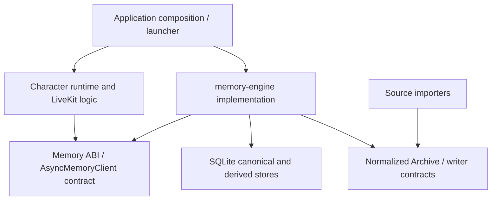
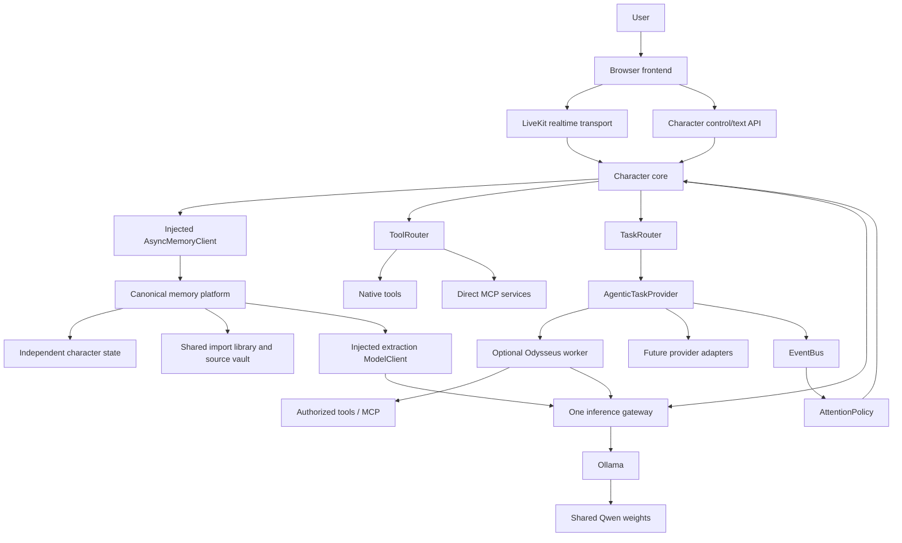
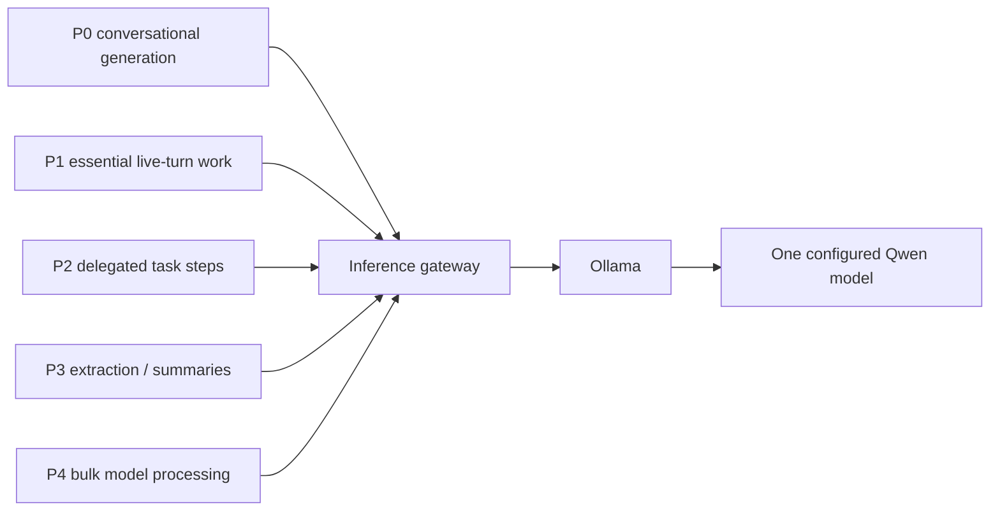
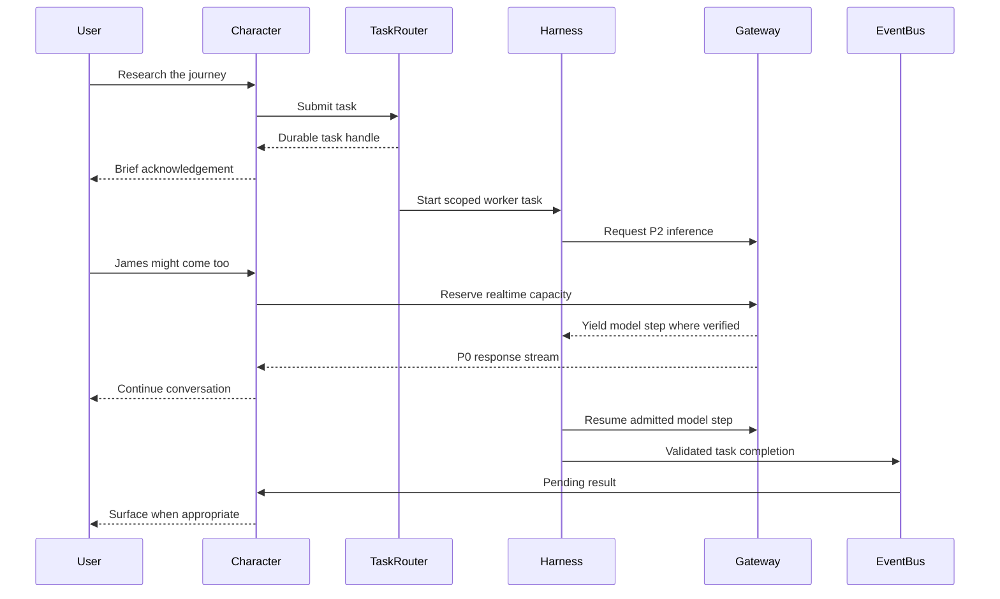

# ember — Character Memory Platform and Local Character Stack — Revised Implementation Plan

## 1. Executive summary

Build one local character application from two first-party repositories:

- **`ember-memory`** owns durable autobiographical memory, source archives, provenance, temporal facts, retrieval, extraction, consolidation, forgetting, seeding, and bundles.
- **`ember-agent`** owns realtime interaction, LiveKit, personality, audio, vision, browser UI, tools, skills, delegation, events, attention policy, deployment composition, and inference scheduling.

The character’s identity, personality, conversation continuity, and memories remain independent of external agent frameworks.

**Odysseus is the first optional agentic provider.** It executes delegated work through an adapter and isolated worker profile. Removing it leaves ordinary conversation, memory, native tools, and independently configured MCP tools functional.

All primary-Qwen generation uses **one inference gateway**, implemented incrementally. Ollama owns the loaded model weights; the gateway owns request admission and scheduling.

The Heretic-derived model build is complete. The model has been quantized/imported and is available through local Ollama. Integration must pin its actual runtime tag and digest and measure its behavior.

The remaining model unknowns are:

- Realtime TTFT and generation throughput.
- Tool-use and structured-output reliability.
- 8K context behavior.
- Runner/KV memory behavior.
- Cancellation and preemption.
- Context-switching cost.
- GPU/VRAM characteristics.
- Odysseus compatibility through the gateway.

### Initial deployment choices

| Component | Choice |
|---|---|
| Language/environment | Python 3.12 and `uv` |
| Realtime framework | LiveKit Agents |
| Primary LLM | Local Heretic-derived Qwen through Ollama |
| GPU | RTX 3090 |
| VAD/STT | Local Silero and faster-whisper; CPU STT initially |
| TTS | Local Kokoro-FastAPI, `af_alloy` |
| Canonical persistence | SQLite |
| Retrieval | FTS5, CPU BGE-small, replaceable sqlite-vec backend |
| UI | Browser, static portrait, headset |
| Memory deployment | In-process engine behind dependency injection |
| Gateway deployment | Launcher-owned local child process by default |
| Concurrency | One speaking character and one active delegated workflow initially |
| External harness | Optional isolated Odysseus worker |
| Cloud AI dependency | None |

---

## 2. Ownership and dependency boundaries

### Ownership

| Component | Owns |
|---|---|
| `ember-memory` | Canonical source records, beliefs, evidence, revisions, source grants, suppression, retrieval, extraction policy, consolidation, bundles |
| `ember-agent` | Personality, conversational state, LiveKit, prompt composition, audio, tools, skills, task routing, events, attention, inference policy, launcher |
| External harness | Task-local execution context, autonomous tool loops, temporary checkpoints, observations, artifacts, structured results |

An external harness cannot own or modify:

- Character identity or personality.
- Canonical autobiographical memory.
- Memory activation/extraction policy.
- Source grants or suppression.
- Conversation continuity.
- The realtime voice loop.
- Inference priority policy.

### Memory dependency injection

Character business logic depends on the **public Memory ABI and `AsyncMemoryClient` contract**.

The application composition root constructs the concrete implementation.



Initial deployment remains in-process:

```text
Character runtime
    → injected AsyncMemoryClient
    → bounded async facade
    → synchronous memory engine
    → SQLite
```

A future deployment can replace the injected client with a local-daemon transport without changing LiveKit hooks, prompt composition, or conversation logic.

Production packaging may install `ember-memory-engine` through the standard local-deployment extra. Installation does not authorize runtime modules to import engine internals.

Only composition, maintenance, and backend adapter modules construct concrete engine implementations. Character logic must not import SQLite backends, migrations, ranking implementations, or engine-private classes.

Enforce this through import-boundary tests.

---

## 3. Architecture diagrams

### Character application



### Inference priorities



Parsing, database operations, CPU embeddings, browser activity, and network I/O do not need a Qwen slot unless they invoke the model.

### Asynchronous delegation



---

## 4. Deployment composition, launcher, startup and shutdown

### User-facing command

The finished application starts through:

```powershell
ember start
```

A Windows PowerShell wrapper may call the same launcher. It must not contain a separate implementation of startup policy.

The browser frontend is served by the application. A production launch does not require a separate frontend development server.

### Runtime topology

| Component | Boundary | Initial management |
|---|---|---|
| Ollama | Independent local model service | Attach to existing service |
| LiveKit Server | Separate realtime service | Check/start where configured as managed |
| Kokoro-FastAPI | Separate TTS service | Check/start where configured as managed |
| `ember-agent` | Main application process | Launcher/composition root |
| Memory engine and async facade | In-process libraries | Constructed and closed by composition |
| EventBus, AttentionPolicy | In-process | Application-owned |
| ToolRouter, TaskRouter, prompt composer | In-process | Application-owned |
| Operational-store client | In-process | Application-owned |
| Inference gateway | Local child process by default | Application-owned |
| Odysseus worker bridge | Optional separate process/profile | Start/connect only when configured |
| MCP servers | In-process client plus natural external server processes | Per-server configuration |
| Frontend | Browser application | Served/opened by `ember-agent` |

Suggested configurable endpoints:

```text
Ollama:              http://127.0.0.1:11434
LiveKit signalling:  ws://127.0.0.1:7880
Kokoro:              http://127.0.0.1:8880
Inference gateway:   http://127.0.0.1:11435
```

LiveKit supports a local server deployment; its documented development signalling endpoint uses port 7880. Production-local configuration uses generated credentials rather than shared development credentials. [LiveKit local deployment](https://docs.livekit.io/transport/self-hosting/local/)

The gateway may later run in-process using the same implementation. There is one scheduler, regardless of its process boundary.

### Composition root

`runtime/composition.py`:

1. Resolves configuration and active character.
2. Constructs the memory implementation through its public factory.
3. Receives its `AsyncMemoryClient` implementation and lifecycle handles.
4. Creates gateway clients, routers, event bus, attention policy, and prompt composer.
5. Injects contracts into the character runtime.
6. Registers shutdown handlers.

A conceptual dependency object is:

```python
@dataclass
class CharacterDependencies:
    memory: AsyncMemoryClient
    inference: InferenceClient
    tools: ToolRouterContract
    tasks: TaskRouterContract
    events: CharacterEventBus
```

Concrete construction stays outside conversation and LiveKit logic.

### Configuration

Deployment configuration contains:

- Active character/profile.
- Data roots and backend selection.
- Model tag and expected digest.
- Gateway endpoint and execution mode.
- Service endpoints and management modes.
- Provider/MCP configuration.
- Prompt budgets.
- Tool authority.
- Startup/shutdown timeouts.

Use management modes such as:

```text
attach
managed
disabled
```

Absolute paths are deployment configuration. They do not enter public contracts or bundle identity.

Dependencies are installed during setup. Startup does not silently download models, install skills, or upgrade packages.

### Startup sequence

1. Load and validate configuration.
2. Acquire the application/profile lock.
3. Validate/open character and memory stores.
4. Determine index health and degraded retrieval capabilities.
5. Check Ollama availability.
6. Verify configured model tag/digest through read-only metadata.
7. Check/start LiveKit where managed.
8. Check/start Kokoro where managed.
9. Start/connect the gateway and verify its model/profile configuration.
10. Perform configured warmup through the gateway.
11. Start runtime API, browser backend, and LiveKit worker.
12. Optionally start/connect the Odysseus bridge.
13. Discover MCP tools and refresh provider health.
14. Expose/open the browser UI.
15. Report overall and feature-specific readiness.

Ollama’s model inventory includes model names and digests, allowing startup to verify a configured pin. [Ollama model inventory](https://docs.ollama.com/api/tags)

Read-only upstream health/metadata checks are permitted. Qwen generation, including warmup, uses the gateway.

Optional discovery has bounded deadlines and can finish after the core UI appears. A stalled provider must not delay usable core startup indefinitely.

### Health output

Example:

```text
Memory ........ ready
Indexes ....... ready / degraded / rebuilding
Ollama ........ ready
Qwen .......... ready — configured digest, warm/cold
Gateway ....... ready — conservative/preemptive mode
LiveKit ....... ready
Kokoro ........ ready
Odysseus ...... disabled / ready / unavailable / unsupported
MCP ........... N available tools; M unavailable servers
Character ..... ready
Voice ......... ready
```

Expose separate states for application, character, and voice readiness. Do not label the character ready merely because its HTTP port is open.

### Degraded startup

| Unavailable component | Result |
|---|---|
| Semantic/FTS index | Character starts with canonical fallback; rebuilding reported |
| Odysseus | Core continues; delegation unavailable |
| One MCP server | Other tools/core continue |
| Kokoro | Spoken output unavailable; browser text output remains available |
| LiveKit Server | Voice transport unavailable; browser text/control path remains available |
| Ollama/Qwen | Memory/control UI available; model-backed conversation unavailable |
| Gateway | Model-backed conversation unavailable; no direct-Ollama bypass |
| Canonical character store | Character unavailable; diagnostic/control mode only |
| Shared source library | Adopted state survives; affected evidence/archive access reports unavailable |

The browser text path uses the same character core, memory client, prompt composer, and P0 gateway. It does not create another personality or conversation system.

### PID and ownership semantics

Record launcher-owned processes with:

```text
application instance ID
component ID
PID
process start time
executable/config identity
ownership mode
```

Before stopping a process, verify identity and start time to avoid PID reuse errors.

- Stop only processes started or explicitly adopted by this application instance.
- A healthy existing service is attached only when its configured identity matches.
- Port occupation alone does not establish ownership.
- Do not kill processes by executable name.
- Keep independently managed Ollama running by default.
- Track owned descendants using appropriate Windows job/process ownership or POSIX process groups.
- Reject duplicate instances for the same profile/stores or connect to the verified existing instance.

### Shutdown sequence

1. Enter draining mode; stop accepting new delegated tasks and background inference.
2. Stop new conversational turns.
3. Stop LiveKit generation/TTS and persist committed delivered dialogue.
4. Cancel/drain current model work according to verified capabilities.
5. Stop or checkpoint owned delegated work; reconcile effectful operations.
6. Commit pending task/results/events and leave undelivered events durable.
7. Flush runtime writes and close/checkpoint the operational database.
8. Flush canonical writes and close memory workers/connections.
9. Stop launcher-owned bridge/MCP/gateway/supporting processes.
10. Release ownership locks.

Use a bounded shutdown deadline. Uncertain external writes remain uncertain and are never automatically replayed.

A failed cancellation does not authorize killing independently managed Ollama. Persist the interrupted request metadata and require a safe startup quiescence/readiness check before new work.

---

## 5. Terminology and durable data layers

Retain five distinct layers:

1. Immutable raw source archive.
2. Canonical normalized source records.
3. Derived search projections.
4. Canonical distilled knowledge/character beliefs.
5. Public Memory ABI.

| Term | Meaning |
|---|---|
| Source record | Immutable content actually present in imported/native conversation or preserved observation |
| Source evidence | Immutable revision and exact span supporting/contradicting a claim |
| Candidate memory | Proposed interpretation awaiting validation |
| Approved imported knowledge | Accepted library-owned snapshot available for seeding |
| Canonical memory / character belief | Accepted character-owned recall record |
| Task result | Validated operational delegated output |
| Tool observation | Attributed, time-bound tool/provider report |
| Derived projection | Rebuildable acceleration |
| Skill | Instructions/resources, without inherent authority |

A task finding is not automatically an autobiographical belief.

Generated summaries never replace original normalized history.

Hidden reasoning/chain-of-thought is excluded from memory, normalized task sources, durable task checkpoints, ordinary logs, and diagnostic exports.

---

## 6. Shared import library and independent characters

### Global library

Owns:

- Raw exports/manifests.
- Normalized conversation graph and documents.
- Source snapshots and identity mappings.
- Assets.
- Immutable evidence spans.
- Candidates/approved knowledge.
- Shared archive indexes.

Source content and existing revisions are immutable. New imports or normalization improvements append records/revisions.

### Character-owned state

Owns:

- Personality/configuration.
- Native history.
- Revisioned beliefs.
- Pins/summaries.
- Independent seed snapshots.
- Character-owned entities.
- Source grants.
- Suppression.
- Private belief/native-history indexes.

Seed metadata:

```text
destination_memory_id
destination_character_id
origin_memory_id
origin_memory_revision
origin_source_store_id
seed_operation_id
seeded_at
evidence references
```

Destination memories receive new UUIDs. Shared evidence is referenced without duplicating imported messages/assets.

Minimal seeded entity context becomes character-owned with origin mappings.

### Presets

| Preset | Beliefs | Supporting evidence | Deep archive |
|---|---|---|---|
| Fresh | None | None | None |
| Seeded | Selected snapshots | Granted support | None by default |
| Selected archive | Selected snapshots | Explicit scope | Explicit scope |
| Primary | Approved selected snapshots | Granted historical scope | Full currently granted scope |

Later imports do not silently revise beliefs or expand grants.

`evidence_read` and `archive_search` are separate capabilities.

Character-bound identity comes from trusted runtime configuration, not model arguments.

---

## 7. Memory ABI, IDs, and serialization

### Maturity

Start:

```text
Memory ABI 0.1.x
Normalized Archive 0.1.x
Bundle format 0.1.x
```

Freeze ABI 1.0 only after real integration and restoration acceptance.

The freeze remains independent of Odysseus and delegated-task completion.

Pre-1.0 releases require compatibility matrices and migrations; they do not justify wiping history.

After 1.0:

- Additive compatible changes use minor versions.
- Breaking semantic changes require major versions.
- Unknown same-major extensions survive round trips.
- Unsupported writes fail.
- Deprecations retain documented read compatibility.

### Identity

Use UUID4 for canonical entities and integer revisions.

External IDs map through source identity crosswalks.

Do not expose SQLite row IDs, ChatGPT IDs, provider task IDs, or vector keys as memory identity.

Ambiguous source equivalence produces warnings and separate identities.

Derived chunk IDs may be UUID5 over immutable input references/specifications.

### Serialization

Use UTF-8 JSON/JSONL:

- Lowercase hyphenated UUIDs.
- UTC RFC 3339 microseconds.
- SQLite integer Unix microseconds.
- Unknown times as `null`.
- Half-open intervals.
- Finite scores.
- Namespaced extensions.
- Specified canonical JSON for object hashes.

Source SHA-256 uses exact UTF-8 content.

Preserve ambiguous timestamp representation and timezone assumptions. Import time never substitutes for missing source time.

Use extensible wire strings for kinds/modalities/reasons. Unknown values remain readable but cannot automatically acquire supported semantics.

```python
class SourceRef(ContractModel):
    source_store_id: UUID
    record_kind: str
    record_id: UUID
    record_revision: int
    part_id: UUID | None = None
```

Paths remain outside this contract.

---

## 8. Memory models, evidence, and client interfaces

Use Pydantic v2 contract objects.

The ABI package has no SQLite, LiveKit, Ollama, MCP, or harness dependency.

### Domain models

Retain:

| Model | Main responsibility |
|---|---|
| `Memory` | Character-owned revisioned belief |
| `CandidateMemory` | Proposed interpretation and verdicts |
| `ApprovedKnowledge` | Library-owned seedable snapshot |
| `FactPayload` | Subject/predicate/value/polarity/validity |
| `EpisodePayload` | Event, participants, place/time |
| `GoalPayload`, `PlanPayload` | Intent, uncertainty, state |
| `Entity` | Store-owned entity and origin mapping |
| `Evidence`, `EvidenceAssertion` | Exact span versus interpreted assertion |
| `MemorySource` | Resolved original evidence/provenance |
| `Conversation`, `Message` | Canonical normalized history |
| `ArchiveChunk` | Derived text/source mapping |
| `SessionSummary`, `PinnedMemory` | Bounded working context |
| `MemoryQuery`, `ArchiveQuery` | Storage-independent filtering |
| `MemoryResult`, `ArchiveResult` | Records plus ranking explanations |
| `RetrievalContext` | Structured prompt input and coverage |

A memory includes ownership, revision, lifecycle, kind, payload, modality, confidence, importance, temporal metadata, processing provenance, and extensions.

### Evidence coordinates

```python
class EvidenceSpan(ContractModel):
    start_codepoint: int
    end_codepoint: int
    start_byte: int
    end_byte: int
    source_content_sha256: str
    quoted_span_sha256: str
```

Validate bounds, nonempty span, Unicode boundaries, exact revision, and hashes:

```python
quote = text[start_codepoint:end_codepoint]
byte_quote = text.encode("utf-8")[start_byte:end_byte].decode("utf-8")

assert quote == byte_quote
assert sha256(text.encode("utf-8")) == source_content_sha256
assert sha256(quote.encode("utf-8")) == quoted_span_sha256
```

Browser code converts codepoint indices to/from UTF-16 indices.

Search normalization never changes canonical evidence.

### Public interfaces

The ABI declares synchronous `MemoryStore` and asynchronous `AsyncMemoryClient` contracts.

Methods cover:

```text
capabilities
search
search_archive
retrieve_context
get
get_sources
get_recent
get_pinned
remember
update
supersede
disable
forget
pin
unpin
record_access
```

Representative async boundary:

```python
class AsyncMemoryClient(Protocol):
    async def retrieve_context(self, request: ContextRequest) -> RetrievalContext: ...

    async def search(self, query: MemoryQuery) -> SearchResponse: ...

    async def search_archive(self, query: ArchiveQuery) -> ArchiveSearchResponse: ...

    async def get_sources(self, memory_id: UUID) -> list[MemorySource]: ...
```

All remaining methods have equivalent typed async signatures.

The engine supplies an `InProcessAsyncMemoryClient` implementation using bounded workers. Future transports implement the same contract.

Mutations carry idempotency keys; updates carry expected revisions.

Typed errors include not-found, revision conflict, access denied, unsupported write/version, invalid evidence/predicate, index unavailable, deadline exceeded, and source unavailable.

### Harness memory access

A worker may receive a task-bound read-only broker capability with:

- Bound character.
- Allowed records/source scope.
- Current suppression checks.
- Limits.
- Expiry/revocation.

No memory mutations, pins, grant management, or canonical source writes are exposed.

---

## 9. Predicates, modality, activation, and temporal semantics

### Predicate registry

```python
class PredicateDefinition(ContractModel):
    name: str
    definition_version: str
    value_type: str
    cardinality: str
    temporal: bool
    replacement_meaningful: bool
    normalization_rules: dict[str, JsonValue]
    aliases: list[str]
    deprecated_aliases: list[str]
    allowed_modalities: list[str]
```

Initial definitions:

| Predicate | Cardinality | Rule |
|---|---|---|
| `hardware.primary_gpu` | One | Replacement requires primary-use evidence |
| `hardware.owns_gpu` | Many | Another purchase does not end ownership |
| `music.likes_genre` | Many | Removal requires evidence |
| `person.knows` | Many | Relationships accumulate |
| `entity.name` | One | Naming/renaming evidence |
| `entity.alias` | Many | Aliases accumulate |

Preserve original extracted predicates and normalization decisions.

Unknown predicates remain conservative until registered or manually confirmed.

Definition evolution is independently versioned.

### Modality

Retain:

```text
FACTUAL_ASSERTION
BELIEF
PREFERENCE
GOAL
PLAN
INTENTION
UNCERTAINTY
HYPOTHETICAL
PAST_STATE
NEGATED_ASSERTION
QUOTED_THIRD_PARTY_CLAIM
```

Store modality in interpreted evidence, candidates, and accepted revisions.

A Berlin intention is not residence. A possible GPU purchase is not ownership. A third-party claim remains attributed.

### Authority and activation

Authority depends on the claim:

- User confirmation/correction is strongest for personal context.
- Direct identified-user statements outrank assistant speculation.
- Tool observations require source-specific authority/freshness.
- Generated summaries do not create independent corroboration.

Initial policy:

```text
activation.conservative@0.1.0
confidence ≥0.90
importance ≥0.50
supported verdict
appropriate authority
compatible predicate/kind/modality
no unresolved ambiguity/conflict
required corroboration
```

Confidence is not a probability.

Persist decision inputs, policy/version, verdicts, reasons, and manual overrides.

Policy changes re-evaluate candidates, not silently rewrite accepted beliefs.

### Time axes

Keep:

- Valid time.
- Observed time.
- Recorded time.

Fields include validity bounds, precision/basis, observed time, recorded time, creation, and last confirmation.

Do not infer continuous validity from vague dates.

Supersession preserves old assertions and creates transition evidence/new revisions.

Queries distinguish:

- Current state.
- Historical world state.
- What the character believed before a correction.

Similarity alone does not merge episodes or resolve contradictions.

---

## 10. SQLite schema and data classification

### Layout

```text
<data_root>/
├── registry.db
├── libraries/<library-id>/
│   ├── memory.db
│   ├── sources/
│   ├── assets/
│   ├── manifests/
│   └── indexes/search.db
└── characters/<character-id>/
    ├── memory.db
    ├── personality/
    ├── config/
    └── indexes/search.db
```

The deployment chooses an appropriate local application-data root.

Live SQLite databases remain local. Raw-source vaults/backups may use configured NAS storage.

### Canonical tables

| Tables | Durable content |
|---|---|
| `store_metadata`, `schema_versions` | Identity and migration history |
| `imports`, `source_components` | Manifests/fingerprints/components |
| `source_keys`, `source_occurrences` | Identity mapping/raw locators |
| `conversations`, `conversation_snapshots` | Conversation identity and snapshots |
| `graph_nodes`, `node_snapshots`, `graph_edges` | Branch/edit/regeneration structure |
| `messages`, `message_revisions`, `message_parts` | Immutable normalized content |
| `documents`, `document_parts` | Documents/preserved observations |
| `assets`, `actors` | Assets and attribution |
| `entities`, `entity_aliases` | Store-owned entity context |
| `predicate_definitions`, `activation_policy_definitions`, `processing_specs` | Referenced specifications |
| `memories`, `memory_revisions` | Knowledge/belief revisions |
| `fact_assertions`, `episode_details` | Typed temporal payloads |
| `evidence_spans`, `memory_evidence` | Exact evidence and interpretations |
| `memory_relationships`, `memory_supersessions` | Derivation/consolidation/transitions |
| `conflict_sets`, `conflict_members` | Preserved conflicts |
| `pins`, `sessions`, `session_summaries` | Working context |
| `seeding_receipts` | Origin/destination mapping |
| `source_grants`, `suppression_rules`, `suppression_targets` | Access and forgetting |
| `processing_runs`, `activation_decisions`, `audit_events` | Processing/user decisions |
| `source_deletion_tombstones` | Destructive deletion disposition |

Evidence spans live with their source record. Characters reference shared library evidence.

Task-specific metadata enters generic preserved sources through namespaced extensions, not agent-task tables in the memory engine.

### Operational memory tables

```text
jobs
job_failures
candidate_memories
mutation_keys
index_outbox
access_stats
maintenance_state
```

Human confirmation/rejection/forgetting survives operational cleanup.

### Derived search tables

```text
memory_projections
message_projections
conversational_units
archive_chunks
chunk_spans
memory_fts
message_fts
archive_chunk_fts
embedding_specs
index_generations
embedding_records
vector_key_map
vec_memories
vec_archive
effective_scope_cache
retrieval_cache
```

### Constraints

```sql
CREATE TABLE memory_revisions (
    memory_id TEXT NOT NULL,
    revision INTEGER NOT NULL CHECK (revision > 0),
    kind TEXT NOT NULL,
    lifecycle TEXT NOT NULL,
    modality TEXT NOT NULL,
    confidence REAL NOT NULL CHECK (confidence BETWEEN 0 AND 1),
    importance REAL NOT NULL CHECK (importance BETWEEN 0 AND 1),
    recorded_at_us INTEGER NOT NULL,
    payload_json TEXT NOT NULL CHECK (json_valid(payload_json)),
    extensions_json TEXT NOT NULL CHECK (json_valid(extensions_json)),
    PRIMARY KEY (memory_id, revision),
    FOREIGN KEY (memory_id) REFERENCES memories(id)
);
```

Evidence rows retain both coordinate systems and hashes, with nonnegative/nonempty checks.

Engine validation enforces hashes, Unicode boundaries, modality/predicate compatibility, and cross-store references.

Important indexes cover source uniqueness, conversation/time, role/time, graph traversal, subject/predicate, temporal bounds, lifecycle/kind/importance, evidence/supersession, seed mappings, grants/suppression, revisions, embedding identities, leases, and idempotency.

Do not enforce uniqueness that destroys conflicting historical facts.

---

## 11. Optional import and source reconnaissance

ChatGPT import is optional bootstrap functionality.

### Phase 0

Begin phase 0 while the personal export is pending:

- **Phase 0a — preparation:** research official export guarantees and primary
  public format observations; implement provisional source models, synthetic
  structural/safety fixtures, bounded reconnaissance for likely layouts, and
  pinned local inference profiles without generation. Public observations remain
  hypotheses about this account, not verified export capabilities.
- **Phase 0b — actual export acceptance:** preserve and inspect the real export,
  confirm/revise the hypotheses, produce sanitized source-derived fixtures, and
  complete the capability/ambiguity report. This gate remains required before
  finalizing phase 1 source-dependent contracts. The generic phase 1 core may
  proceed as experimental 0.1 contracts before this acceptance.

Track evidence and provisional designs in `docs/phase-0-research.md`,
`docs/phase-0-source-model.md`, and `docs/phase-0-runbook.md`.

Inspect the real export for:

- Components/formats.
- Conversation graph.
- Regenerations/edits/selected paths.
- Missing nodes.
- Timestamps/timezones.
- Archive/deletion markers.
- Content/channel types.
- Actors/tool/model metadata.
- Attachment files/references.
- Unknown structures.
- Memory-related content, if present.

Produce sanitized structural fixtures and coverage/capability reports.

Do not assume saved memories are included.

### Pipeline

```text
Inspect
 → immutable preservation
 → fingerprint/manifest
 → source adapter
 → bounded resumable normalization
 → canonical validation
 → coverage report
 → indexing jobs
 → candidate extraction
 → validation/consolidation/activation
 → approved knowledge
```

ZIP fingerprints preserve raw identity plus logical inventory. Directory fingerprints use deterministic relative paths/content hashes.

Source namespaces prevent accidental account merging.

Commit records and resume cursors together.

Equivalent identities survive reparsing; changes append revisions; ambiguity produces warnings.

### Graph/content handling

Preserve graph structure independently of messages.

Visible paths are derived views. Alternative branches remain searchable and labelled.

Ambiguous branch selection blocks automatic branch-dependent activation.

Preserve reasonable unknown metadata and report unsupported content.

Exclude reasoning/analysis from normalized recall, extraction, indexing, and prompts. Preserve original raw exports verbatim.

Preserve attachment hashes/files/references/unavailable status. No automatic remote fetching.

### Memory summary

Use `chatgpt_memory_summary` as a separate source adapter.

Preserve Markdown/text exactly and extract atomic candidates with evidence.

Summary-only factual confidence remains below the initial automatic threshold unless corroborated or confirmed.

Archive evidence may support, date, refine, contradict, or supersede summary claims.

---

## 12. Extraction, consolidation, chunking, and embeddings

### Extraction

```text
Source window
 → optional temporary compression
 → atomic claims
 → actor/modality
 → predicates/entities/time
 → exact evidence validation
 → support/contradiction
 → duplicates/conflicts
 → activation
 → canonical record
 → outbox
```

Prioritize durable preferences, relationships, experiences, projects, equipment, goals, and recurring interests.

Reject unsupported speculation, filler, noisy duplicates, and misinterpreted hypotheticals.

Original source spans remain evidence.

Re-extraction proposes diffs and respects manual corrections/suppression.

### Early versus full extraction

Phase 3 uses a narrow **production deterministic extractor** for supported explicit facts, plus normal evidence validation and audit. It proves the real path without introducing a background Qwen workload before P3 exists.

Phase 6 introduces general model-based extraction through P3/P4.

Do not classify background extraction as P0.

### Consolidation

Use normalized claim keys, predicate/entity/value comparison, lexical/semantic candidate matching, and evidence-aware decisions.

Preserve redirects, revisions, and every evidence relationship.

### Conversational grouping and chunks

Group compatible turns using graph/reply relationships, adjacency, short gaps, continuation/topic signals, and paragraphs.

Initial gap heuristic: about ten minutes, adjusted by reply/topic signals.

Pack approximately:

```text
400 target tokens
480 maximum content tokens
64 overlap tokens
```

Use the embedding tokenizer and reserve attribution/template space.

Prefer complete units; split oversized units by paragraph/sentence/token boundaries.

Retain short fragments and exact mappings. Never mix exclusive branches.

### Embeddings

Initial model:

```text
BAAI/bge-small-en-v1.5
CPU
384 dimensions
512-token model limit
```

Persist model/tokenizer revisions, pooling, dtype, normalization, query/document mode, prefix, preprocessing, truncation policy, template version, exact input hash, target revision, timestamp, and generation.

Silent truncation is forbidden.

Replacement builds a separate generation, validates it, switches the pointer, and leaves canonical data unchanged.

---

## 13. Retrieval, diagnostics, and degraded operation

### Fast recall

Search character-owned accepted beliefs, pins, entities, and recent native context.

Initial limits:

- 40 lexical candidates.
- 40 semantic candidates.
- Six ordinary recalled memories.

Apply structured scope first, rank fusion, bounded entity/importance/time adjustments, redundancy reduction, and final canonical/access checks.

Ranking remains versioned behind retriever/reranker interfaces.

No realtime model-based reranker.

Vector filtering must search eligible records correctly rather than discard an unrestricted tiny top-k.

### Deep archive

Separate mode:

- Message/chunk FTS.
- Semantic chunks.
- Source/date/role/conversation/branch filters.
- Literal source-text verification.
- Provenance navigation.

Use for historical wording, first known mention, broad history, insufficient confidence, or exact evidence.

### Result explanations

Retain:

```text
SEMANTIC_MATCH
LEXICAL_MATCH
ENTITY_MATCH
STRUCTURED_FACT_MATCH
PINNED
IMPORTANT
TEMPORAL_MATCH
EXACT_SOURCE_MATCH
DEGRADED_FALLBACK
```

Diagnostics include ranks/contributions, coverage, index generation, deadlines, temporal interpretation, and access-policy revisions.

Separate “why retrieved?” from “why believed?”

### Fail softly

Initial fast-recall deadline: 150 ms.

Return available pins, lexical results, structured facts, recent context, and summary when semantic work misses the deadline.

Timed-out native work remains bounded until completion.

Missing/corrupt `search.db` permits canonical startup, structured lookup, and provenance. Rebuilds preserve IDs.

---

## 14. SQLite concurrency and forgetting

### Concurrency

Retain:

- Synchronous core.
- Dedicated writer per store.
- Two foreground read workers initially.
- Separate deep-search and derived writers.
- Async facade.
- Thread-owned connections.
- WAL/local files.
- Short transactions.
- Prepared parameterized queries.
- Inference/embedding outside transactions.

Canonical mutations and index outbox events commit together.

Separate database consistency uses final canonical checks, not assumed cross-database atomicity.

CLI writes use active ownership/control interfaces or acquire offline writer ownership.

### Forgetting

- **Disable:** removes a record from recall.
- **Forget:** adds durable suppression across claim/origin/source/alias dependencies.
- **Revoke archive:** removes access; adopted beliefs are handled explicitly.
- **Delete source:** destructive maintenance with dependency report and revalidation.

Forget invalidates pins, summaries, retrieval caches, known prompt context, archive routes, extraction, and reseeding.

Initial suppression may hide an entire content part; show impact before applying.

### Delegated context

Track task input dependencies.

On relevant forgetting/revocation:

1. Revoke read capability.
2. Block pending delivery/promotion.
3. Cancel affected model work.
4. Stop/purge copied task context/checkpoint.
5. Allow explicit sanitized restart.

A database change does not erase information already sent to a worker.

Providers unable to purge affected personal-context copies are unsupported for that mode.

Final results recheck current grants/suppression.

---

## 15. Atomic tools and direct MCP

```python
class ToolProvider(Protocol):
    async def list_tools(self) -> list[ToolDefinition]: ...

    async def invoke(
        self,
        tool_name: str,
        arguments: dict[str, JsonValue],
        context: ToolContext,
    ) -> ToolResult: ...
```

Implement native and MCP providers. Harness-tool adapters are optional for useful unique functions.

`ToolDefinition` contains stable identity, schemas, provider, requirements, effect class, timeout, idempotency, platform, and extensions.

`ToolContext` is runtime-created with bound character/session/turn/task, invocation, authorization, scopes, deadline, and cancellation.

`ToolResult` contains validated data, bounded text, artifacts, warnings, and a receipt distinguishing success/failure/timeout/confirmation/unknown effect.

### Router

ToolRouter discovers, normalizes, authorizes, validates, bounds execution, and records receipts.

Expose relevant schemas only.

Initial direct actions normally have a five-second bound. Autonomous multi-step work uses delegation.

A timeout does not authorize repeating an uncertain write.

### MCP independence

Character and harness may use the same reusable service through distinct scoped clients.

Network servers use separate credentials. Stdio servers use separate processes or a policy relay; stdin is not shared between clients.

Negotiate capabilities with a pinned SDK.

Discovery/annotations do not grant authority.

Long-running extensions require explicit adapter support.

MCP model-sampling requests are disabled unless routed through the gateway with the correct workload class.

---

## 16. Generic delegated-task interfaces

```python
class AgenticTaskProvider(Protocol):
    async def capabilities(self) -> AgenticCapabilities: ...
    async def submit(self, request: AgentTaskRequest) -> AgentTaskHandle: ...
    async def status(self, task_id: UUID) -> AgentTaskStatus: ...
    async def cancel(self, task_id: UUID) -> None: ...
    async def get_result(self, task_id: UUID) -> AgentTaskResult | None: ...
    async def subscribe(self, task_id: UUID) -> AsyncIterator[AgentTaskEvent]: ...
```

Polling is the fallback.

Capability-gated input/context-update methods support confirmation and revised constraints.

### Request

Includes:

```text
task/idempotency IDs
bound character/session/turn
goal and user request
minimal explicit context
allowed tools and authorization reference
deadline/budgets
result schema version
notification policy
skill references
extensions
```

Runtime identity/authority is not taken from model arguments.

### States

```text
QUEUED
STARTING
RUNNING
WAITING_FOR_INFERENCE
WAITING_FOR_TOOL
WAITING_FOR_USER
SUCCEEDED
FAILED
CANCELLED
TIMED_OUT
```

Preemption pauses a model step, not the task.

Record cancellation requested separately until work stops.

### Result

Includes:

```text
task/character/session/turn
request revision
status
summary/findings
citations
artifacts
tool receipt references
warnings
start/completion/expiry
provider extensions
```

Validate structure, origin, freshness, authority, artifact existence, and citation linkage.

Unknown states are protocol failures, not assumed success.

### Capabilities

Advertise async execution, cancellation, events, input/update, recovery/purge, tool families, artifacts, result formats, shared endpoint support, and skill formats.

Capabilities remain separate from grants.

---

## 17. Task routing, context, and continuity

The main Qwen generation chooses ordinary response, atomic tool, delegation, or task management through schemas. No extra routing LLM is required.

TaskRouter:

1. Validates capability/authority/context.
2. Persists queued work/outbox.
3. Returns a local durable handle promptly.
4. Submits asynchronously.
5. Reconciles provider events.

The initiating voice turn ends after acknowledgement.

Initial defaults:

- One active delegated workflow.
- Bounded pending queue.
- About 30-minute wall deadline.
- Up to 12 model rounds and 30 tool calls.
- Bounded inference budget.
- Policy-controlled overrides.

### Context package

Include goal-relevant constraints, selected facts with modality/time/provenance, authorized artifacts, optional read capability, and revision/dependency manifest.

Initial selected personal-context budget: about 1,024 tokens.

No full personality, archive, database, or unrelated conversations.

Relevant follow-ups become explicit updates at safe boundaries. “James might come” stays uncertain.

Unsupported updates require an explicit revised task, not silent replay.

Worker prompts are functional. The character remains the social interface.

---

## 18. Odysseus adapter and empirical gateway compatibility

### Inspected reference

```text
odysseus@0e6cbd83159018bc280ae35f463b9f9ab74b3729
```

Relevant inspected modules:

```text
src/agent_runs.py
src/agent_loop.py
services/memory/skill_format.py
```

Checkout location is developer/deployment configuration.

The inspected run manager survives subscriber disconnects but not a server restart. The agent loop exposes model routing/tool filtering and includes additional memory/verification/escalation behavior.

### Worker bridge

Use a small versioned isolated bridge with:

- Separate data/workspace.
- Functional prompt.
- No personal-memory injection/extraction.
- No canonical memory-writing MCP.
- No automatic skill learning/publishing.
- No cloud/teacher fallback.
- No model management/serving tools.
- Gateway-only Qwen calls.
- Broker-enforced tools.
- Sanitized checkpoints.
- Structured results.

Use existing APIs/configuration where sufficient; keep required prompt/tool/checkpoint/model hooks inside the adapter.

### Transport reconnaissance

Before declaring a revision supported:

1. Run the isolated pinned worker against the real Ollama model in an exclusive integration environment.
2. Trace methods/endpoints and transport behavior without retaining sensitive prompts.
3. Identify discovery, metadata, streaming, tool calls, thinking fields, options/keepalive, structured output, and auxiliary requests.
4. Implement the required safe gateway subset.
5. Run actual worker/gateway contract tests.
6. Pin the supported revision and compatibility profile.

A controlled direct-upstream baseline is an integration test, not a production routing path. Production always uses the gateway.

Likely starting endpoints are:

```text
/v1/chat/completions
/v1/models
/api/chat
filtered /api/tags
```

They are candidates, not a frozen compatibility claim. Add safe metadata endpoints only when observed and implemented.

Unsupported endpoints fail explicitly. Do not route around the gateway.

Provider changes invalidate contract tests and keep the revision unsupported until updated.

### Bridge lifecycle

Implement capabilities, submit/status/events/result/cancel, user input, optional updates, and context purge.

Checkpoint completed boundaries only.

After restart, reattach/resume only supported safe checkpoints. Otherwise report interrupted failure.

Never replay uncertain effects automatically.

---

## 19. One progressively implemented inference gateway

The gateway is owned by `ember-agent`, even when deployed separately.

It owns no model weights.

### Incremental implementation

| Phase | Gateway capability |
|---|---|
| **3** | Production P0 path, local process/interface, one upstream/model, IDs, LiveKit streaming, health |
| **6** | P3/P4 classification, bounded queues, conservative background admission |
| **9** | P1/P2, full priorities, voice reservation, accounting, fairness, task/event integration |
| **13** | Measured live preemption for the pinned runtime profile |

There is no replacement gateway or second scheduler.

Earlier versions reject unsupported workload classes. Background work never masquerades as P0.

Memory job queues and task workflow queues track jobs; they do not independently allocate GPU inference.

### Request contract

Includes request/context IDs, authenticated workload, model, messages, output constraints, deadline, optional task/step IDs, and extensions.

Clients cannot raise priority through prompt text or untrusted metadata.

### Model and context

Use:

- One allowlisted tag/digest.
- One active upstream generation.
- Common tested runner/context configuration.
- No alternate server or fallback model.
- Separate explicit request contexts.

Initial context is 8,192 tokens, subject to measurement.

Reject/compact oversized requests instead of silently expanding VRAM usage or truncating.

Character, worker, and extraction contexts do not mix.

All auxiliary model calls use the gateway or are disabled.

---

## 20. Priority and measured preemption

| Priority | Work |
|---|---|
| P0 | Active conversational generation |
| P1 | Essential live-turn model work |
| P2 | Delegated workflow steps |
| P3 | Extraction/consolidation/summaries |
| P4 | Bulk model processing |

Voice outranks every background class.

Background fairness initially uses bounded FIFO queues and roughly 4:1:1 P2:P3:P4 service. Aging never promotes work above live conversation.

### Conservative mode

Default until Phase 13 acceptance:

- Background generation only when voice is disconnected or explicitly suspended.
- A live connected session’s apparent idle gap is not assumed safe.
- Non-model I/O may continue.
- Voice startup waits for safe quiescence.

### Verified preemptive mode

Enable only for the tested Ollama/model/transport/cancellation/GPU profile.

Voice reservation begins at user speech start and remains through turn generation, TTS, and a guard interval.

A configurable idle interval, initially about 20 seconds, permits background admission after realtime activity.

Preemption:

1. Stop background admission.
2. Interrupt underlying generation.
3. Observe release using tested behavior.
4. Serve P0/P1.
5. Requeue the interrupted step.

### Buffering

P2–P4 outputs are buffered until a successful generation completes.

Partial tool arguments/JSON never reach executors.

On interruption, discard partial output and retry the immutable model step. Completed tools are not replayed.

Compatible streaming clients receive heartbeats/progress while waiting, not a false completion.

### Measurement

Record cancellation request, upstream outcome, subsequent TTFT/admission, runner/GPU observations, retry cost, and profile version.

Coroutine cancellation or HTTP closure alone is not proof.

Do not routinely unload/restart Ollama for preemption.

Regression or uncertain release disables preemptive admission.

---

## 21. Events and attention

```python
class CharacterEvent(RuntimeContract):
    id: UUID
    kind: str
    character_id: UUID
    session_id: UUID | None
    created_at: datetime
    priority: str
    correlation_id: UUID | None
    payload: dict[str, JsonValue]
    source: str
```

Initial task/tool lifecycle events use the same boundary later available to timers, vision, VRChat, and notifications.

EventBus uses bounded asyncio queues, durable terminal outbox, deduplication, progress coalescing, and at-least-once terminal delivery.

Task transition and terminal event commit together.

### Attention actions

```text
SPEAK_WHEN_IDLE
ATTACH_TO_NEXT_TURN
SHOW_UI_ONLY
WAIT_FOR_USER
URGENT_INTERRUPT
```

Routine completion does not interrupt user speech, active TTS, or generation.

Topic changes/session endings favor pending UI delivery.

Expired findings are labelled or refreshed.

Confirmation remains pending.

Providers cannot request urgent interruption merely by supplying a priority field.

Persist notification state before speech dispatch. After a crash during uncertain delivery, show the result without automatically repeating speech.

---

## 22. Operational task state, observations, and artifacts

Keep outside the Memory ABI:

```text
<runtime_root>/runtime.db
<runtime_root>/tasks/<task-id>/
<runtime_root>/artifacts/
```

Tables cover tasks, attempts, context manifests, events/outbox, results, tool receipts, confirmations/authorizations, artifacts, notification state, provider health, skill installations, and minimal inference metadata.

The gateway queue is ephemeral. Recovery reconstructs safe work from task/job state; it does not replay a persisted queue blindly.

### Source promotion

A validated task result remains operational until selected findings are used/preserved.

Then trusted character code:

1. Rechecks access/freshness/suppression.
2. Normalizes selected observations.
3. Materializes required evidence/assets.
4. Adds task/provider/tool/source/origin metadata.
5. Uses normal extraction/activation.

Do not import whole task transcripts.

### Artifacts

Use stable references containing ID, owner, task, media type, size/hash, managed locator, creation, and retention class.

Default temporary retention is bounded; validated operational artifacts may retain about 30 days unless saved.

Canonical evidence retention is independent of task cleanup.

Serve owner-bound escaped content. No arbitrary model-supplied paths or executable downloaded HTML.

---

## 23. Portable skills and authority

Support:

```text
skill/
├── SKILL.md
├── scripts/
├── references/
├── templates/
└── assets/
```

Normalize name, description, instructions, resources, requirements, source, content hash, and extensions.

Agent Skills specifies YAML frontmatter plus Markdown and progressively loaded resources. [Agent Skills specification](https://agentskills.io/specification)

Preserve provider fields under `extensions.odysseus` and `extensions.openclaw`, retaining originals and translation diagnostics.

OpenClaw runtime integration remains deferred; metadata preservation does not require its provider.

### Rules

Skills cannot grant access, expose credentials, change memory/personality/scheduler policy, or execute installers automatically.

Declared tools/requirements are filtered against runtime authority.

Load metadata first, selected instructions next, resources when needed.

A skill too large for the current prompt is deferred, delegated where supported, or reported unavailable. Do not cut required procedural steps silently.

Duplicate identities require explicit selection.

Scripts execute only through authorized tools.

---

## 24. Security and authorization

Native, MCP, and delegated tools share authority concepts:

- Bound actor/character/task.
- Action/resource scope.
- Filesystem/network/service permissions.
- External effects.
- User authorization.
- Expiry/revocation.
- Receipts.

Scoped research can authorize repeated read/search operations without repeated prompts.

Sending messages, purchases/bookings, destructive changes, and actions beyond existing authorization require concrete approval.

### Confirmation

An `ActionIntent` binds exact action/target/argument hash, preview/artifact hashes, expected effect, and expiry.

Approval yields a receipt. Changed details invalidate it.

The worker waits for user input and cannot invent consent.

### Credentials and execution

Credentials remain in backends/OS storage, not prompts or general worker environments.

Default delegated authority includes public research, isolated browser inspection, task-workspace access, and artifact generation.

Arbitrary host shell is disabled until a tested restricted execution boundary prevents access to canonical data, credentials, and administrative endpoints.

If enforcement is unavailable, retain safer structured tools.

Prompt instructions and directory conventions are not a sandbox.

### Injection protection

Imported sources, websites, tool outputs, skills, and provider findings remain untrusted data.

They cannot change personality, memory policy, source grants, tool authority, confirmation, priorities, or configuration.

Disable harness administration and arbitrary internal API routes that bypass the broker.

Local AI processing remains independent of optional authorized external research/email/calendar services.

---

## 25. LiveKit and explicit prompt budgets

Use the injected memory client from the turn hook before generation. LiveKit documents `on_user_turn_completed` for RAG in STT–LLM–TTS pipelines. [LiveKit RAG integration](https://docs.livekit.io/agents/logic/external-data/)

The character prompt composer owns representation. Neither DB nor harness constructs its system prompt.

### Starting allocations

For an 8,192-token context, begin with:

```text
input ceiling: 7,000
response reserve: at least 1,192
```

Configurable starting soft allocations:

| Category | Tokens |
|---|---:|
| System/security/identity/personality | 1,024 |
| Relevant tool schemas | 768 |
| Selected skill instructions | 512 |
| Pins | 384 |
| Retrieved memories | 768 |
| Accepted session summary | 384 |
| Archive/task/tool excerpts | 640 |
| Recent turns/current input | 2,304 |
| Template/formatting allowance | 216 |
| **Total input allocation** | **7,000** |

These are starting values for measurement, not independent hard promises. Unused capacity may be borrowed under the policy.

Count the actual serialized prompt, including schemas, role framing, and template overhead.

Use a pinned tokenizer/template verified against model usage where possible. Until reliable counting is established, use a conservative guard.

### Inclusion and trimming

1. Preserve required system/security/identity instructions and current user input.
2. Select only relevant authorized tools.
3. Select only active skills needed for the turn.
4. Remove irrelevant/unselected schemas before sacrificing useful history.
5. Reduce low-ranked archive/task/tool excerpts.
6. Reduce lower-ranked recalled memories.
7. Reduce older completed turns, using an accepted summary.
8. Enforce the final ceiling.

Keep required current tool-call/result pairs intact.

Selected schemas must remain valid complete schemas. Selected skill procedures must remain semantically complete.

Pins are bounded and prioritized; the UI reports pins that do not fit.

If mandatory content cannot fit, return a typed prompt-overflow error or request a smaller input/configuration correction. Never silently truncate core instructions or let the backend discard context.

Increasing context is considered only after reducing unnecessary content and measuring VRAM/latency.

### Diagnostics

Record:

```text
tokens by category
actual total and reserve
tools/skills considered and included
dropped tool/skill IDs and reasons
memories considered/included/dropped
history turns included/dropped
excerpt coverage
overflow reason
tokenizer/template/budget policy version
```

Keep diagnostic IDs/counts separate from raw sensitive text.

Task-result delivery uses the existing excerpt allocation and P0 generation.

---

## 26. Failure behavior

| Failure | Response |
|---|---|
| Provider missing/offline | Delegation unavailable; core continues |
| Provider crash | Reattach/resume safe checkpoint or fail explicitly |
| Ollama/model unavailable | Control/memory UI survives; conversation unavailable |
| Gateway unavailable | No direct-backend fallback |
| Tool/MCP failure | Typed bounded error; unaffected tools continue |
| Model preemption | Retry step; task stays alive |
| Browser/tool hang | Deadline/termination; uncertain effects retained |
| Malformed/unknown result | Quarantine/protocol failure |
| Character restart | Reconcile tasks/outboxes/health |
| Late result | Owner-bound pending notification |
| Cancel/completion race | Attempt/terminal checks prevent false completion |
| Deadline | Revoke new work, cancel, record timeout/effects |
| Prompt overflow | Explain composition failure; no silent truncation |

No failure directly changes accepted beliefs.

Task cancellation and model-step preemption remain distinct.

---

## 27. Bundles, backup, and portability

### Bundle kinds

**Source/import bundle:** normalized archive, manifests, retained raw sources/assets, approved knowledge/candidates, provenance, optional indexes.

**Character bundle:** identity/personality/configuration, native history, beliefs/revisions/seeds, pins/summaries, grants/suppression, optional materialized evidence.

Normal backups reference shared libraries backed up once.

Self-contained export materializes the necessary evidence closure, preserving logical IDs and explicit partial coverage. Unrelated archive data is excluded.

Including a complete raw ZIP or permitted archive scope is explicit.

### Operational export

Task state, skill packages, and saved artifacts may be an optional operational export.

Restoration does not automatically resume external writes or credentials.

Character memory restores with providers disabled.

### Required backups

Canonical DBs, registry, personality/configuration, retained sources/assets/manifests, specifications, grants, suppression, revisions, audits.

Derived FTS/vector/search/cache data is rebuildable.

Use consistent SQLite backups and a source-deletion barrier for dependency snapshots.

### Portability

Use UUID references, UTC, configurable roots, `pathlib`, standard SQLite, and platform adapters.

WSL databases live on its Linux filesystem.

OS paths, service commands, sandbox implementation, and provider locations remain deployment concerns.

---

## 28. Repository and release structure

### `ember-memory`

```text
ember-memory/
├── packages/
│   ├── memory-abi/src/ember_memory_abi/
│   │   ├── models/
│   │   ├── protocols.py
│   │   ├── serialization.py
│   │   ├── versions.py
│   │   └── errors.py
│   ├── memory-engine/src/ember_memory_engine/
│   │   ├── backends/sqlite/
│   │   ├── sources/
│   │   ├── characters/
│   │   ├── predicates/
│   │   ├── policies/
│   │   ├── retrieval/
│   │   ├── embeddings/
│   │   ├── extraction/
│   │   ├── consolidation/
│   │   ├── bundles/
│   │   └── migrations/
│   └── memory-importers/src/ember_memory_importers/
│       ├── base/
│       ├── chatgpt/
│       └── memory_summary/
├── cli/
├── schemas/
├── tests/
├── benchmarks/
└── docs/adr/
```

### `ember-agent`

```text
ember-agent/
├── src/ember_agent/
│   ├── runtime/
│   │   ├── app.py
│   │   ├── composition.py
│   │   ├── launcher.py
│   │   └── health.py
│   ├── memory/client.py
│   ├── personality/
│   ├── audio/
│   ├── vision/
│   ├── events/
│   ├── inference/
│   ├── tools/
│   │   ├── native/
│   │   └── mcp/
│   ├── agentic/
│   │   └── providers/odysseus/
│   ├── skills/
│   │   └── adapters/
│   ├── web/
│   └── observability/
├── integrations/odysseus-worker/
├── frontend/
├── personalities/
├── schemas/
├── tests/
├── benchmarks/
└── docs/adr/
```

Only two first-party product repositories.

Gateway, bus, routers, and bridge remain in `ember-agent`.

Odysseus is a pinned third-party dependency/checkout.

Personality files remain identity, personality, behaviour, speaking style, and examples Markdown.

Release memory ABI/engine/importers separately with a compatibility matrix. Standard local setup installs pinned engine packages; core character modules still depend on the ABI contract.

---

## 29. CLI and browser operations

### Memory CLI

Retain inspection/import/extract/audit/status, character create/seed/grant, recall/archive search, show/sources/history, pin/disable/forget/conflicts, rebuild/reembed/reextract, validate/migrate, backup/restore/export, and source-deletion preview.

Examples:

```powershell
ember-memory import chatgpt export.zip --library personal --resume
ember-memory import memory-summary memories.md --library personal
ember-memory search "computer specs" --character primary --explain
ember-memory archive-search "Berlin" --character primary --from 2025-01-01 --to 2026-01-01 --role user
ember-memory sources <memory-id> --character primary
ember-memory forget <memory-id> --character primary
ember-memory rebuild-indexes --character primary
ember-memory export character --character primary --self-contained --output primary.zip
```

### Application CLI

```powershell
ember start
ember status
ember stop

ember gateway status
ember providers list
ember providers check odysseus
ember tasks list --character primary
ember tasks show <task-id>
ember tasks cancel <task-id>
ember tasks retry <task-id>

ember tools list --character primary
ember skills inspect .\skill
ember skills import .\skill
ember runtime backup --output runtime-backup
```

Maintenance gateway startup uses the same implementation and ownership rules.

Retries revalidate current authority/context.

### Browser

Retain memory/personality/provenance/forgetting/grant/backup controls.

Add:

- Startup/service health and durations.
- Feature readiness.
- Provider capabilities.
- Tasks/progress/results/artifacts.
- Cancel/retry/confirmation.
- Origin navigation.
- Inference owner/queues/preemption mode.
- Prompt composition diagnostics.
- Tools/skills/requirements.
- Sensitive diagnostics hidden by default.

---

## 30. Observability and benchmark targets

### Memory scale

Plan for:

```text
10,000 conversations
500,000 messages
250,000 archive chunks
100,000 canonical memories
```

Archive vectors are shared once per library.

Retain warm p95 targets:

| Operation | Target |
|---|---:|
| ID/provenance | ≤10 ms excluding assets |
| Structured lookup | ≤15 ms |
| FTS | ≤30 ms |
| Semantic scan | ≤80 ms excluding encoding |
| Fast recall | Aim 50–100 ms; deadline 150 ms |
| Common archive search | ≤500 ms |
| Small mutation | ≤20 ms excluding inference |
| Canonical startup | ≤2 seconds excluding models |

Targets require measurement.

### Model/task metrics

Queue time by class, active time, tokens, preemptions, cancellation/release observations, TTFT/audio latency, context sizes, rounds, failures, waiting-for-I/O versus model, starvation, and notification delay.

Measure baseline versus P2/P3/P4 contention.

Initial verified-preemption target: added warm voice p95 latency ≤200 ms versus matching baseline, with no simultaneous upstream generation or partial tool execution.

### Prompt metrics

- Actual tokens per category.
- Included tool schemas/skills.
- Memories/history considered/included/dropped.
- Overflow avoidance.
- Budget/template version.
- Difference from previous turn and contributing category.

### Startup metrics

- Store open/validation time.
- Index health.
- Ollama/model discovery.
- Warmup.
- Gateway readiness.
- LiveKit/TTS readiness.
- Provider readiness.
- MCP discovery.
- Overall feature readiness.

Distinguish canonical startup from full cold model/service startup.

These diagnostics answer why prompts grew and why startup slowed.

---

## 31. Test plan

### Memory/import contracts

Retain real sanitized fixtures, malformed/duplicate/resumed imports, graph preservation, unknown metadata, stable reparsing identity, reasoning exclusion, serialization/versioning, Unicode evidence, temporal/recorded history, predicate/modalities, activation, consolidation, suppression, backups, portability, and independent characters.

### Dependency tests

- Core character modules import ABI/client contracts only.
- Concrete engine construction occurs in composition.
- In-process and fake/transport clients satisfy the same contract.
- LiveKit/prompt code runs unchanged with another client.
- No mandatory memory daemon.

### Derived-data acceptance

Delete FTS/vectors/search DB, restart degraded, resolve provenance, rebuild, and recover the same canonical IDs.

Embedding replacement changes only derived generations.

Portable export preserves required evidence and excludes unrelated history.

### Tool/task/security tests

Retain normalized schemas, collisions, validation, capability failure, deadlines, uncertain writes, authority, direct MCP without harness, no sampling bypass, bounded execution, idempotent submission, cancellation races, safe recovery, malformed/late results, artifacts, cross-character denial, and no harness memory writes.

### Gateway progression tests

- Phase 3 accepts P0 and rejects unsupported classes.
- Phase 6 admits P3/P4 only under conservative rules.
- Phase 9 adds P1/P2 using the same gateway.
- No background request is relabelled P0.
- Phase 13 enables preemption only for accepted profiles.
- Queue reconstruction does not replay effects or mix contexts.

### Provider compatibility tests

Actual pinned worker tests cover discovery/metadata, native/OpenAI transports used, streaming, tools, thinking fields, options, structured output, auxiliary calls, and unsupported endpoints.

Provider changes fail closed without direct-backend fallback.

### Prompt tests

- Explicit category accounting.
- Dynamic tool filtering.
- Selected skills only.
- Irrelevant schemas dropped before useful history.
- Low-ranked excerpts/memories trimmed.
- Whole completed-turn trimming.
- Current input and required tool pairs retained.
- Mandatory instructions preserved.
- Oversized skills/input produce explicit outcomes.
- No silent backend truncation.
- Diagnostics explain every drop.

### Skills/events

Retain portable resources, provider metadata round trips, duplicate IDs, requirements, no privilege escalation, no automatic execution, event deduplication, restart durability, speech/topic/session gating, and progress-flood isolation.

---

## 32. Deployment acceptance tests

### A. Core startup without harness

Run `ember start` with valid memory, model, LiveKit, and Kokoro; Odysseus absent.

Verify memory, voice, native tools, configured direct MCP, browser readiness, and unavailable-provider reporting.

### B. Full startup

Enable the supported worker bridge.

Verify ownership, capabilities, gateway-only model routing, no second server, and task delegation.

### C. Degraded startup

Individually remove indexes, Odysseus, an MCP server, Kokoro, LiveKit, Ollama, and gateway.

Verify the documented feature matrix, truthful health, UI availability, and no hidden model fallback.

### D. Shutdown

Verify:

- No SQLite corruption.
- Durable terminal events retained.
- No duplicate replay.
- Owned bridge/descendants stopped.
- Independent Ollama remains running.
- Uncertain writes not retried.
- Active model interruption recorded accurately.

### E. Restart/crash

Kill/restart the main application.

Verify identity/memory, task reconciliation, result/event deduplication, refreshed health, safe inference reconstruction, and ownership recovery.

Uncertain spoken notification delivery must not trigger automatic duplicate speech.

### F. Port/ownership conflicts

Verify unrelated listeners are not adopted/killed, PID reuse is detected, duplicate profiles are prevented, and attached services are left running.

---

## 33. End-to-end architectural acceptance

### Early memory slice

```text
Real source
 → actual importer
 → normalized record/evidence
 → deterministic production candidate extraction
 → validation/activation
 → independent seed
 → restart
 → injected ABI client
 → LiveKit prompt composition
 → production P0 gateway
 → Qwen answer
 → exact provenance
```

Use Milo if present; otherwise an equivalent real explicit fact.

Do not infer “plush” without evidence.

### Temporal scenario

GPU A followed by explicit replacement with B supports current B, prior A, exact evidence, and recorded interpretation history.

Buying B alone does not end A ownership.

### One-model/agentic scenario

Prove model ownership, contexts, gateway routing, auxiliary-call coverage, preemption or conservative limitation, task survival, continuing I/O, structured completion, attention-based delivery, no belief bypass, and unchanged character after provider removal.

### ABI 1.0 gate

With harnesses disabled:

```text
Real export
 → normalize
 → canonical storage
 → model-based extraction/validation
 → seed
 → LiveKit/gateway recall
 → deep archive
 → exact evidence
 → backup
 → restore
 → repeat
```

Also require temporal corrections, suppression, derived rebuild, embedding replacement, selective export, and Windows/Linux compatibility.

Odysseus is not part of this gate.

---

## 34. Delivery phases

Each phase leaves working, tested behavior.

| Phase | Deliverables |
|---|---|
| **0 — Source reconnaissance** | 0a public-format preparation; 0b actual-export inventory, capability report, sanitized fixtures, ambiguity |
| **1 — ABI/archive 0.1** | Models, IDs, serialization, evidence, predicates/modalities, client contracts |
| **2 — Canonical engine** | SQLite, graph/revisions, provenance, temporal primitives, sync/async facade, degraded startup |
| **3 — Real importer + LiveKit slice** | Deterministic production extraction, seed/restart/provenance; **minimal production P0 gateway**, upstream/model pin, IDs, streaming, health; initial real-model baseline |
| **4 — Libraries/characters/bundles** | Grants, suppression, independent seeds, linked backup, selective materialization |
| **5 — Retrieval/indexes** | Grouping, FTS, BGE-small, sqlite-vec, hybrid, diagnostics, rebuild |
| **6 — Full extraction** | Structured model extraction, resumable jobs, policies/summary import; **same gateway gains P3/P4 queues and conservative admission** |
| **7 — Consolidation/time** | Duplicate redirects, conflicts/supersession, recorded history, safe re-extraction |
| **8 — Stable application integration** | Browser/audio/memory, explicit prompt budgets, **single-command composition/startup/shutdown**, health and portability |
| **9 — Generic agent foundations** | Events/attention, ToolProvider/TaskRouter foundations, operational store; **same gateway gains P1/P2, reservation, fairness/accounting** |
| **10 — Direct MCP** | Discovery, normalization, credentials, scoped authority, UI |
| **11 — Odysseus delegation** | Real transport reconnaissance, compatibility profile, isolated bridge, async lifecycle/results/security |
| **12 — Portable skills** | Loader, requirements/resources, provider metadata/translation |
| **13 — Preemption hardening** | Actual cancellation/runner/GPU/context-switch contention testing; enable live preemption only after acceptance |

Phase 1's generic ABI/archive 0.1 core can advance while the personal export is
pending. Source-dependent mappings and actual-export acceptance remain open;
synthetic conformance does not satisfy them. Phase 2 may use generic records for
engine development. Phase 3 model/gateway foundations do not depend on an export,
but its real-import/historical-recall acceptance does. See `docs/phase-1-contracts.md`
for the implemented contract surface and remaining acceptance boundaries.

Phase 2 canonical engine is implemented experimentally as engine 0.1.0 with
SQLite schema 0.1.0 / user_version 1; ABI/archive contracts remain 0.1.0. Synthetic
storage, policy, temporal, crash and async acceptance pass. See
`docs/phase-2-canonical-engine.md` and
`ember-memory/docs/adr/0003-canonical-engine-and-workers.md` for architecture
and coupling. Root phase status is in `docs/adr/0005-phase-two-canonical-engine.md`.
Phase 0b and source-dependent acceptance remain open. Phase 3 has not started.

### Phase architecture review workflow

For every phase, review this PLAN and the existing implementation first:

1. Define desired behavior.
2. Decide ownership.
3. Identify existing abstractions.
4. Decide whether a new primitive is genuinely needed.
5. Define contracts and invariants.
6. Define failure behavior.
7. Define acceptance tests.
8. Implement and validate against the existing architecture.

Record decisions and introduced coupling in an ADR; explain meaningful decisions
as work proceeds. Deliver tested behavior and an architecture summary, then stop
for the user's review before starting the next phase. Current checkpoint: phase 2
ready for review, phase 3 pending review.

Model integration is not deferred for a pending build: the model exists. Phase 3 starts baseline validation; later phases test their specific features.

Early phases do not perform unimplemented background model workloads through P0.

### Freeze and final hardening

Run the memory ABI freeze once memory/character acceptance is complete, independently of Phases 11–13.

Final hardening covers scale, migrations, recovery, packaging, privacy, security, and reproducibility.

---

## 35. Versioning, ADRs, and v1 boundary

### Separate versions

Retain independent memory ABI/archive/schema/bundle/importer/predicate/policy/extractor/chunker/embedding/index versions.

Also version runtime contracts, tool/task schemas, gateway compatibility/scheduling, attention, prompt-budget/template, skill adapters, and supported harness bridge/revision.

Migrations back up, acquire ownership, validate, rebuild derived data, and restore on failure.

Operational restoration never automatically resumes uncertain external effects.

### ADRs

`docs/adr/README.md` is the workspace architecture index. Root ADRs record each
implemented phase and cross-component integration; `ember-memory/docs/adr/` and
`ember-agent/docs/adr/` own detailed component decisions and link back. Numbering
is independent: qualify references by component/path. Update root phase status and
affected component ADRs together. Preserve history and distinguish planned,
implemented, pending-review and acceptance states. ADRs explain decisions; this
PLAN remains authoritative for design and engineering standards.

| Decision | Consequence |
|---|---|
| Generic memory platform owns durable memory | Importers/harnesses cannot become owners |
| Character logic depends on ABI | Composition constructs in-process engine; transports can change |
| SQLite canonical store | Durable portable identity/history |
| Shared import library | No per-character archive duplication |
| Independent seed snapshots | Characters evolve/forget independently |
| Separate source/character bundles | Explicit backup dependencies |
| Provisional ABI until acceptance | Real data/integration precede 1.0 |
| Provenance and dual coordinates | Exact evidence survives processing |
| Predicates/modality/versioned activation | Conservative stable claim semantics |
| Temporal plus recorded history | Preserve world and interpretation changes |
| Derived indexes are disposable | Canonical state survives search failure |
| Sync core/async facade | Bounded work protects realtime loop |
| Optional replaceable harness | Character continuity survives removal |
| Atomic tools differ from tasks | Short actions remain lightweight |
| Direct MCP | Tools work without harness |
| Single gateway grows across phases | One scheduling implementation from P0 to preemption |
| Ollama owns weights, clients own contexts | No personality/history mixing |
| Voice outranks background | Human conversation retains priority |
| Measured preemption or exclusive fallback | Behavior matches actual capacity release |
| Task results are observations | No automatic durable belief |
| Harness mutations denied | Memory policy remains locally owned |
| Events plus attention | Completion does not force interruption |
| Portable skills plus extensions | Preserve ecosystem functionality |
| Skills cannot grant authority | Procedures stay subordinate to policy |
| Local application composition | Several processes feel like one program |
| Dynamic prompt budgets | Explicit competition, trimming, diagnostics |
| Empirical provider compatibility | Pinned tests determine safe supported surface |
| Machine paths are configuration | Contracts and bundles remain portable |
| Selective export/local processing | Privacy and independent recovery |

### V1 includes

All established memory/character capabilities, startup/shutdown, degraded operation, explicit prompt composition, native/direct MCP tools, generic delegation, one Odysseus adapter, shared gateway, structured results, events/attention, portable skills, and security boundaries.

Live preemption is conditional on measured acceptance; conservative scheduling is a valid documented fallback.

### Deferred

Qdrant/experimental ANN, multimodal archive understanding, distributed/multiple heavy harnesses, autonomous skill/memory rewriting, autonomous purchases/destructive actions, cloud execution/sync, SQLCipher packaging, uncertain entity auto-merging, realtime model reranking, elaborate knowledge-graph/planner systems, full VRChat autonomy, and simultaneous speaking characters.

## Changes from the previous plan

- Made one gateway’s P0 → P3/P4 → P1/P2 → measured-preemption progression explicit.
- Moved concrete memory construction to composition while retaining an in-process v1 engine.
- Added one-command startup, feature health, process ownership, shutdown, and restart semantics.
- Added explicit tool/skill/system prompt budgets, trimming rules, and diagnostics.
- Made Odysseus compatibility depend on actual pinned-worker transport tests.
- Removed machine-specific paths from durable architecture.
- Updated model status to complete/imported and scheduled integration measurements immediately where relevant.
- Added deployment, dependency-boundary, gateway-phase, and prompt-composition acceptance tests.


## Engineering language and code-quality standards

### Languages

Primary backend/runtime language:
- Python 3.12

Frontend:
- TypeScript
- React

Native code:
- C++23 permitted only for isolated performance-sensitive components
  where profiling demonstrates a material benefit.
- Native modules must expose a narrow language-neutral or Python-facing
  interface and must not own canonical application semantics.
- The Python implementation remains the reference behavior unless an ADR
  explicitly states otherwise.

### Python package management

- `uv` for environments, dependency resolution and lockfiles.
- `pyproject.toml` as the canonical package/tool configuration.
- No manually maintained `requirements.txt` as the primary dependency source.

### Python style

- Ruff for formatting and linting.
- One canonical Ruff configuration shared across first-party packages.
- Modern Python 3.12 syntax is preferred.
- Maximum line length: 100 characters.
- Four-space indentation.
- Double quotes as formatter-selected default.
- Explicit, descriptive names over abbreviations.

### Typing

- Pyright in strict mode for first-party production code.
- Public functions and methods require type annotations.
- Avoid `Any`; use it only at genuinely untyped external boundaries.
- Narrow external/untrusted values immediately after parsing.
- Prefer Protocols for dependency boundaries.
- Prefer discriminated unions / typed models over dictionaries carrying
  implicit schemas.

### Data models

- Pydantic v2 for serialized/public/runtime contract models.
- Plain dataclasses or ordinary Python objects are acceptable for internal
  implementation state where runtime validation is unnecessary.
- Do not use Pydantic models merely as generic mutable state containers.

### Async

- `asyncio` is the standard asynchronous runtime.
- Never perform blocking filesystem, SQLite, model, or network operations
  directly on the realtime event loop.
- Blocking work must use bounded worker execution or dedicated services.
- Background tasks must have explicit ownership and cancellation behavior.
- Avoid untracked `asyncio.create_task()` fire-and-forget work.

### Error handling

- Do not use exceptions for ordinary protocol outcomes.
- Domain failures use typed project exceptions or structured result types.
- Never use bare `except:`.
- Never silently discard exceptions.
- Preserve exception chaining where wrapping errors.
- Logs must not expose prompts, credentials or personal source content by default.

### Interfaces

- Dependency injection at architecture boundaries.
- Depend on Protocols/contracts rather than concrete implementations.
- Avoid global mutable singletons.
- Avoid circular imports.
- External-provider-specific models do not leak into generic runtime packages.

### Functions/classes

- Prefer small cohesive functions and classes.
- Do not create abstraction layers solely to satisfy imagined future use cases.
- Avoid inheritance when composition or a Protocol is sufficient.
- Public APIs receive docstrings describing semantics, invariants and unusual
  failure behavior.
- Obvious private implementation methods do not require redundant docstrings.

### Comments

Comments explain:
- why
- invariants
- non-obvious behavior
- external quirks
- safety/security requirements

Comments should not narrate obvious code.

### Tests

- pytest
- pytest-asyncio where appropriate
- unit tests colocated by package under `tests/`
- integration and end-to-end tests explicitly marked
- regression tests required for fixed bugs
- real personal source data must never be committed
- sanitized fixtures reproduce structural properties of real exports

### CI quality gate

Every first-party commit/PR must pass:

uv sync --locked
ruff format --check .
ruff check .
pyright
pytest

Relevant integration tests run additionally where the required local services
are available.

### C++

If C++ is introduced:
- C++23
- CMake
- clang-format
- clang-tidy
- warnings treated as errors for first-party code
- RAII ownership
- no raw owning pointers
- sanitizers used in supported development/test configurations
- narrow bindings to Python
- no duplication of canonical memory/business rules in C++

### General philosophy

Optimize first for:
1. correctness
2. readability
3. explicit ownership
4. testability
5. portability
6. observability
7. measured performance

Do not optimize based solely on hypothetical performance concerns.
