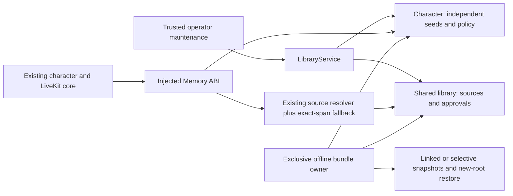

# Root ADR 0007: Phase 4 libraries, independent characters and portable bundles

Date: 2026-10-08.
Status: Phase 4 deliverables implemented and acceptance verified on Windows;
awaiting user architecture review before Phase 5.

## 1. Desired behavior

A reviewed library snapshot can seed multiple independent characters. Each character
owns new belief/entity IDs, history, grants and suppression. Later imports and library
entity revisions cannot silently revise seeds or expand permissions. Back up libraries
once, restore linked character snapshots with explicit dependencies, or export only a
selected character's beliefs and exact permitted evidence spans.

Phase 3's operator-reviewed real archive claim is still open. This phase does not
activate any personal source or treat synthetic/model integration as that approval.

## 2. Ownership

ember-memory owns approvals, seed transactions, canonical policy and bundles.
Trusted maintenance supplies authority and character identity. Source/model verdicts
never grant it. The agent continues using its injected ABI client and existing P0
route. No additional database daemon, model scheduler, or runtime process is added.

## 3. Existing abstractions

Reuse CandidateMemory, ApprovedKnowledge, Entity/OriginMapping, MemoryDraft/Memory,
SourceRef/Evidence, grants, suppression, receipts, recorded time, immutable revisions,
bounded database workers and OS-held root ownership. Public ABI/archive remain 0.1.0.

## 4. Necessary primitives

LibraryService provides explicit manual approval and atomic independent seed adoption.
BundleService owns exclusive offline publication; restore_bundles validates a complete
set before publishing a new root. BundleManifest 0.1.0 declares file integrity,
logical stores, dependencies, selected memory IDs and partial evidence coverage.
Materialized evidence stores verified spans without forging partial source revisions.

The engine advances to 0.2.0/schema 0.2.0 (user_version 2) through an additive,
backed-up migration. Current character/realtime interfaces do not change.

## 5. Contracts and invariants

Approval is operator-only and source/entity ownership and exact evidence are checked.
Approvals and selected entity revisions are immutable. Seeding remaps semantic entity
references into new destination UUIDs, commits provenance/support grants/receipt/audit
with the beliefs, and checks claim/source/origin suppression before commit.
Supporting grants confer evidence_read; archive_search remains separately explicit.
Expiry is checked on delivery as well as admission. Revocation retains adopted beliefs.

Linked character bundles contain full character state and reference source stores by
UUID. Source bundles contain complete canonical library state, raw sources, assets,
manifests and specifications. Self-contained character bundles contain selected belief
history, pins, receipts, suppression, required entities/configuration and exact evidence
closure. They exclude unrelated messages, attachments, raw ZIPs and derived indexes.
Stable runtime human-subject identity is retained even when selected beliefs use a
separate seeded subject. Providers/credentials are never started by restoration.

Registry snapshots are scoped to the bundle's logical catalog; restore validates and
reconstructs their union. Character/library UUIDs remain unchanged; the internal new
root registry UUID is new. Root/deployment paths remain external configuration.

## 6. Failure behavior

Bad authority/evidence, stale revisions, changed replay keys, forgotten origins,
unsupported writes and expired permissions fail with typed content-free errors.
A failed seed rolls back destination entities/grants/beliefs/receipts together.
Immutable evidence may already exist in its source store without a destination belief.

Backup uses SQLite's consistent backup API under exclusive root ownership. Missing
linked dependencies, unavailable permitted portable evidence, hash/path/coverage/version
mismatches, contradictory snapshots or failed publication do not publish a usable
partial result. Restore requires a new local root and never merges/overwrites live
state. Publication staging is on the destination filesystem for final atomic rename.
Writable projections are built in local scratch space and published only after
close; copied members are flushed before the manifest. Schema
failure rolls back the store transaction and retains its pre-upgrade recovery image.

## 7. Acceptance tests

The component tests exercise approval authority/replay; distinct seeds and entity
mapping; frozen approved entity context; independent edits/forgetting; blocked reseed;
exact revocation/expiry; linked restoration with a library stored once; selective
Unicode evidence including a smaller span within the same message; omitted unrelated
native history; preserved suppression; continued authoring after restore; malformed
bundles; no-overwrite/ownership/publication failure; migration backup/rollback/retry;
and operator CLI seeding/export/restore. Actual LiveKit tests add restored independent
library seed recall and new memory authoring through the existing ABI boundary.

Final quality gate: root/agent/memory locked setup, Ruff format/lint, strict
Pyright, unchanged ABI schemas and three lockfile checks passed. All **332 tests
passed** on Windows/Python 3.12.15 with actual LiveKit and pinned non-MTP Qwen enabled;
none skipped. This includes 27 new engine tests and two new portable-seed room tests.
A dedicated validation-owned gateway satisfied the older opt-in test prerequisite,
and was shut down afterward. Independently managed Ollama remained running.

| Phase 4 deliverable | Delivered behavior | Acceptance |
|---|---|---|
| Grants | Exact snapshot/part scopes, separate capabilities, expiry and exact revocation | Independent denial, expiry during delivery, no implicit archive grant |
| Suppression | Persistent claim/source/origin suppression | Denied reseed and selective restore without resurrected belief/evidence |
| Independent seeds | Immutable approved snapshots, new belief/entity UUIDs, atomic origins/receipts | Two characters evolve independently; frozen entity context; failed multi-seed rollback |
| Linked backup | One full source bundle referenced by character bundles; consistent scoped registries | Two-character restore with one library; missing/stale dependency rejection |
| Selective materialization | Fresh selected canonical state and only permitted exact evidence spans | Unicode/hash/coordinate preservation, unrelated same-message text excluded, actual-room Qwen recall and continued authoring |

Evidence and limitations are also recorded in PLAN's Phase 4 record.
Linux/scale/ABI 1.0 acceptance remain their explicit gates, not inferred from Windows.

## 8. Implementation and coupling

[Memory ADR 0005](../../ember-memory/docs/adr/0005-libraries-seeds-and-bundles.md)
owns schema/format/maintenance detail. The only new backend coupling is source-bound
approval/entity snapshots, destination seed policy transactions, and sparse-evidence
resolution in the existing engine-private resolver. Character core, importer graph
normalization, LiveKit text transport and P0 scheduling do not acquire bundle dependencies.
Tests compose those existing parts to verify restored state is usable.

Review this phase before Phase 5. Indexing/rebuild, full model extraction, audio/browser
integration and additional gateway priorities remain in their planned phases.
