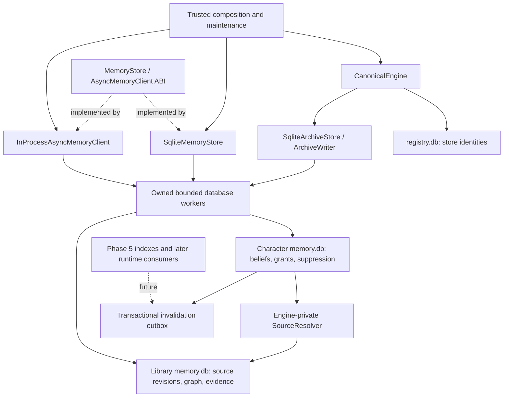

# Phase 2 — canonical engine architecture review

Status: implemented, experimental engine 0.1.0; awaiting user architecture review
before phase 3. The personal export is pending. No personal claims or character
beliefs were created during implementation.

## What this phase adds

Ember can persist generic normalized source graphs and character-owned beliefs,
restart with stable identities, retrieve exact original quotes, preserve temporal
and recorded history, and use its existing sync/async memory interfaces. This is
the durable foundation for the importer and realtime slice.

ABI/archive contracts remain unchanged at 0.1.0. The engine package advances from
its empty reservation to experimental 0.1.0. Initial SQLite schema 0.1.0 uses
`PRAGMA user_version=1`, independently of the ABI version. No migration/reset of
existing personal state took place.

## Architecture and introduced coupling



| Boundary | Owner/dependency | Coupling introduced |
|---|---|---|
| Public contracts | ABI owns models/protocols; engine implements them | No SQLite/provider dependencies or fields added to ABI |
| Storage composition | Engine owns registry, per-store DBs and locks | Explicit blocking construction/close; one engine owner per local root |
| Character business logic | Runtime will receive a bound ABI client | Backend maintenance helpers must not become model/harness tools |
| Archive persistence | ArchiveWriter plus engine-only source-key assignments | Importer commits crosswalk, records and cursor together |
| Shared provenance | Engine-private SourceResolver | Backend-specific transaction reuse stays inside engine; no cross-DB atomicity |
| Manual authority | Trusted confirmed-user binding | Default clients read-only; model verdict strings confer no authority |
| Async lifetime | Facade shares store-owned workers | Drain facades, then close engine off realtime loop |
| Index/context invalidation | Atomic outbox and policy epoch | Future consumers must process invalidation; copied context is not purged yet |

Each store owns one writer and two foreground readers, with 16 accepted jobs per
group by default. Thread-owned connections use WAL and short transactions. Queue
admission is nonblocking. Timed-out running work keeps its slot until completion.
Source resolution uses a short-lived read-only connection on the already owned
calling worker, avoiding recursive reader-pool submission. Native evidence reuses
the character writer transaction, avoiding self-deadlock.

Canonical DBs must be local without symlink/reparse ancestors or mapped network
drives. Raw sources and future backups may use the separately planned NAS locations.
No model files were opened or model services started.

```text
<explicit canonical root>/registry.db
<explicit canonical root>/registry.owner.lock
<explicit canonical root>/libraries/<UUID>/memory.db
<explicit canonical root>/libraries/<UUID>/memory.owner.lock
<explicit canonical root>/characters/<UUID>/memory.db
<explicit canonical root>/characters/<UUID>/memory.owner.lock
```

Rawsource/assets/manifests, personality/config and separate `indexes/search.db`
remain in the planned layout for their owning phases. The initial shared store
schema persists typed immutable JSON and relational graph/provenance/time/policy
fields; registry.db contains only identity tables. Unused future features are not
represented as implemented simply by adding empty folders or tables.

## The eight checks

1. **Desired behavior:** source/graph and belief durability, exact evidence,
   restart, temporal queries, idempotent mutations and reads without indexes.
2. **Ownership:** engine owns storage/workers; libraries own original sources and
   evidence; characters own adopted beliefs, grants, pins and suppression.
3. **Existing abstraction:** implement ArchiveWriter, MemoryStore and
   AsyncMemoryClient; reuse SourceRef/Evidence, predicates, temporal models,
   queries, receipts and typed failures.
4. **Necessary primitive:** engine-only ownership lock, source-key assignments,
   resolver, trusted authority, owned bounded workers and injected clock/cost
   counter. No alternate public memory interface or provider framework.
5. **Contracts/invariants:** immutable sources/revisions; atomic import keys,
   records, cursor and receipt; atomic belief revision, receipt, audit and outbox;
   expected revisions, exact grants, server-recorded time and no automatic activation.
6. **Failure behavior:** reject unsafe roots, duplicate ownership, unknown schemas,
   stale revisions, changed keys and invalid evidence. Preserve running-write
   uncertainty; degrade missing libraries/indexes; block missing character state.
7. **Acceptance tests:** actual temporary SQLite, synthetic Unicode/graphs,
   concurrent CAS, injected commit failure, child-process crash/WAL recovery,
   heartbeat/cancellation/timeout/drain, permissions, suppression and history.
8. **Implement:** cohesive database/archive/ownership/worker/state/mutation/
   retrieval modules behind existing facades. Validate, document and stop for review.

## Contracts and practical limits

**Imports:** provider keys return existing UUIDs or proposed UUIDs. New proposals
become durable with the batch; conflicting concurrent proposals fail. Assignments
must match the batch records and adapter. Existing revision replay compares source
content independently of server-assigned recorded time. Unknown historical source
times stay null. Graph edges retain direction, order, duplicates, missing links and
ambiguity; storage does not repair the graph.

**Mutations:** expected revisions protect updates. Same semantic request/key replays
its receipt; changed content or operation fails. Deadline options may change on
replay. Explicit confirmed-user bindings still validate owned entities, predicates,
exact evidence, grants and suppression. This is manual confirmation, not an automatic
extraction approval policy. Temporal replacement requires a meaningful predicate;
plural GPU ownership cannot use replacement semantics. Distinct transition evidence
is retained in replacement provenance and dependency tracking.

**Time:** valid, observed and recorded axes remain independent. `recorded_before`
is exclusive and selects the then-latest revision; current disable/forget still
controls recall. `valid_at` requires a known start and known end or explicitly open
end. Unknown validity is excluded from explicit historical-validity queries. Full
conflict/consolidation policy remains phase 7.

**Across stores:** evidence stays with its source. A failed character transaction
may leave a reusable unreferenced immutable library span; it cannot create a belief
or receipt. Missing libraries preserve adopted beliefs and return unavailable
evidence; archive results omit unavailable sources. Store availability is observed
at engine startup; restart reopens a restored library. Missing registered character
DBs block startup without creating an empty DB. Corrupt/unknown schemas fail closed.

**Policy:** evidence_read and archive_search are separate exact snapshot grants;
new revisions do not expand access. Part grants support evidence, while archive
fallback requires whole-record grants. Revoking source access retains adopted
beliefs. Forgetting previews and suppresses claims, registered aliases, origins and
source parts from every memory revision, removes affected pins and emits outbox/
policy changes. It can affect other memories using the same source part, so review
the preview. It does not delete library sources or suppress another character.
A suppressed part conservatively hides the whole archive record in this fallback.
Complete scopes, expiry, seeds and bundles remain phase 4.

**Retrieval/context:** canonical structured/literal search, recency, pins, archive
fallback and provenance work without search.db, with partial/degraded coverage.
Policy/time filters precede memory result limits; recency ranks by recorded time.
Archive fallback scans at most 4,096 scoped metadata candidates and reports an
exhausted scan window. Literal memory matching uses SQLite case handling; archive
text uses Unicode casefold. Archive valid_at matches a known source-created instant,
not an inferred interval. Unsupported query cursors fail explicitly.
Pins have priority, with at most six ordinary memories and separate memory/archive
budgets. Future/expired pins cannot bypass time eligibility. Delivered source
records and evidence enter context dependencies. Default context cost uses UTF-8
bytes, a conservative provisional budget rather than measured model tokens;
composition can inject a counter. Session summaries, full prompt accounting and
runtime context purging remain later work.

**Async:** queued cancellation can prevent execution; running work remains owned.
Running-write timeout raises WriteOutcomeUnknownError; coroutine cancellation stays
CancelledError and does not prove rollback. Resolve with the identical idempotency
key after completion. `aclose` stops facade admission and asynchronously drains
jobs, returning the latest 128 safe failures plus a truncation marker if needed.
Engine closure drains characters before libraries and releases OS locks, off the
realtime loop. Process death releases locks and incomplete WAL transactions roll
back. The later application must supply its complete bounded shutdown orchestration.

## Validation and review checkpoint

Windows/Python 3.12.15: locked install, Ruff format/lint, strict Pyright,
**242 pytest tests** and reproducible ABI schemas pass. There are **42 new engine
acceptance tests**, including marked child-process crash integration. CI is configured
for Windows/Linux; Linux was not executed locally. Tests use synthetic data and no
model calls or external runtime services.

Phase 0b real-export compatibility, production normalization, extraction,
seeding/bundles/linked restore, indexed retrieval and ABI 1.0 acceptance remain open.
Phase 3 next adds the real-importer/realtime slice and minimal P0 gateway; actual
historical-recall acceptance still requires the export. No phase 3 implementation
or model workload began in this delivery.

[Memory ADR 0003](../ember-memory/docs/adr/0003-canonical-engine-and-workers.md) records
these decisions. This delivery stops for user architecture review.

## Interface example

Explicit composition creates storage; importing the package performs no startup.
This example creates an empty registry/character without importing knowledge:

```python
from pathlib import Path
from ember_memory_abi.interfaces import MemoryQuery, MemoryStore
from ember_memory_engine import CanonicalEngine

with CanonicalEngine(Path(".local/canonical")) as engine:
    character = engine.create_character()
    client: MemoryStore = engine.character(character.store_id)
    result = client.search(MemoryQuery())
    assert result.results == ()
    assert result.coverage.index_status == "degraded"
```

For async composition, construct the engine/store off the realtime loop, wrap the
store in InProcessAsyncMemoryClient, inject as AsyncMemoryClient, await aclose, then
close the engine off the loop. Do not expose maintenance internals as model tools.
`ember start` remains unimplemented until its planned runtime/composition delivery.
